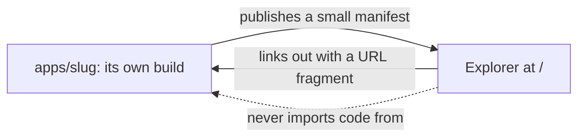
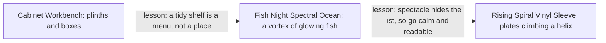
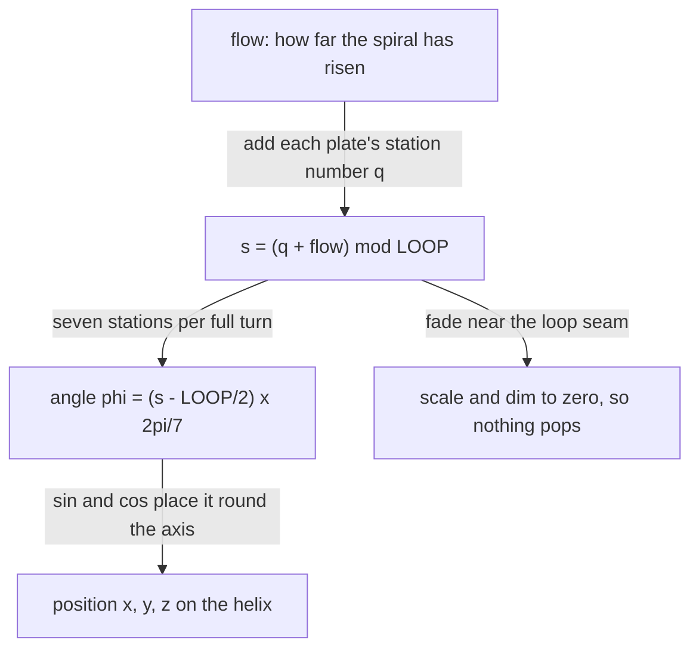
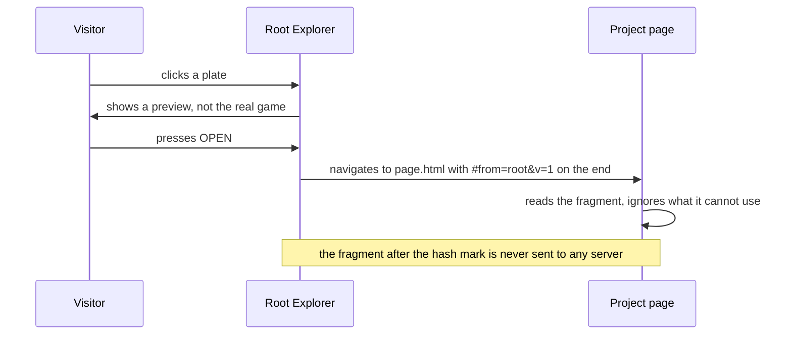

# Guide 00: The Front Door

*How the home page of `independents` was designed three times, what each attempt taught, and how a spinning 3D spiral of game cards actually works.*

[Back to the index](README.md) · Next: [01. Life Ecologies](01-life-ecologies.md)

---

## The one-sentence version

The front page of `independents` (the "Root Explorer") is a lobby for nineteen small games, and getting a lobby right turned out to be a design problem as interesting as any of the games inside it.

---

## 1. Start here: what is a "landing page" for?

Imagine walking into a shop with nineteen very different rooms. The lobby has one job: help you work out **what this place is** and **which door to open first**, quickly and without making you feel stupid.

A weak lobby makes one of two mistakes:

- It is **only pretty**. You gasp, then you have no idea where to click.
- It is **only useful**. It is a plain list of links, perfectly clear and not very inviting.

The three designs in this guide are three different attempts to be both. Each one got something right, each one taught the next one something, and the final one (the Rising Spiral) is the one you see now.

---

## 2. First, a question of *where it lives*

Before any pixels, there was an architecture question, and it matters more than it sounds.

The repository holds nine finished games under a folder called `apps/`. Each of them is a completely separate little project: it has its own list of ingredients, its own build steps, its own tests. One rule of the whole collection is that **there is no shared framework**. If you deleted one app, the others would not notice.

So where does the *front door* go? There are two tempting answers, and both are wrong:

1. **Inside `apps/`, as one more app.** But it is not an app. It is the thing that *points at* the apps. Filing it among them is like putting the building's reception desk inside one of the offices.
2. **Wired into the apps**, so that each app imports bits of the front door (or the other way around). This quietly creates a web of dependencies, and the whole point of "independents" is that there are none.

The answer the design settled on is: **the front door lives at `/`, the very top of the site, as a sibling of `apps/`, not a member of it.**

```text
/
├── index.html          the front door: plain static files, no build step
├── catalog.json        one hand-edited list of game names
├── apps/<name>/        untouched; each keeps its own build
│     └── independents.manifest.json    the only thing an app owes the front door
```

### Three rules that keep it honest

1. **Neither side imports the other.** The front door reads small data files that apps *publish*. It never reaches into an app's code, and no app ever reaches into the front door. If you deleted `/`, every app would still run.
2. **No build step.** There is no "install" or "compile" for the front door. It is files, served as they are. That means nothing exists that could break the build of anything else.
3. **A link list underneath the spectacle.** Every game is a plain, ordinary link in the page before any fancy 3D code runs. Keyboard users, screen readers, people on slow phones, and people whose browsers cannot do 3D all still get a working menu. The 3D world is a *second view* of the same list, never the only way in.


*Apps publish a small manifest upward. The front door links down. Nothing imports anything.*

<details><summary>Mermaid source</summary>



</details>

### What "manifest" means

A **manifest** is just a small fact sheet that an app hands to the front door: its name, a one-line tagline, whether it is finished, what colour it likes, and where it lives. Think of the card on a museum wall beside a painting. The museum (front door) does not paint the pictures; it only needs a card for each.

This keeps the apps in charge of what *they* are, and the front door in charge only of how to *show* them. That is called **separation of concerns**, which is a fancy way of saying "each part minds its own business".

---

## 3. Three directions, three lessons

The front door has been designed three times. Here is the family tree.


*Each direction taught the next one something. None was wasted.*

<details><summary>Mermaid source</summary>



</details>

### Direction one: The Cabinet Workbench

**The picture in your head.** You look down on a drafting table, like an architect's desk, from above. Each game is a small object standing on a little plinth (a base), like exhibits in a cabinet of curiosities. Click one and the camera glides in so you can inspect it. Press the space bar and the table sinks into darkness while every object lifts off and floats into a web, joined by glowing threads that show which games are cousins.

**What was good.** The metaphor suited the audience. The collection is a set of hands-on toys for formal ideas, and a workbench says "pick one up".

**What went wrong (and was caught early).** The designers wrote down their own criticism of it, before building too far. Four problems:

| The weakness | Plain-English meaning | The fix |
| --- | --- | --- |
| **Fake animation** | A spinning picture that is not actually the game is a screensaver, and a lie at the door is a lie about the whole building. | A rule: *no motion without real state.* Something may only move on the front door if a real, deterministic game session is driving it. |
| **An art-asset treadmill** | If every game needs a hand-modelled 3D object, adding game number twenty means hiring a sculptor. The front door becomes the bottleneck. | Objects are *skins* over a handful of standard shapes. A new game ships a fact sheet, not a sculpture. |
| **An editorial mood board** | The glowing threads claimed "these games are related", but drawn by hand they go stale silently. | The threads are *derived* from the manifests and checked by a script. |
| **3D as the only menu** | You cannot bookmark a 3D scene, search it, or use it with a keyboard. | Deep links, keyboard stepping, a search key, and a plain list when 3D is missing. |

**The lesson carried forward:** the front door must be *honest*, and it must always be *a menu first*.

### Direction two: The Fish Night Spectral Ocean

**The picture in your head.** It is night in a flooded desert. A lone watcher stands on a dune. Above them, a colossal vortex of thousands of glowing fish spirals into the sky. Among the fish swim nineteen large, translucent creatures, like X-ray photographs of deep-sea animals. Each creature has one glowing organ, and that organ *is* a tiny live window onto its game.

**How it was built, in plain English.**

- The sky, the water and the desert are drawn by small programs that run on your graphics chip (called **shaders**). They are procedural: made by arithmetic rather than by hand.
- The shoal is **4,400 fish**, all drawn at once in a single batch. Each fish's position is *calculated* on the graphics chip from the current time, rather than stored, which is how a few thousand objects can swirl smoothly. Their paths follow a **logarithmic spiral**, the same curve seen in seashells and hurricanes, which makes the fish speed up toward the rim and bunch near the eye.
- Nine species of creature (manta ray, nautilus, jellyfish, angler and so on) were made from a few dozen lines of geometry each, so a twentieth game would just pick a species.
- Each game exposed a tiny **port**: a small module that runs a deterministic session of the game, headlessly, so the creature's organ could show the *real* state.

**What was good.** It was unforgettable, and it obeyed the honesty rule: every glowing organ was a true session of its game. It even defended against its own flaws: the fish are declared scenery ("the sky"), and only creatures are games.

**What it cost.** A vortex is a poor menu: beautiful, but you have to hunt for the thing you want. It was also heavy machinery for a lobby: several full-screen glow and colour-grading passes, a 3D library, special fonts, and a live game session behind every creature. A lobby's job is to be glanced at, not played.

**The lesson carried forward:** a front door should be **calm, fast and readable**. It does not need to *run* the games, only to make you *want* to open them.

### Direction three: The Rising Spiral Vinyl Sleeve

**The picture in your head.** Think of the back of a record sleeve from the era of vinyl: matte charcoal paper, crisp typewriter-style lettering, thin lines linking each track title to its running time, plenty of breathing space and a single orange accent. Now imagine the record's groove unwound into a **spiral staircase made of thread**, rising from the bottom of your screen and flowing out of the top, with nineteen printed "plates" hanging from it like cards on a string. It climbs on its own. You scroll or drag to speed it up, and click a plate to step in front of it.

This is the current page. It evolved through five revisions, each driven by feedback:

1. **Revisions 1 and 2:** a full-bleed charcoal card, then the split into **LIVE** (nine finished games) and **ROADMAP** (ten in the workshop), with three layout options.
2. **Revision 3:** a small 3D world inside a bordered window, next to a long tracklist and a miniature working copy of each game. Too busy, and written like an engineering log.
3. **Revision 4:** the whole page *becomes* the world: one full-window canvas, art-directed previews instead of miniature games, and plain-English copy. The plates sat on a flat spinning disc.
4. **Revision 5, the Rising Spiral:** the disc unrolled into a helix. That revision came from one piece of feedback: *"Instead of the circle with the plates on top of it, show them as an auto-moving spiral coming from the bottom to the top of the screen."*

**What it kept from before:** the honesty (every plate is clear about what it is), the menu-first thinking (a plain list of real links always exists, and it is what you get with no 3D at all), and the zero-coupling architecture.

**What is new:** *calm*. One canvas fills the browser window. The words on the page are plain sentences a first-time visitor understands, with no engineering jargon.

---

## 4. How a rising 3D spiral actually works

This is the part that looks like magic and is really one small formula. We will build it from nothing.

### 4.1 What "3D on a screen" even means

Your screen is flat. To show a 3D scene, a computer does what a painter does: it imagines a **camera** somewhere in a made-up world, works out where each object would appear if you photographed it, and paints that. Two effects do most of the work:

- **Perspective**: things farther from the camera look smaller.
- **Brightness and fog**: things farther away look dimmer.

The spiral uses both. Plates on the *near* side of the helix are large and bright. Plates winding around the *back* are small and dim. This gives depth with no floor or walls at all.

### 4.2 What is a helix?

A helix is the shape of a spring or a spiral staircase: a path that goes **around** while also going **up**. To describe it you need only two things at any moment:

- how far **around** you have turned (an angle, call it φ, the Greek letter "phi"), and
- how far **up** you have climbed.

### 4.3 Sine and cosine in thirty seconds

Imagine standing at the centre of a clock face, pointing at a number. As the hand sweeps around, two things happen: how far the tip is **left or right** of the centre, and how far it is **toward or away from you**. Those two measurements are exactly what the maths functions **sine** and **cosine** give you, for any angle:

- `sin(φ)` gives the sideways position,
- `cos(φ)` gives the depth (toward or away from the camera).

Multiply either by the **radius** `R` (the width of the clock) and you have a real distance. So a point circling the axis sits at:

```text
x = R · sin φ        (left or right)
z = R · cos φ        (toward or away from the camera)
```

Now add a height that grows steadily with the angle, and you have a spiral.

### 4.4 The actual recipe

Every plate is given a **station number** `q`, its place in line along the spiral. The nineteen plates sit one station apart. The ten ROADMAP plates are pushed a little further along (by 0.7 of a station), leaving a gap that visually separates LIVE from ROADMAP. After the last plate there is a seam of 1.8 stations where the loop closes. Altogether:

```text
LOOP = 18.7 + 1.8 = 20.5 stations around the full loop
```

A single number called **`flow`** says how far the whole spiral has risen. It increases all the time (by about **0.42 stations per second** when you are not touching anything). Then for each plate:

```text
s  = (q + flow) mod LOOP                how far up the helix it is
φ  = (s − LOOP/2) · 2π/7                the angle round the axis
x  = R · sin φ
y  = (s − LOOP/2) · dy + y0             height
z  = R · cos φ
```

Let us unpack the symbols, because each one is a nice small idea.

- **`mod` (modulo)** is "wrap around like a clock". On a 12-hour clock, 13 o'clock is 1 o'clock. Here, if `q + flow` ever exceeds `LOOP`, it wraps back to near zero. That is how a plate that leaves through the top of the screen re-enters from the bottom, one lap later.
- **`2π/7`** is one-seventh of a full turn (about 51°). It says: **seven stations make one full circle**. Seven plates, then you are back facing the same direction.
- **`R`** is the spiral's radius: 11.5 units on a desktop, 8.5 on a phone, which is tighter to fit a narrow screen.
- **`dy`** is the height gained per station. It is not a fixed number: the page *solves* for it so the loop is slightly taller than your window. That guarantees the spiral always enters below the bottom edge and leaves above the top edge, whatever size your screen is.


*One number, flow, drives everything: add to it and every plate climbs and swings round at once.*

<details><summary>Mermaid source</summary>



</details>

### 4.5 Two worked examples

**Example one.** A plate with `q = 3` while `flow = 2`:

- `s = 3 + 2 = 5`.
- `s − LOOP/2 = 5 − 10.25 = −5.25`.
- `φ = −5.25 × (360° / 7) = −270°`.
- `sin(−270°) = 1` and `cos(−270°) = 0`, so `x = R` and `z = 0`.

That plate is at the far **right** edge of the helix, and, since `−5.25` is negative, *below* the middle of the screen.

**Example two.** A plate at `s = 10.25` (exactly half-way around the loop):

- `s − LOOP/2 = 0`, so `φ = 0`.
- `sin 0 = 0`, `cos 0 = 1`, so `x = 0` and `z = R`.

That plate is at the **centre height, closest to the camera**. This is the "front" position, so it is big and bright.

As `flow` grows, every plate slides through all of these positions in turn. Because the height always increases with `s`, a plate is *always* rising, even while it swings round the axis: up the right-hand side, across the back (small and dim), up the left-hand side, and finally across the front again (big and bright) one turn higher. That combination of turning while climbing is called a **screw motion**, like a bolt being driven into wood, and it is why the whole thing reads as one continuous upward spiral rather than a merry-go-round.

### 4.6 One lap, in numbers

At 0.42 stations a second:

- one full **turn** of the helix (7 stations) takes about **17 seconds**,
- one full **loop** (20.5 stations, all nineteen plates) takes about **49 seconds**.

### 4.7 The wrap-around trick, and why plates never "pop"

When a plate reaches the top of the loop and re-enters at the bottom, an unprepared viewer would see a plate vanish and another appear. To avoid that, plates near the loop's ends **scale and fade to nothing** over 1.6 stations. By the time a plate is invisible it can re-enter without anyone seeing. The test script checks it directly: over a full lap of 3,200 simulated frames, **zero plates are visible at the moment of wrapping**.

### 4.8 Small touches that sell the illusion

- **A carousel fan.** Each plate turns toward you by `0.95 · sin φ` radians, so those at the sides are angled and the ones behind still show their faces.
- **A thread.** A one-pixel hairline follows the helix, solid for LIVE and dashed for ROADMAP, rebuilt every frame so the dashes ride up with the plates.
- **Chalk dust.** 360 specks drift upward slightly slower than the spiral, so the rise has parallax: near and far things move at different speeds, as they do out of a train window.
- **Hover slows it.** When you point at a plate, the flow eases to a crawl (0.05) so you can read it; move away and it picks up again gently.

---

## 5. Theme previews versus emulators

Each plate on the spiral shows a small moving picture of its game. There are two very different ways to make such pictures, and choosing between them was a real design decision.

| | An **emulator** | A **theme preview** |
| --- | --- | --- |
| What it is | A miniature working copy of the game, with its real rules and buttons | A short, art-directed, looping animation that captures the *mood* and the *one idea* of the game |
| Strength | Honest, playable | Beautiful, fast, calm, cheap |
| Weakness | Cluttered. Revision 3 had debug-style buttons and an engineer's vocabulary (`STATE HASH`, `TICK 60 HZ`). A lobby is not a laboratory. | Not the real thing, so it must never pretend to be |
| Cost | Nineteen game engines to keep in sync | Nineteen small drawing functions |

The spiral chose **theme previews**. Each is one small drawing function that paints into a 600 by 750 canvas, which the 3D world then wraps onto a plate like a sticker. Every preview must satisfy four rules (and a test script checks all four):

1. It **moves on its own**.
2. It **reacts to the pointer** (the test runs it twice with the same random seed and checks that pointing makes a visible difference).
3. It has one **poke**: a thing that happens when you click.
4. It is **deterministic** when its randomness is fixed, so tests can be repeatable.

Notice how this *keeps* the honesty rule from Direction One. A preview is honest because it is *obviously a preview*: it carries a badge saying LIVE or IN THE WORKSHOP, it has "chalk ink plus the project's single colour", and clicking through is how you actually play. Two of the plates (Sporefront and Terrarium Hash) run a *real* Life-like rule, because a living board **is** the mood of those games; the other seventeen are choreographed. None carries debug controls.

What the plates say, in plain words, matters just as much as how they move. Every game has one hook of **18 to 72 characters** (for example, *"Eat the stones. Then dump them behind you."*), one short "what you do" paragraph, who plays, and how long a sitting takes. Words like *state hash*, *tick rate* and *algorithm* appear nowhere on the page. That is a test too: the verification script searches the page for engineering vocabulary and fails if it finds any.

---

## 6. The handoff: how the lobby passes you into a game

You have found a game you like and press **OPEN**. The front door navigates your browser to that game's own page. But a lobby could do something nicer than a bare hello: it could say *"this visitor arrived from the front door"*, or even *"…and had reached this exact state in the preview"*. How does it pass that along when there is no server in the middle?

### 6.1 The URL fragment, again

Remember the glossary: the part of a web address after a `#` is the **fragment**, and the browser **never sends it to any server**. It stays on your device. That makes it a safe, private note you can tuck into the link you are about to follow.

So the front door opens the game with an address like:

```text
../../apps/fogwalk/#from=root&v=1
```

Read it aloud: *"Open Fogwalk. This visitor comes from the root. The note format is version 1."* The game's page can read that after it loads, and ignore the parts it does not understand. A game that ignores the fragment loses nothing.


*The note rides in the part of the address after the hash mark, which never leaves your device.*

<details><summary>Mermaid source</summary>



</details>

### 6.2 In the Fish Night version, it carried more

The earlier Fish Night design went further, because its creatures were *real* sessions. Its handoff looked like:

```text
#from=root&v=1&s=<fragment>&h=<hash8>
```

- `s` was the exact *state* the visitor had reached in the creature's organ, so Sporefront and Terrarium Hash could reopen the **very plate or case** you had been looking at.
- `h` was a short **fingerprint** (the first eight characters of a SHA-256 hash) of that state, so the receiving game could check that the note had not been mangled.

And here is a lesson worth keeping: the receiving game must treat that note as **untrusted input**. It is text a person could have typed or edited by hand. A careful app validates it with its *own* rules before believing it, just as a bank checks a cheque instead of trusting whoever wrote it.

### 6.3 Why not just a normal `?question=mark` query?

A normal address can carry data after a `?`, but that part **is** sent to the server on every request. For a collection whose whole point is "no server needs to know", the fragment is the right tool.

### 6.4 Roadmap games and pending games

ROADMAP prototypes live under `prototypes/` and open at `../<group>/index.html#<slug>&from=root&v=1`, where the first `#<slug>` picks which game on a shared page. Long Haul is not on the main branch yet, so its button reads **ARRIVING SOON** and only shows a polite message instead of leading somewhere broken.

---

## 7. How do we know it works? The verification script

A pretty page that breaks on a phone is not a finished page. So the Rising Spiral ships with `verify.cjs`, a script that opens the page in a real (invisible) browser and checks, with real mouse, keyboard and touch events, a long list of things. There are now **88 checks**. A few examples in plain English:

- The page really is one canvas the size of the window, with no scrollbars.
- With *no input at all* the spiral rises, and at least three in four visible plates climb.
- Front plates are drawn at least **1.3 times wider and 1.5 times brighter** than back plates.
- Over a full lap, every plate wraps and **none pops**.
- One mouse-wheel notch moves exactly one track.
- On a 390 by 844 phone: no sideways scroll, every button at least 44 pixels tall (the size of a comfortable fingertip), and the plate framed above the bottom sheet.
- With 3D switched off, the page falls back to a plain scrolling list of nineteen real links.
- Zero errors in the browser's error log.

And one added in the latest polish: the two big buttons on the cover, **LIVE** and **ROADMAP**, must have their counts (`09` and `10`), their dots, their action labels and their arrows in **exact vertical columns**, on desktop and on a phone, even though "PLAY NOW" and "THE WORKSHOP" are different lengths. The page does this with a shared CSS grid, so the browser lines the columns up itself and no one has to nudge pixels by hand.

The principle is one worth stealing for anything you make: **write down what "correct" means as a test, and let the computer check it every time.**

---

## 8. What to take away

If you remember only five things:

1. **A lobby is a menu first and a show second.** Make the plain list work, then decorate.
2. **Keep the front door decoupled.** It reads facts apps publish; nothing imports anything.
3. **Do not fake it.** Moving pictures are fine, as long as they do not pretend to be what they are not.
4. **One formula can make a lot of magic.** A spiral is `sin`, `cos`, a steady height and a clock-style wrap.
5. **Write down "correct" as tests.**

### A tiny glossary

- **Canvas**: a blank rectangle a program can draw on.
- **Shader**: a small program that runs on your graphics chip, often used to colour millions of pixels at once.
- **Helix**: a path that turns round an axis while climbing.
- **Modulo (`mod`)**: wrapping around, like hours on a clock.
- **Manifest**: a small fact sheet one part of a system hands another.
- **Fragment**: the part of an address after `#`, which never leaves your device.
- **Deterministic**: the same input always gives the same output.
- **Progressive enhancement**: building the plain, working version first and layering fanciness on top.

---

*Next: [01. Life Ecologies](01-life-ecologies.md), where we meet a board of cells that decides for itself whether to live or die.*
