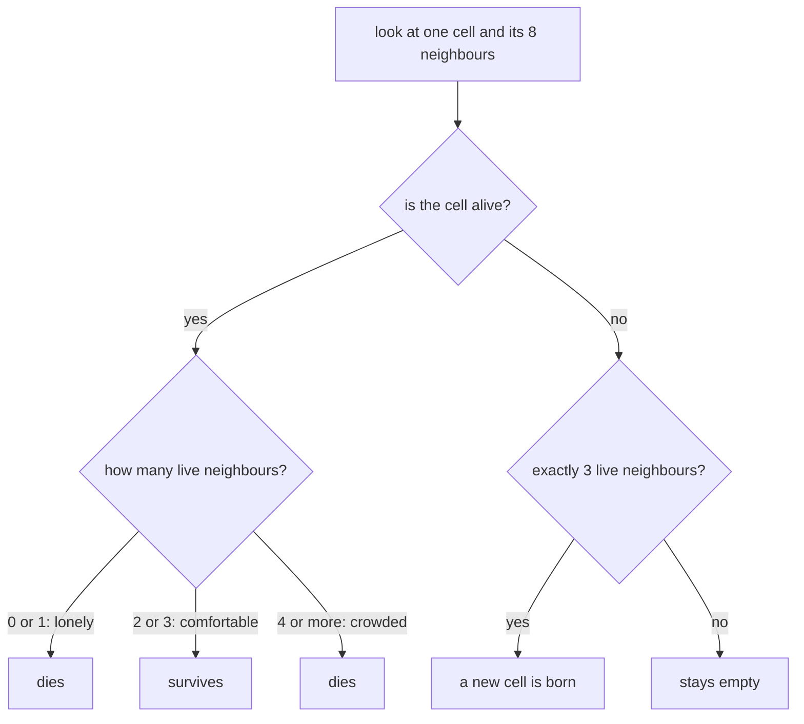
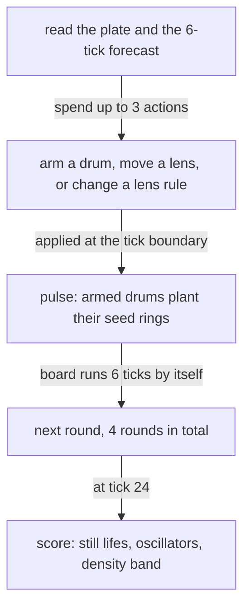
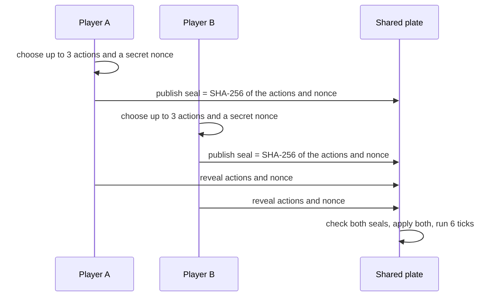
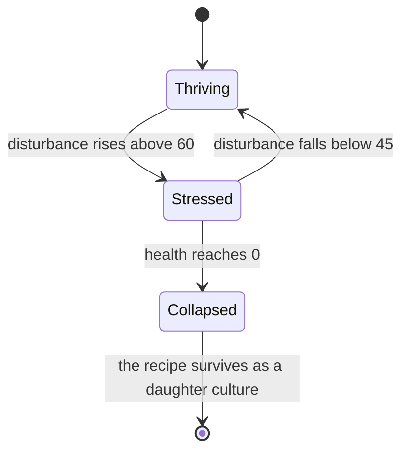
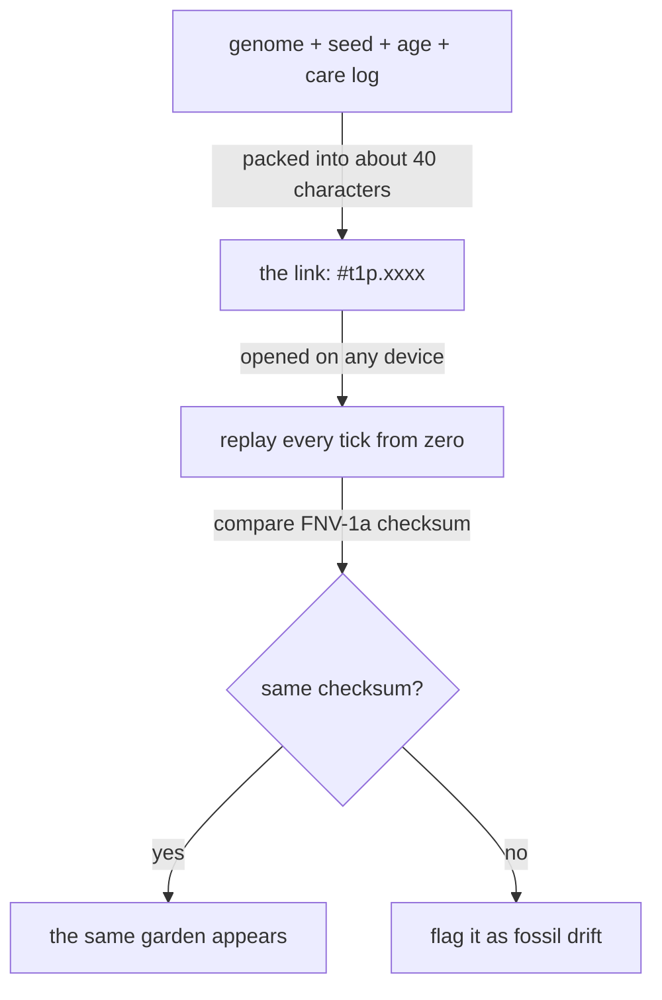

# Guide 01: Life Ecologies

*Conway's Game of Life, cellular automata from absolute scratch, and the two games built on top of them: **Sporefront** (10) and **Terrarium Hash** (11).*

[Back to the index](README.md) · Previous: [00. The Front Door](00-landing-page-designs.md) · Next: [02. Submissive Systems](02-submissive-systems.md)

---

## The one-sentence version

A **cellular automaton** is a grid of tiny squares that obey one simple rule about their neighbours, and from that rule alone, surprisingly rich "life" appears; these two games ask how you can *play* with something that has no players in it.

---

## Part A: Cellular automata from absolute scratch

### A.1 A grid, a clock, and a rule

Imagine a sheet of graph paper. Every square is a **cell**, and each cell is in one of two states: **alive** (coloured in) or **dead** (empty).

Now imagine a clock that ticks. At every tick, *all* cells simultaneously look at their neighbours and decide what they will be at the next tick. Nobody moves. Nobody is in charge. Each cell follows the same short rule using only local information: *who is next to me?*

That is the whole idea. A grid, a clock, and a local rule. That is a **cellular automaton** ("cell-like self-operating machine").

Three words to keep in your pocket:

- **Neighbours.** A cell's neighbours are the eight squares touching it, including the diagonals. (This is called the **Moore neighbourhood**.)
- **Generation.** One tick of the clock. The grid after the tick is the "next generation".
- **Simultaneous.** Every cell decides from the *old* grid at the same instant. No cell sees another cell's new state half-way through.

### A.2 The most famous rule: Conway's Game of Life

In 1970 the mathematician John Conway proposed a particular rule. It is a "game" only in name; there are no players. You set up a starting pattern, press play, and watch. It reads like a story about a village:

| Situation | What happens | Plain meaning |
| --- | --- | --- |
| A live cell has **0 or 1** live neighbours | It **dies** | **Loneliness.** No one around to keep it going. |
| A live cell has **2 or 3** live neighbours | It **survives** | **Comfort.** Just the right amount of company. |
| A live cell has **4 or more** live neighbours | It **dies** | **Overcrowding.** Too many mouths to feed. |
| A dead cell has **exactly 3** live neighbours | A cell is **born** | **Reproduction.** A third parent tips the balance. |
| Anything else | Nothing changes | |


*How one cell decides its fate, from only a count of its eight neighbours.*

<details><summary>Mermaid source</summary>



</details>

You will often see this compressed to **B3/S23**: **B**irth on 3, **S**urvival on 2 or 3. This shorthand matters, because later we will change the numbers and get entirely different "universes". For instance, **HighLife** is **B36/S23** (born on 3 *or 6*; survives on 2 or 3). Each such rulebook is called a **rule**, and a whole family of them can be written the same way.

### A.3 Doing one tick by hand

Let us watch the simplest interesting pattern. Use `#` for alive and `.` for dead. Here is **three live cells in a row**:

```text
. . . . .        Generation 0
. . . . .
. # # # .
. . . . .
. . . . .
```

Check the middle cell: it has two live neighbours (left and right), so it **survives**. The left end has only one live neighbour (the middle), so it **dies of loneliness**. The right end likewise. Now look at the empty cell directly *above* the middle: its three live neighbours are the three cells below it, so it is exactly **3** and a cell is **born**. Same below. The result:

```text
. . . . .        Generation 1
. . # . .
. . # . .
. . # . .
. . . . .
```

Now it is a vertical line. Run it again and, by exactly the same logic, it becomes horizontal again. It flips forever, like a blinking light. It is called a **blinker**.

### A.4 The three kinds of citizens

When you run Life for a while, patterns fall into a few families. Learning to recognise them is learning to read the board.

1. **Still lifes.** Patterns that never change. The **block** (a 2 by 2 square) is the classic: every cell has exactly three neighbours, so all survive, and no empty cell touches enough to be born. Nothing ever changes again. Their **period** is 1.
2. **Oscillators.** Patterns that return to where they started after some number of ticks. The blinker above has **period 2**. Bigger ones, like the **pulsar**, repeat in 3 ticks.
3. **Spaceships.** Patterns that return to their shape *but shifted somewhere else*, so they travel. The smallest and most beloved is the **glider**: five cells that crawl diagonally across the board, moving one square every four ticks, like a tiny pedalling insect.

Everything else is **chaos**: a mess that keeps changing for a long time before (maybe) settling into some still lifes and oscillators. A famous seven-cell seed, the *acorn*, takes over five thousand ticks to settle. That unpredictability is part of what makes Life so fascinating, and, as we are about to see, so hard to make a game from.

### A.5 Why a grid that wraps around: the torus

What happens at the edge of the board? A cell on the edge has fewer neighbours, which would change the rules at the border. A neat fix is to make the board **wrap around**: the top edge connects to the bottom, and the left edge to the right. A glider that leaves on the right re-enters on the left.

Geometrically, a flat sheet whose opposite edges are glued together is a **torus**: the shape of a doughnut. On a torus **every cell has exactly eight neighbours**, with no special cases, and there is no edge at all. Both games here use a 64 by 64 torus, which is a convenient number for reasons we will meet later.

### A.6 Why this matters at all

It is worth pausing on why people have loved Life for fifty years. **Rules that are tiny and local can produce behaviour that is rich and global.** No cell knows about gliders. No cell is "the glider". Yet gliders exist, travel, collide and build things. This is called **emergence**, and it appears everywhere: ant colonies, traffic jams, flocks of birds, even the formation of snowflakes. Cellular automata are the cleanest laboratory for it.

---

## Part B: Why raw Life is not a game

Here is the problem the designers faced, stated plainly in their notes:

> **A cellular-automaton game is a slot machine unless the player can compute the consequence of a move, or the game gives them a legible forecast of it.**

Let us unpack that.

### B.1 The slot-machine problem

Life is **chaotic**, in the mathematical sense: a tiny change now can cause a very different picture later, and for a busy 64 by 64 board there is no human-readable way to predict what comes next. So if a game says *"drop a few cells here and watch"*, what has the player really done? They have pulled a lever. Something happens. They cannot tell why. Skill becomes superstition: *"I think left side seeds work better?"* There is no learning, only luck.

A game must have **attribution**: you need to be able to say *"I did this, so that happened"*. Without that, there is no difference between playing well and playing badly.

So the challenge is: **how do you turn a chaotic system into something you can plan against, without pretending it isn't chaotic?**

### B.2 Other ways raw Life fails

The designers listed seven specific ways a Life game would likely disappoint, each phrased as a test that would catch it. Here they are in plain English, with the fix that was built:

| The failure | What it feels like | The fix |
| --- | --- | --- |
| **The slot machine** | Moves feel random | A **six-tick forecast**: the real engine runs the next six generations and shows you the trace. You do not predict Life, you *read a forecast*. |
| **The seam** | When two rules meet on one board, no one can tell which applies to a given cell | **Strict ownership**: a cell belongs to the topmost "lens" covering it, else to ordinary Life; the boundary is drawn as a one-cell outline. |
| **The twitch** | If you can click anywhere, any time, it becomes a reflex game | **Committed actions**: you get three actions per round; they apply at the tick boundary, and the board runs by itself between. |
| **No objective** | "Grow as much as you can" ends in grey ash, and everyone ties | Score **invariants in a band**, not raw size (see below). |
| **The dominant choice** | One rule simply always wins, so the choice is fake | A built-in **dominance audit**, and local lenses that cost an action. |
| **The spectator** | If you cannot touch the board, you are just watching | You touch the **seam**, but richly: 8 drums times 32 rotations times 3 lens positions times 5 rule presets. |
| **The unfair duel** | In alternating turns, the second player sees everything | **Simultaneous sealed commits** (explained below). |

---

## Part C: Sporefront

### C.1 The pitch

> *Scatter a few spores and watch a living board decide what to do.*

Sporefront is a 64 by 64 wrap-around Life board that you **cannot touch in the middle**. You may only act at the rim, and with three instruments:

- **Seed drums** on the edge.
- **Rule lenses** that change the rules in a circular patch.
- **A forecast trace** that shows the next six ticks.

Visually it looks like a 1970s photographic darkroom: near-black ground, a plate of amber "agar", a red safelight, grease-pencil rings and film-strip seed drums. Newborn cells flash peach and then settle into dark spores. The designers say the register is sharp-edged and "never rounded: no glass, no neon".

### C.2 The seed drums

Around the board's rim sit **eight drums**, two per side. Each drum covers an arc of **32 cells** of the edge and holds a ring of 32 bits, a pattern of seeds-to-be. Two things you can do:

- **Rotate** a drum. Rotating slides the ring along its arc. This is free, so aiming is never taxed.
- **Arm** it. This costs one action. At the next **pulse**, an armed drum plants its live bits onto the board's edge cells and then shuts.

The drums are the main verb. You are choosing *where* and *what* to plant, by turning a wheel, not by clicking a square. That keeps the board's interior untouched and the decisions meaningful.

### C.3 The three rule lenses

Imagine three round magnifying glasses you can drag anywhere across the board (even across the wrap-around seam). Under each lens, the universe obeys a *different rule*. Each lens has a radius of 7 cells and carries one of five rule presets:

| Preset | Rule | Personality |
| --- | --- | --- |
| **Conway** | B3/S23 | The classic. Balanced. |
| **HighLife** | B36/S23 | Like Life, but a sixth neighbour also gives birth. It has a tiny pattern that copies itself. |
| **Day & Night** | B3678/S34678 | Dead and alive are nearly symmetric: a mirror world. |
| **Seeds** | B2/S | Nothing survives; every cell dies each tick, but births are explosive. |
| **Maze** | B3/S12345 | Cells survive easily, so structure builds up in winding corridors. |

Moving a lens or changing its preset costs one action. Where lenses overlap, the **topmost wins**; outside every lens, ordinary Life applies. Exactly one rule owns every cell at every moment, so there is never doubt about what will happen.

(An aside for the curious: this works by giving every cell a rule number and then running each rule only on its own region. The same region masks are used by the display, the forecast and the solver, so they can never disagree.)

### C.4 The six-tick forecast

Remember the slot-machine problem. The cure is the **trace**: the engine runs the *exact same code* that runs the real game, six generations ahead, and draws a faded preview of where cells will be. Crucially it is computed, not illustrated. You can believe it.

Why six and not twenty-four? Because the designers do not want to remove the planning. A round is six ticks; a whole trial is 24. You see one round ahead. The structures that score are the ones that survive the *other eighteen*, which you must anticipate. As the notes put it, the trace "removes the excuse *I could not see what happened*; it does not remove the planning."

### C.5 The rhythm of a round


*One round: read, commit up to three actions, pulse, then watch six ticks run by themselves.*

<details><summary>Mermaid source</summary>



</details>

Sporefront is played in **four rounds of six ticks** (24 ticks in all). At the start of each round you have **three actions**. When the round ends, a **pulse** fires: every armed drum plants its ring and shuts, and the action budget resets to three. Between pulses the board runs on its own, with **no ability to interfere**. This separates the *thinking* from the *watching*, and makes the game about planning rather than reflexes.

### C.6 How you win: invariants in a band

If the goal were "have the most cells", everyone would produce a similar, explosive mess that decays into an ash pile. So the goal is instead to hold **a particular kind of order**.

A trial (a "level") sets targets such as: at tick 24 the plate must hold **6 still lifes** and **4 oscillators**, with **density between 3.5% and 9%**, and a certified score of **80 or more out of 100**. *Density* is the fraction of cells alive. Life on a board this size naturally settles near 5%, so a **band** turns that natural resting point into a *place to hold*, not a number to push.

The score combines how well-balanced the territory is and how much structure there is. Structure is simply: 14 points per still life, 12 per oscillator, 28 per spaceship, capped at 100. A **classifier** reads the board by flood-filling each connected group of live cells, running it forward up to twelve generations in a scratch copy, and asking: does it return to the same shape (still life or oscillator, depending on how long it takes), does it return *shifted* (spaceship), does it die out (transient), or does it never settle (chaos)? The cell colours you see *are* the classifier's opinion: pale lichen for still, brass for oscillating, oxblood for ships.

There are five hand-tuned trials:

| Trial | Name | Rule lenses | Target (still / oscillators / ships) | Par (actions) |
| --- | --- | --- | --- | --- |
| I | Seam Ignition | HighLife, Day & Night, Seeds | 6 / 4 / 0 | 7 |
| II | HighLife Nursery | HighLife, HighLife, Conway | 2 / 8 / 0 | 6 |
| III | Day & Night Shear | Day & Night, Day & Night, Conway | 3 / 5 / 1 | 6 |
| IV | Ash Starvation | Seeds, Maze, Conway | 8 / 1 / 2 | 8 |
| V | Oscillator Crown | Conway, Conway, Conway | 2 / 8 / 1 | 8 |

**Par** is the fewest actions in which a certified solution exists, as in golf.

### C.7 The duel: sealed commits

Sporefront can also be played **two against one another** on a shared board. Each strain (player) owns four drums and one lens. The question is fairness. If you took turns, the second player would simply look at what you did and respond; a free read.

The fix is the same trick used in sealed-bid auctions and rock-paper-scissors: **both players choose at the same time, in secret, then reveal together.** But on a computer with no referee, how do you stop someone from peeking, or changing their mind after seeing your move? You use a **commit and reveal** with a **hash**.

Plain English first. Picture each player writing their chosen actions on paper, sealing it in an envelope and placing it on the table. When both envelopes are on the table, both are opened. No one can change what is inside after sealing. The **hash** plays the role of the envelope.


*Both players lock their choices behind a fingerprint, then reveal together; the fingerprint proves nobody changed their mind.*

<details><summary>Mermaid source</summary>



</details>

**What a hash is.** A **hash function** like **SHA-256** takes any input and produces a fixed-length jumble of 64 hexadecimal characters. Three properties make it perfect for envelopes: the same input always gives the same fingerprint; changing even one character gives a totally different fingerprint; and you cannot work backwards from a fingerprint to the input.

**Why a nonce is needed.** There are only so many possible action bundles (three actions drawn from a modest menu of drums and lenses). If you simply published the hash of your actions, a cheeky opponent could hash every possible choice, see which matches, and read your mind. The remedy is a **nonce**: a long random number mixed into the input. The seal is `SHA-256 of {version, seed, round, nonce, actions}`. The nonce is kept secret until the reveal, so there is no way to guess your way to the contents. At the reveal, each side recomputes the hash from the revealed actions and nonce and checks it matches the earlier seal. Match means honest; mismatch means cheating, detected.

Sides swap after four pulses, and a result is **deterministic**: given the seed, the lens set and the history of reveals, the engine reproduces the exact same board and the same scores on any computer.

**Three ways to carry a duel:**

1. **Local pass-and-seal**: one device, handed back and forth, with the card hiding the first player's move.
2. **Against a bot**: the bot searches a bounded set of its own options (a **beam search**, described below), prices each, and seals its best line. It does not see your commit.
3. **A sealed link**: the whole duel packed into a link (about 1 KB). The recipient's browser replays the history from the seed, restores the seal, and hands the device to the second player. **The program travels, not a screenshot.**

### C.8 How the levels are certified (BFS and beam search)

A designer who publishes a puzzle must know it is *solvable* and *interesting*, not too easy and not impossible. In Sporefront this is automated, and two classic computer-science tools do the work.

- **Breadth-first search (BFS)** is the "try everything systematically" method. From the starting position, try every possible single move; then from each result try every possible move; and so on, level by level, like ripples spreading in a pond. It is **exhaustive**, so if BFS says "reachable", it is *proved*. Its drawback is cost: the number of possibilities explodes.
- **Beam search** is the "be smart" version. At each step, keep only the best handful of candidates (the "beam") and discard the rest. It explores far deeper but gives no proof, only a best guess. Here the beam width is 64.

So the designers split the work: **beam search explores, BFS proves.** Beam search finds a promising line over four rounds; BFS then *proves* that the final pulse can actually reach the target, and a full replay checks that every step was legal. A par is only published when both certificates exist.

The build also **rejects bad levels** automatically. A level is thrown away when: no action is needed to win (it plays itself), one rule preset wins in more than 70% of solutions (the choice is fake), a random player wins more than 35% of the time (too easy), the best player wins less than 10% (too hard), or par is under 2 or over 4 pulses.

Rather than trust anyone's word, a script called `certify.mjs` pulls the page's **own engine code** out of `index.html`, re-solves all five trials, replays every stored answer and checks the SHA-256 implementation against known test values. The page and the checker share the exact same source text, so they cannot drift apart.

### C.9 Why a board can be 64 numbers (a peek under the hood)

A normal implementation checks eight neighbours for each of 4,096 cells: over 32,000 lookups per tick. Sporefront does something cleverer called a **bitboard**.

A 64 by 64 board is stored as just **64 numbers**, one per row. Each number is 64 bits wide, and each bit is one cell: 1 means alive, 0 means dead. Now "the cell to my left" is the same row *shifted by one bit*, and "the row above" is simply the previous number. The computer can then add up all eight neighbour-rows for **all 64 cells in a row at once**, using the same circuitry that adds ordinary numbers. That is why the board is 64 wide: it is the exact width of one machine word. One generation takes roughly **0.2 milliseconds**, about 1% of the time between two animation frames. The six-tick forecast costs about 1.2 ms. That is what makes it feel live.

---

## Part D: Terrarium Hash

### D.1 The pitch

> *A tiny glass garden whose whole recipe lives in its web address.*

If Sporefront is about **the hand at the boundary**, Terrarium Hash is about **the hand withheld**. It is the same underlying Life, but your goal is the opposite: *learn when not to touch it.*

Visually it is nineteenth-century: a **Wardian case**, the sealed glass boxes Victorians used to keep ferns alive. Laid cream paper with faint fibres, a brass double rule frame, engraved serif labels, condensation on the glass, moss and lichen instead of dots. The motion is slow and ambient.

### D.2 The genome and the care tools

Each terrarium has a **genome**: a rulebook in the B/S notation from earlier, stored in just **18 bits** (9 birth bits, covering counts 0 to 8, and 9 survival bits). Different genomes make different ecosystems, from the standard Life to bizarre ones.

You have three **care tools**, each a single click, each with a printed cost in **disturbance**:

| Tool | What it does | Disturbance |
| --- | --- | --- |
| **Mist** | Plants a small constellation of seven spores | +5 |
| **Prune** | Clears a disc of radius 5 | +8 |
| **Stir** | Shifts the entire plate by one row and seven columns | +12 |

### D.3 Why over-caring kills the colony

Here is the core idea, and it is gentle and true to life. **A garden that is poked constantly cannot grow.** There is a gauge on the glass called **disturbance**. Every time you act it rises; it drains away by itself at 0.12 per tick. What does disturbance do?

- While it is **above 60**, the colony's **health** falls.
- While it is **below 45**, health **recovers**.
- At **zero health**, the case collapses and freezes.

There are two more hazards, both natural: if the case becomes too full (density above 42%), it **suffocates** and adds disturbance by itself; if nearly empty (below 1.2%), it **starves** and loses health.


*The colony changes state at two different thresholds, a design called hysteresis.*

<details><summary>Mermaid source</summary>



</details>

### D.4 Hysteresis, explained with a thermostat

Notice that the thresholds are *different*: it gets worse above 60, but only recovers below 45. In the middle band (45 to 60) health simply holds steady. This asymmetry is called **hysteresis**, and a household thermostat is the perfect example. A heater that switched on at exactly 20 degrees and off at exactly 20 degrees would click on and off dozens of times a minute. Real thermostats switch on at, say, 19 and off at 21, leaving a gap so the system settles.

The designers use the same idea for two good reasons:

1. **It makes the game legible.** The player can see the needle and learn: "up there is danger; I have to get down there to heal."
2. **It makes recovery possible but slow.** A single misstep is not fatal. A pattern of constant poking is. A mist every ten seconds is roughly sustainable; a mist every three seconds collapses the case within about a minute. (That is the playtest *target*; the project's notes describe measuring it across 100 seeds.) The player learns this from watching the needle, not from a manual.

And the "opaque punishment" trap is avoided: the costs are printed on the tools *before* you click.

### D.5 The case breathes, and collapse is not the end

Two more design details keep it humane:

- **The breath.** Every 56 ticks, if the colony has fewer than 40 cells, a deterministic ring of spores appears at a position chosen by a pseudo-random sequence. It costs no disturbance. It makes the case "ambient" instead of a countdown to ash.
- **The daughter culture.** When a case collapses, its genome and seed survive, and the next culture starts from them. Death becomes an archive rather than a loss.

### D.6 Reading the case: success is understanding

The game is not "keep it alive" but "**read it and decide whether to touch it**". A classifier (the same idea as in Sporefront) scans the case and names what lives there: still lifes, oscillators, ships, chaos; it counts the **species** (shapes treated as identical if they match after rotating or sliding, so a blinker in either orientation is one species); and it paints the glass accordingly. Often the right move is simply to wait.

### D.7 A garden that fits in a link

This is the cleverest trick in the whole game, and it explains the name. *Hash* here refers to the **URL hash**: the `#fragment` we met in the glossary.

**The naive way.** To share a garden, you would save a **snapshot**: every cell, 64 by 64 = 4,096 bits = 512 bytes. As link text this is roughly 683 characters, long, ugly and fragile.

**The clever way.** Because the simulation is **deterministic**, you do not have to save the garden at all. You only need to save the **recipe**: the *genome*, the *seed*, the *age*, and the *list of things the player did*. Anyone who runs that recipe from the beginning will arrive at exactly the same garden. Think of the difference between a **photograph of a cake** and **the recipe for a cake**: the recipe is tiny, and it makes the cake again on any kitchen counter.


*The link stores a recipe, not a picture; opening it replays the garden from zero and checks that it matches.*

<details><summary>Mermaid source</summary>



</details>

Sizes measured in the prototype:

| What is stored | Bytes | Characters in the link |
| --- | --- | --- |
| A raw picture of the board | 512 | 683 |
| A recipe with no care events | 25 | 34 |
| A recipe with 4 care events | 33 | 44 |
| A compressed snapshot (frozen specimen) | 219 to 240 | 292 to 320 |

(A **byte** is a unit of data. In a link, binary data is written using **base64url**, a way of spelling any bytes with ordinary letters, digits, `-` and `_`. It makes every 3 bytes into 4 characters, which is why 25 bytes becomes 34 characters.)

The recipe's layout is: a version number, the two rule masks, the seed, the age, a count, then one short entry per care event (how many ticks since the last one, which tool, and where), and finally a **checksum**.

**The fossil-drift check.** What if the garden grows *differently* on another computer? Then the link would be a broken fossil. Three disciplines prevent it:

- **Integers only.** The simulation uses whole-number arithmetic. Decimals can differ by tiny rounding amounts on different machines; integers never do.
- **A seeded pseudo-random generator.** "Random" numbers come from a formula started from the seed, so they are the same every time. The code never calls the browser's own random function after seeding.
- **A fixed order of operations**: rows top to bottom, cells left to right, care events in the order logged.

And finally, a **checksum** called **FNV-1a**: a quick, tiny fingerprint of the final board. When you open a link, the page replays the recipe from zero and compares fingerprints. If they differ, it says **fossil drift** instead of silently showing you a different garden. (It is a smoke detector for corruption, not a security lock; for tamper-proofing, you would use SHA-256.)

### D.8 The herbarium

A **herbarium** is a collection of pressed plants kept for study. This game ships a cabinet of **six pressed specimens**, each one a real recipe of 32 to 64 characters: *Glider Archipelago*, *Pulsar Cathedral*, *Twin-Bee Symbiont*, *Replicator Spore*, *Slow Coral* and *High-Entropy Broth*. Pressing one replays it from scratch and verifies the checksum. The thumbnails come from the same replay, so the cabinet can never display something the engine could not reproduce.

---

## Part E: What the two games have in common (and why they are opposites)

| | Sporefront | Terrarium Hash |
| --- | --- | --- |
| What you do | Act at the boundary | Restrain yourself |
| The challenge | Turn chaos into a plan using a forecast | Learn that every touch has a cost |
| The register | Hot, ticking, darkroom, sharp edges | Slow, ambient, Victorian glass |
| The score | Structures in a density band | Biodiversity and stability |
| How it saves | A sealed link carries the duel history | A link carries the recipe |

The designers made a deliberate choice **not** to blend them into one visual style: *"the contrast is the design: one plate is about the hand at the boundary, the other about the hand withheld. Blending them would erase the argument."*

### The costume test, applied

Remove the darkroom from Sporefront. Is there still a game? Yes: a rim, three rule patches, and a forecast. Remove the glass case from Terrarium Hash. Is there still a game? Yes: a gauge with two thresholds and a rule that over-attention kills. The themes supply *vocabulary* (a safelight and a grease pencil, a glass case and a specimen label), not the mechanics. That is exactly what the collection's motto asks for.

---

## Part F: What to take away

1. **Simple local rules produce rich global behaviour** (emergence).
2. **Chaos makes a poor game unless you add a legible forecast.**
3. **Constrain the verb**, not the choice: when you cannot click everywhere, each decision weighs more.
4. **Score a band, not a maximum.** It turns natural resting points into goals.
5. **Hysteresis** (different thresholds in each direction) makes systems stable and learnable.
6. **Determinism lets a recipe replace a picture**: share the instructions, not the result.
7. **Commit and reveal with a hash and a nonce** gives fairness without a referee.
8. **BFS proves; beam search explores.** Know which tool gives certainty.

### Glossary

- **Cell**: one square in the grid, alive or dead.
- **Generation / tick**: one step of the clock.
- **B/S notation**: a short way to write a rule, like B3/S23.
- **Still life / oscillator / spaceship**: patterns that stay, repeat in place, or travel.
- **Torus**: a wrap-around surface, like a doughnut.
- **Emergence**: big behaviour arising from small rules.
- **Density**: the fraction of cells alive.
- **Hysteresis**: a different threshold going up than going down.
- **Seed**: a starting number that decides a repeatable "random" sequence.
- **Hash / SHA-256 / FNV-1a**: fingerprints of data; SHA-256 is strong, FNV-1a is a fast checksum.
- **Nonce**: a secret random number mixed in to stop guessing.
- **Commit and reveal**: seal a choice now, open it later.
- **BFS / beam search**: exhaustive layer-by-layer search, and a pruned search that keeps only the best few.
- **Bitboard**: storing a grid as bits in whole numbers so many cells are processed at once.
- **Base64url**: spelling raw bytes using letters, digits and two symbols, so they can live in a link.

---

*Next: [02. Submissive Systems](02-submissive-systems.md), where you will command a bathysphere and a loom with only one button each.*
