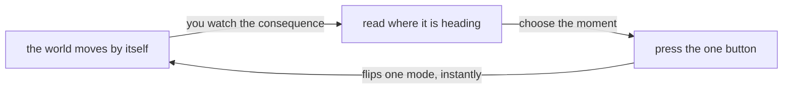
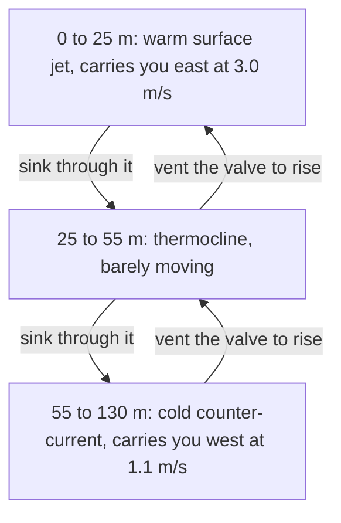
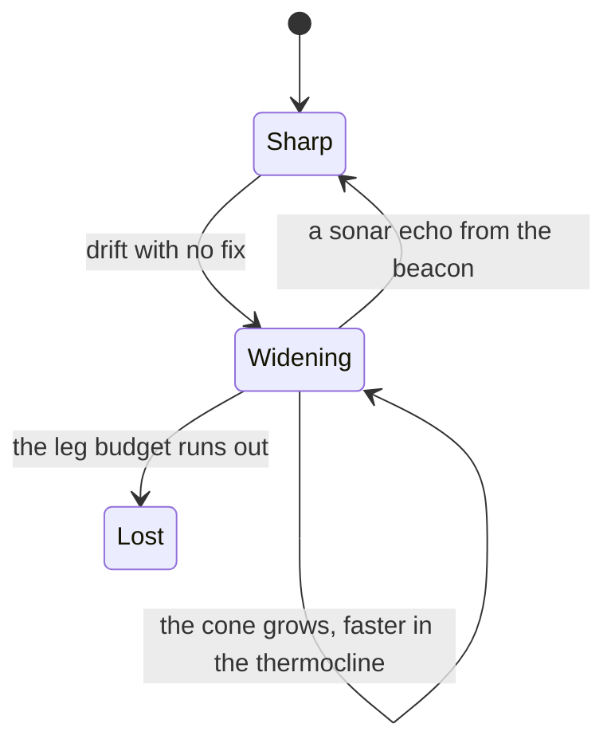
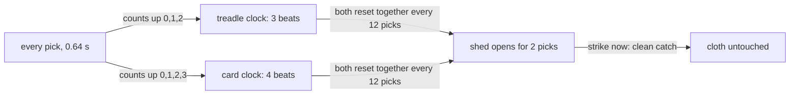
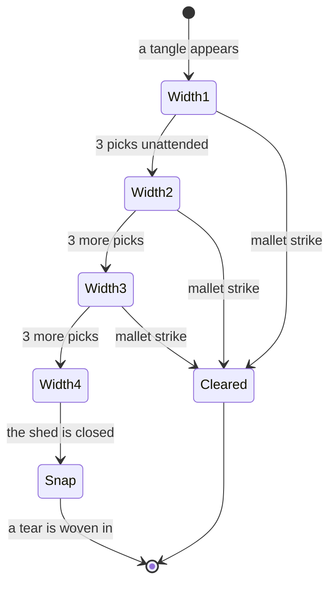
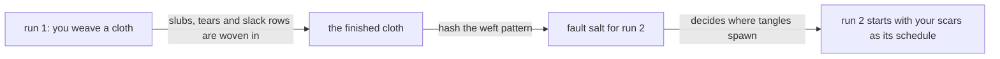

# Guide 02: Submissive Systems

*Games where you have one button and no steering wheel: **Driftwatch** (12), an unmanned bathysphere, and **Loomweight** (13), a loom that weaves itself.*

[Back to the index](README.md) · Previous: [01. Life Ecologies](01-life-ecologies.md)

---

## The one-sentence version

In a **submissive** game the world does what it does and you are only allowed to *nudge the timing*, which sounds like nothing and turns out to be the whole art, much as it is for a sailor, a balloonist or a drummer.

---

## Part A: What "submissive" means

### A.1 Start with the boat

Think about sailing. A sailor cannot steer the wind. They cannot make the sea flow somewhere else. What they *can* do is choose **when** to tilt the sail, **when** to tack (turn), and **which way** to point the bow. The wind and the water do almost all of the work; the sailor's skill is knowing the moment to act.

Now think about a hot-air balloonist. They have no steering at all. A balloon can only go up or down. But the air at different heights blows in different directions, so by choosing *when* to rise and *when* to sink, they pick which wind layer carries them. It is a game of reading the invisible and timing a very small decision.

These are the two parents of the games in this guide. The player is **not the pilot**. The player is the **correction**: someone who, at carefully chosen moments, flips one small switch on something that otherwise runs on its own.

### A.2 The three promises

The design notes describe the family resemblance in three promises.

1. **You own no steering.** No aiming, no routing, no controlling a character through space. The plant (the thing being controlled) is never waiting for you; it carries on regardless.
2. **You own exactly one switch, and the right to choose when.** In Driftwatch the switch is a valve: rise or sink. In Loomweight it is a mallet: strike, or don't. That is one or two choices in total. The only freedom you have is *when*.
3. **The world is continuous, autonomous and deterministic.** The ocean carries the hull; the loom advances its own clocks. Changes are instant. Nothing random happens behind your back.

Engineers have a name for this structure: **impulsive control** of a system that otherwise runs deterministically. The word *impulse* just means a sudden, instant nudge. You are not driving; you are delivering a small number of well-placed kicks.

### A.3 "But one button is shallow, surely?"

This is the natural objection, and the designers took it seriously. Four answers, each one important.

**1. The depth is in the *schedule*, not the verb set.** A switch has two states, but the *moment* you flip it is any real number of seconds. Flip twice, a minute apart, and you get a completely different journey from flipping twice one second apart. A two-letter alphabet can write infinitely many words. So the space of possible strategies is unbounded, even though your hand is almost still.

**2. The value of a press depends on the situation.** In Driftwatch the identical press might buy you 40 metres east or 55 metres west, depending on which depth you happened to be at. The verbs are few; their consequences are rich and depend on history. That is exactly what a planning problem is.

**3. Intervention is rationed.** This is the crucial one. The designers learned from an earlier game, Fogwalk, that if there is no cost to acting, then random flailing solves most puzzles (in Fogwalk, random play solved about 95% of easy boards before they added a move budget). So here:

- Driftwatch grants a **budget** of valve shifts for each leg.
- Loomweight puts a permanent **flaw in the cloth** for every unnecessary strike, and a far worse one for missing a needed strike.

In the notes' own words: *"'Submissive' without a cost on intervention is a screensaver; submissive under budget is a discipline."*

**4. Determinism makes the waiting meaningful.** Because the world never hides anything and never acts on your behalf, the time between presses is not dead time. It is you *reading the consequences of your last move* so you can time the next one. Every press is a bet placed on something that matures slowly. That cadence, few, weighty and slow to resolve, is exactly what ordinary action games never give you.

*The loop: the world moves, you read where it is heading, you pick a moment, you press once.*

Mermaid source

### A.4 What was left out, deliberately

Games like this are tempted to add things. The designers wrote down what they cut and why, a "graveyard" kept so nobody reinvents it:

- **Oxygen or battery meters** for the bathysphere. A ticking resource meter just makes you ferry a resource instead of timing a valve; it is generic survival pacing.
- **Cooldowns on the valve.** They would change the cost structure of every possible plan and add yet another gauge to watch. The budget does that job more legibly.
- **Passing ships** to dodge. The ocean is already the opponent; a second source of events competes with it.
- **Player-chosen thread colours** in Loomweight. That would grow the game into a colour editor and spoil the contract "the loom decides, you time it".
- **A second tool** ("repair knots") in Loomweight. With two verbs, the one-button honesty collapses.

Submission here is not "slow twitch". It is **low-frequency command over a continuous plant**.

---

## Part B: Driftwatch

### B.1 The pitch

> *Ride the ocean current with a single valve.*

You are the crew of an **unmanned bathysphere**: a sealed instrument drifting through a vertical slice of the ocean. It has no propeller, no rudder and no thruster. It has exactly one lever, the **valve**:

- **HOLD = VENT**: the hull becomes buoyant and **rises** (at 2.6 metres per second).
- **RELEASE = FLOOD**: the ballast fills and the hull **sinks** (at 2.3 metres per second).

Your goal is to reach a tracking **beacon** placed ahead of you and deeper than you.

### B.2 Why having no "neutral" forces you to plan

On a real submarine you can hover: balance buoyancy so you neither rise nor sink. Driftwatch removes that. **There is no neutral.** The valve is always either venting or flooding, so the hull is *always* rising or sinking and never parked.

Why is this such a clever constraint? Because hovering is the escape hatch from planning. If you could stop at a depth, you could wait there at no cost until the sea carried you where you wanted. Without a hover, depth is *always* changing, and so is the current you are in. **Every moment you are moving through water layers, each pushing you in a different direction.** Your position east or west becomes the accumulated result of how long you spent in each layer. You cannot decide a place to be; you can only decide *when to flip*, and let arithmetic do the rest.

### B.3 From scratch: ocean shear layers

Here is the physical idea, which is real oceanography.

The ocean is not one blob moving one way. It is stacked in **layers**, and different layers can flow in different, even *opposite*, directions. The change in current from one layer to the next is called **shear**. Imagine a stack of playing cards where you push the top card east and the bottom card west: each card slides relative to its neighbour. That is a shear.

The game uses three layers:

| Depth | Name | Horizontal push |
| --- | --- | --- |
| 0 to 25 m | Warm surface jet | **3.0 m/s east** |
| 25 to 55 m | Thermocline (the in-between layer) | 0.6 m/s east (weak: the "toll band") |
| 55 to 130 m | Cold counter-current | **1.1 m/s west** |

The **thermocline** is the real name for the thin zone where warm surface water meets cold deep water. Here it is the slow lane you must pass through whenever you change layers.

*Three layers of water moving at different speeds; the valve is the only way to change which one carries you.*

Mermaid source

So the vehicle rides something like a **conveyor belt that runs in opposite directions at different heights**. To go east cheaply, you want to be in the surface jet. But the surface is dangerous (if you come up above 3 metres, the hull breaks the surface and the leg ends). To go west you sink into the cold counter-current, but go too deep and you get crushed.

**A tiny worked example.** (These numbers use the speeds above, to give a feel; they are illustrative.) Suppose you spend 10 seconds in the surface jet. You drift 30 metres east. Suppose you spend 10 seconds in the cold counter-current. You drift 11 metres west. Now notice what a single descent from the surface costs. Falling from 25 m down to 55 m at 2.3 m/s takes about 13 seconds, all of it in the near-stationary thermocline, so you gain only about 8 metres east during the crossing. The *toggle* itself is cheap; the **time you are forced to spend in the slow layer** is the real cost. That is why "the skill is the offset you entered the toggle from": how much eastward distance you banked in the surface jet before you committed to the descent.

### B.4 The ocean's own swirls: eddies and divergence-free currents

If the ocean were just three flat layers, it would be a simple conveyor. To keep it alive, the game adds **eddies**: rotating whirlpools of water, 9 to 11 of them per leg, whose swirl adds a bit of up-and-down motion as well as sideways motion. Near the edge of an eddy, the water pushes your hull up or down, and your valve must fight it to stay in your layer.

How do you make an ocean that *behaves like water*? There is one rule that real water obeys: **it cannot be created or destroyed**. If water flows into a region, an equal amount flows out. A flow that obeys this rule is called **divergence-free** ("divergence" means how much a flow spreads out from a point).

The designers use an elegant mathematical trick to guarantee this. Instead of drawing arrows directly, they define a single smooth landscape called the **stream function** (written Ψ, "psi"). Think of it as a **map of hills and valleys**. The rule is: **water flows along the contour lines**, the lines of equal height on the map, just as a hiker following a contour path neither climbs nor descends. Because the arrows are made from the *slope* of one landscape, the flow is divergence-free automatically; water can't pile up or vanish.

- The layers come from a landscape that is a simple ramp, giving perfectly horizontal bands.
- Each eddy is a **bell-shaped bump** (a Gaussian) added to the landscape. Water goes round a bump along its closed contour lines, which is exactly a whirlpool.

Everything is built from a seed, using a small deterministic generator, so the same seed always gives the same ocean. The seed can sit in a link, so a leg can be shared as a challenge.

### B.5 The rules of a leg

- The chart is a vertical slice, **420 m long and 130 m deep**, wrapping at the ends.
- The beacon is **90 to 240 m ahead and 55 to 80 m down**, deliberately inside the cold counter-current so reaching it means entering the deep flow. You acquire it by coming within **8 m**.
- **Three ways to fail:**
  - **BROACHED**: the hull rises above 3 m depth and breaks the surface.
  - **CRUSHED**: the hull reaches 96 m, past its safe depth.
  - **GROUNDED**: the hull hits the sea floor. Underwater pinnacles rise close below the thermocline, so lazy descents are punished at exactly the shelves.
- **The budget.** Each press of the valve (in either direction) costs one shift. You are allowed the **certified minimum plus two**. If you spend it all before reaching the beacon, the chart is stamped **BEACON LOST**. Succeed and it stamps **FIX CONFIRMED** and the next leg begins.
- **There is no pause button.** The ocean does not care about you.

### B.6 How the game proves a leg is possible: the certificate

Imagine a game handed you a puzzle with no promise it can be solved. You would feel cheated. Driftwatch proves, by computer, that every leg is solvable, and *how cheaply*.

The proof uses the same **breadth-first search** from the previous guide. Here, a "state" is *where the hull is, plus whether the valve is open*. A "move" is either *let the plan run for two seconds* (free) or *flip the valve* (costs one shift). The search explores outward in layers by number of shifts: first everything reachable with zero flips, then with one, then two, and so on. The first layer in which the beacon appears is **K**, the minimum number of flips. The budget is then **K + 2**.

Two details show how careful this is:

- The search uses **the exact same step function as the game**, with the exact same tiny time step. So a solution it finds is something you can truly replay in the game. The designers check this: ten published courses replayed through the live game *all* hit the beacon with **zero deviation**.
- An early attempt cheated by "snapping" the hull to the middle of its grid cell between steps. That teleported the vehicle and made the search think crossing layers was impossible. (A great cautionary tale: a verifier that quietly differs from the thing it verifies is worse than none.) The fix was to remember each state's **exact** position.

The generator also **rejects boring seeds**: any leg where K is zero (the current delivers you with no decisions at all) is thrown away, as is any where K is more than ten (a tedious slog). A leg must be **both solvable and interesting**.

The "PLOT COURSE" option prints the planner's solution as a dashed line with one red ring for each valve flip. It is a nice honest touch: the solver *is* the game engine wearing a chart.

### B.7 The Dead-Reckoning Uncertainty Cone

This is the strongest idea in Driftwatch, and it works by *removing* information.

**What "dead reckoning" means.** Before satellites, ships worked out where they were by knowing their starting point, speed, heading and time elapsed, and adding it up. It works, but errors accumulate: a slightly wrong speed makes a slightly wrong position, and that error grows with every hour. A navigator would therefore periodically take a **fix** (a sighting of a known landmark or star) to reset the error to near zero.

In Driftwatch, the hull's *true* position is always exact inside the game. But the **plotted position on the chart** is only a dead-reckoned estimate. The plot does not know about the eddies, so as you drift without any confirmation, the true position and the plotted one slowly part ways. The chart shows this as a **stippled cone** that widens with every unconfirmed second of drift, and widens faster in the thermocline (about 1.15 m/s of growing doubt there, versus about 0.5 to 0.6 elsewhere), because shear is where the unmodelled errors pile up.

*The cone of doubt grows while you drift and collapses when you buy a sonar fix.*

Mermaid source

**Sonar fixes.** The cone collapses back to a precise red crosshair when you get a **sonar fix**: an echo from the beacon. You have a rationed **three per leg**. Crossing the thermocline sharply also resets it.

**Why this makes the game better, not just harder.** Your real defence now becomes: *buy an echo before the cone swallows your next hazard.* Toggles become fewer, earlier and more charged, because each one has to be scheduled against the cone's growth as well as against the current. It is a beautiful paradox from the notes: **felt agency drops to a rumour while actual play tightens.** You feel less in control, so you think harder. And the simulation underneath did not change at all; only what the *chart claims* changed.

### B.8 Five legs, and the tests that keep it honest

The prototype cycles through five certified campaign legs: *The Shelf*, *Counter-Gyre*, *Silent Thermocline*, *Twin Eddies* and *The Abyssal Narrows*, each at a fixed shareable seed with its own printed certificate. A test script checks that:

- every leg certifies with K between 2 and 10;
- every printed course replays with exactly zero deviation;
- never touching the valve solves **zero** legs (the game does not play itself);
- a game-integrator replay of every printed course lands on the beacon at the exact shift count.

The design notes also set a target for the full build: a player toggling at random should solve no more than about 10% of legs within budget, which would show the budget is real work. And the test script has already caught a genuine bug: the search stored positions with slightly too little precision (32-bit numbers instead of 64-bit), so tiny rounding errors added up to about 0.00002 metres over a leg. After the fix, the deviation is exactly zero.

### B.9 The look

Driftwatch is dressed as a **Cold-War bathymetric fan-fold plotter**: the ivory, perforated paper of a strip-chart recorder, dark teal ink, a hairline cyan grid, contour hatching for the sea floor, and red stamp ink used *only* for hazards. The vehicle is drawn as a surveyor's fix mark with a hand-drawn tick trail rather than a cartoon submarine. A plotter printing the planned route is period-authentic, so the "plot course" feature belongs naturally.

---

## Part C: Loomweight

### C.1 The pitch

> *Keep a loom weaving in time. You never steer it.*

A mid-century Japanese weaving shop. A mechanical loom is weaving a pattern on its own, following punched cards. You are the shop assistant. You cannot change what the cloth *becomes*. Your one tool, a **mallet**, is to catch the machine's own faults before they ruin the fabric.

### C.2 From scratch: how a loom works

Weaving is the oldest way to make cloth. Two sets of threads cross at right angles:

- The **warp** threads run lengthwise, held tight on the loom.
- The **weft** thread runs crosswise, carried back and forth by a small boat-shaped holder called the **shuttle**.

To pass the shuttle through, the loom must lift some warp threads and lower others so there is a gap, a tunnel, in between. That gap is called the **shed**. The shuttle shoots through the shed, the threads change places, and the weft is pressed into place. Each trip across is one **pick**. The pattern in the cloth depends on *which* warp threads are lifted on each pick. The lifting is done by little loops called **heddles**, driven by foot pedals called **treadles** on a simple loom.

### C.3 From scratch: the Jacquard punch card

In 1804, Joseph Marie Jacquard built a loom that could weave any picture automatically. His idea: a chain of stiff **punched cards**. Each card is one row of the picture. A hole means "lift this thread"; no hole means "leave it". The loom reads one card per pick. Change the cards and the same loom weaves a different picture.

This is historically important: punched cards were the first widely used way to store a *program* on a physical object. They later inspired early computers. Loomweight honours that. It runs a chain of **24 punched cards**, each with a 12-bit hole pattern generated from a seed, and each card sets the texture of one pick.

### C.4 What a polyrhythm feels like: three against four

A **rhythm** is a pattern of beats. A **polyrhythm** is two different rhythms played at once. Here is how to feel the one Loomweight uses.

Tap a steady beat with your right hand that divides a bar into **3** equal taps. With your left hand, tap **4** equal taps across the same bar. Tap 1 lands on the same beat for both hands, then the hands drift apart, and they only meet again at the *end* of the bar. The shortest bar that contains a whole number of both is **3 × 4 = 12** small steps, which is called the **least common multiple**.

Loomweight runs two such counters off the same pick:

- the **treadle clock** counts 0, 1, 2 and repeats (period **3**),
- the **card clock** counts 0, 1, 2, 3 and repeats (period **4**).

They start in step, drift out of step, and come back into step every **12 picks**. A pick lasts **640 milliseconds**, so the whole cycle (the **supercycle**) is **7.68 seconds**. You can see both hands on a dial and hear them: a tick on every third pick and a low thud when the shed opens.

*Two clocks counting 3 and 4 line up every 12 picks, and that alignment is the window.*

Mermaid source

### C.5 Why you must wait for the shed

The special moment is when both clocks line up: the **shed** is open for **2 picks out of every 12**, a window **1.28 seconds** long. Open warp threads means a tool can be passed through cleanly. That is when a **clean catch** is possible.

The window is deliberately *coarse*. Rhythm games usually demand "now!" and reward reflexes. This one gives you a full 1.28 seconds and **at least 4 picks (about 2.5 seconds) of warning** every time. It is rhythm without reflexes: all you need is to *attend to the beat*.

### C.6 The faults: tangles and dye

The loom has two kinds of trouble.

**Tangles.** From time to time a warp thread tangles. A tangle appears at one heddle with a **width of 1** and grows: it gets one wider on each of its 3rd, 6th and 9th unattended picks (widths 2, 3, then 4). At width 4 the shuttle cannot pass. If that happens on a pick when the shed is *closed*, the thread **snaps**, and a **tear** is woven into the cloth. Three tears and the loom halts.

*A tangle grows each three picks until it snaps; any mallet strike clears it, but the shed decides how clean.*

Mermaid source

The spawn schedule is not random. It is a **hash** of the seed, the card and the pick (a deterministic fingerprint, as in Guide 01), so the same seed always tangles in the same places, and the generator promises that every tangle appears between **4 and 9 picks** before the next shed. You are never ambushed. The designers call this "the latency to react is designed-in, never luck".

**Dye.** The loom carries **five bobbins** of dye, each good for 22 to 34 picks. When the active bobbin runs dry, the loom flags a **splice**: a blend of the dry bobbin's two neighbours. If you strike while it is flagged, you get a **clean splice**. If you ignore it for 3 picks, the loom performs a **forced splice** itself and leaves **two pale slub rows** in the cloth (a *slub* is a thick, uneven spot in a thread). Blends are **irreversible**: a colour once mixed is never unmixed.

### C.7 What your mallet can do

The mallet is graded by *what is happening* and *when*:

| Situation | Result | What the cloth records |
| --- | --- | --- |
| A tangle is live, the shed is **open** | **Clean catch** | Nothing |
| A tangle is live, the shed is **closed** | **Hurry catch** | One dark, thick **slack pick** row, forever |
| Dye is dry, no tangle | **Clean splice** | Nothing |
| Nothing pending | **Blind mallet** | One slack pick row |
| (Automatic) you ignored a dry flag | **Forced splice** | Two pale slub rows |
| (Automatic) a tangle reached width 4 on a closed shed | **Snap** | A **tear**, plus four slubbed rows |

Look at how the costs slope. Acting early is cheap but visible (one slack row). Missing the window is expensive (a tear). Doing nothing at all, the *no-op* strategy, loses the loom after about 86 picks. **Spamming the mallet** on every pick avoids tears but fills the cloth with about 240 dark rows per 250 picks: survival at the price of the artifact. The only graceful path is to **wait for the shed**.

### C.8 Rhythm, fairness, and a promise that is measured

The designers made a promise: *attending to the rhythm alone must be a complete defence.* They test it with scripted players:

| Policy | Result (measured on the prototype) |
| --- | --- |
| **Shed-only** (strike only at shed time when a tangle is live) | **0 tears** over 40 seeds of 250 picks each |
| **Strike immediately** on any tangle | Survives (0 tears), but about 16 slack rows per 250 picks |
| **Spam** (strike every pick) | 0 tears, but about 240 slack rows: the cloth is just dark lines |
| **Do nothing** | All 3 tears, halts around pick 86 |

If a diligent player ever tore a thread, the designers say the **tangle gate** (not the player's reflexes) must be retuned. Because the game is indexed by pick number instead of wall-clock time, a whole run can be recorded as just *the seed plus the list of picks you struck*, and it replays identically on any machine.

### C.9 "The Cloth Is the Next Level"

This is the deepest idea in Loomweight.

**The cloth is the score.** There is no points counter. The only record of how you did is the cloth itself: every slub, slack row and tear is woven permanently into it. A glance tells the story. When the loom halts, the run is "framed": the cloth is hung as woven, torn as torn.

**The stronger variant** goes further. What if the cloth *also* decided the next challenge? In "Generation II", the finished cloth is **hashed** (fingerprinted) and that fingerprint becomes a **fault salt**: the seed that decides where tangles appear in the next run. So:

- A cloth full of slack rows is a cloth that **spawns more tangles** (the spawn rate can rise from about 13% up to 38%).
- Tear scars imprint **scar heddles**, spots that tangle again, and make tangles mature faster.
- Dye splices **shorten every future bobbin**, and the final blended colour carries over as the **heirloom ink**.
- Because the seed is the cloth, a Gen II weave **replays bit-for-bit** from its parent.

*Your mistakes are woven into the cloth, and the cloth writes the opening of the next run.*

Mermaid source

In the designers' words, the world becomes **generative and self-referential**: *the tapestry is the level.* Your mishandling today writes tomorrow's hazards into the warp. There is also an honest cost to failing fast beyond the tear itself; the damage can compound. And a framed cloth is, in a literal sense, a *save file*: its pattern contains the future in the weave.

### C.10 The look

Loomweight is dressed as a **Meiji-era woodblock textile sample book**: cream washi paper, flat inks in sumi black, indigo, vermilion and ochre, a hand-stamped red *hanko* seal, registration corner marks called *kentō*, and the cloth drawn as a real woven swatch with the slubs and tears visible. You can export a finished cloth as an **SVG sample sheet** for printing, with every pick reproduced one to one.

---

## Part D: Two games, one idea

| | Driftwatch | Loomweight |
| --- | --- | --- |
| The world | An ocean sliced into opposing layers | A loom running two rhythms |
| Your single act | Flip the valve | Strike the mallet |
| What you cannot do | Hover, steer, pause | Choose colours, add tools |
| What makes waiting meaningful | You watch the drift to time the next flip | You count the beat to wait for the shed |
| What rations your acts | A budget of K + 2 shifts | Permanent flaws in the cloth |
| How it proves fairness | Breadth-first search certificate | A "diligent player never tears" test |
| What you carry forward | A shareable seed | A cloth that seeds the next run |
| The twist | Less information (the cone) sharpens play | Your mistakes become the next level |

Both are the same trick in different clothes: **take away steering, keep the timing, put a price on acting, and prove the whole thing is fair.**

### The costume test, applied

Strip away the ocean. What is left? A continuous system with two opposing flows, a single toggle with a budget, and a widening doubt you can only buy back. That stands up. Strip away the loom. What is left? A 3-against-4 rhythm, graded timing with an artifact that remembers every error, and a score that feeds the next level. That also stands up. The themes decorate real mechanics rather than being the mechanics.

---

## Part E: What to take away

1. **Constrain the verb and the decision becomes the timing.**
2. **No neutral means no escape from planning.**
3. **Shear (layers flowing differently) turns a vertical choice into a horizontal outcome.**
4. **Divergence-free flows from a stream function** make an ocean obey the real rule that water is conserved.
5. **Information you deliberately lose can make the player think harder**, as long as the simulation underneath is exact.
6. **Polyrhythm** (3 against 4) gives a natural 12-beat cycle with a rare, readable window.
7. **A permanent artifact beats a score**: the cloth shows every mistake.
8. **Feeding the past into the future** (the cloth hashes into the next run's schedule) gives mistakes memory.
9. **Prove fairness with a replayable test**, not a belief.

### Glossary

- **Submissive / low-agency game**: you influence timing, not direction.
- **Impulsive control**: steering a self-running system with occasional instant nudges.
- **Shear**: neighbouring layers of a fluid moving at different speeds.
- **Thermocline**: the thin ocean layer where warm water meets cold.
- **Divergence-free**: a flow that neither creates nor destroys fluid.
- **Stream function (Ψ)**: a landscape whose contour lines are the flow's paths.
- **Eddy**: a rotating whirl of water.
- **Dead reckoning**: estimating position from speed, heading and time alone.
- **Sonar fix**: a measurement that resets the position error to near zero.
- **Warp / weft / shuttle / shed / pick / heddle / treadle**: the parts of weaving, as defined in C.2.
- **Jacquard loom**: a loom driven by a chain of punched cards.
- **Polyrhythm**: two rhythms played together; 3 against 4 repeats every 12.
- **Slub**: a thick, uneven knot in a thread.
- **Hash**: a deterministic fingerprint of data.
- **Breadth-first search (BFS)**: exhaustive search that explores layer by layer.
- **Certificate**: a machine-checked proof that something (like a leg's solvability) is true.

---

*Back to the [index](README.md). Up next in this series: the games about secrets and fairness, and the games where programs are the board.*
