# Live CS Formalisms: a guide for people who have never studied computer science

*Three small games about the ways running software goes wrong, explained from the ground up.*

This guide covers the three games in `prototypes/cs-formalisms/`:

| Game | The problem it teaches | You play as | Your tools |
| --- | --- | --- | --- |
| **Deadlock** | Several workers freeze each other by waiting in a circle | A 1960s railway dispatcher | **Hold** (delay a cart) and **Loan** (lend priority) |
| **Byzantine Choir** | A group cannot agree when a member lies differently to different neighbours | A signals officer in a Napoleonic semaphore network | **Cut** a link, **Delay** a relay |
| **Garbage Collector** | A program runs out of usable memory even though plenty is technically free | A 1984 memory-scope operator | Mark, scan, shade, sweep, compact |

You do not need to know anything about programming to follow this. Every idea is first told as an everyday story. Only after that do we show how the game turns it into something you can play. Each game section ends with *how the browser proves the puzzle is fair*, so when somebody asks "how do you know this level can be won?" you have a real answer.

**How to read this guide.** Each game has three parts: (1) the real-world idea from scratch, (2) how the game works, (3) what went wrong in early designs and what the certifier proves. If you only have ten minutes, read the *Say it in one breath* box at the top of each game and the cheat-sheet at the very end.

---

## Part 0. Three words you need first

Every one of the three games is built on the same background ideas. Here they are in plain language.

### A program is a set of workers following instructions

Imagine an office. Each employee has a to-do list and does the items one at a time. A computer program works the same way. Inside a computer, each "employee" is called a **thread** or a **process**. We will mostly say **worker**. All the workers share one building (the computer's memory and devices), so they must take turns with anything that cannot be used by two at once: one printer, one file being written, one bank balance being updated.

### A state machine is a rulebook with a "you are here" marker

A **state machine** (or **automaton**) is just a list of situations ("states") and rules for moving between them. A traffic light is one: *green → yellow → red → green*. A worker's to-do list is one: *step 1 → step 2 → step 3 → done*. A whole system of many workers is also a state machine: its "situation" is *where every worker is right now, plus who holds what*.

Why does this matter? Because once you describe a system as a state machine, a computer can **list every situation it could ever reach** and check each one for disasters. That is called **exhaustive search**, and it is how all three games prove their levels are fair. No guessing and no sampling. The browser checks them all.

### A certifier is a referee that shows its working

In these games, a **certifier** is a piece of code that answers "can this level be won, and what is the best possible score?" It does not trust a human designer's opinion. It searches. When it says "par is 1", it can hand you the actual winning move sequence as proof, and the game can replay it. We call that proof a **certificate**.

---

# Game 1. Deadlock

> **Say it in one breath.** *Deadlock is when workers each hold something and each wait for something another worker holds, so nobody can ever move. In the game you are a railway dispatcher who gets one or two interventions, and you must use them before the loop closes, because afterwards there is nothing left to fix.*

## 1A. The real-world ideas, from scratch

### Shared things need a "one at a time" rule: the mutex

Picture a single-lane tunnel. Only one train may be inside at once. A **mutex** (short for *mutual exclusion*) is the sign at the tunnel mouth: "occupied, wait". In software, a mutex guards anything two workers must not touch simultaneously. Lock it, use it, unlock it.

In the game, a **track section** is a mutex. A cart that has the section "holds the lock". Another cart wanting it must **wait**.

### What is a deadlock?

Here is the classic picture. Three carts, three sections of track:

- Cart A is sitting on section 1 and wants to move onto section 2.
- Cart B is on section 2 and wants section 3.
- Cart C is on section 3 and wants section 1.

Everybody is politely waiting for somebody who is politely waiting for somebody else. Nobody will ever release anything, because releasing requires moving, and moving requires someone else to release first. That is a **deadlock**: a permanent freeze where every worker is waiting on another.


*Three carts, each holding one section and wanting the next: a closed loop of waiting is a deadlock.*

<details><summary>Mermaid source</summary>

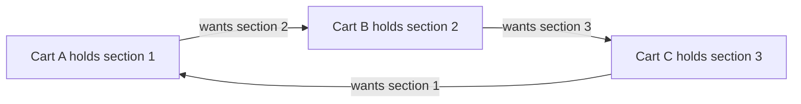

</details>

Computer scientists call this picture a **wait-for graph**. Draw one dot per worker and one arrow from each waiter to whoever holds what it wants. A deadlock is exactly **a loop in that drawing**. The game's red pencil arcs are this graph.

> **Real-life version:** four cars arrive at a four-way intersection at the same moment, each blocked by the car to its right. Every driver is correct to wait. Nobody can go. (Computer scientists also tell this story with five philosophers and five forks, called the *dining philosophers*, which was posed by Edsger Dijkstra in 1965. The game's fourth board, **The Dining Switchyard**, is exactly that.)

### The four Coffman conditions (the recipe for a deadlock)

In 1971, E. G. Coffman and colleagues showed that a deadlock needs **all four** of these to be true at once. Remove any one and deadlock becomes impossible.

| # | Condition | Plain meaning | In the game |
| --- | --- | --- | --- |
| 1 | **Mutual exclusion** | A thing can be used by only one worker at a time | A section holds one cart |
| 2 | **Hold and wait** | A worker keeps what it has while asking for more | A cart sits on its section while its next signal is red |
| 3 | **No preemption** | Nobody can forcibly take a thing away | There is no "force release" lever |
| 4 | **Circular wait** | The chain of waiting loops back to the start | The red loop on the board |


*All four conditions together make a deadlock; break any single one and the freeze cannot happen.*

<details><summary>Mermaid source</summary>

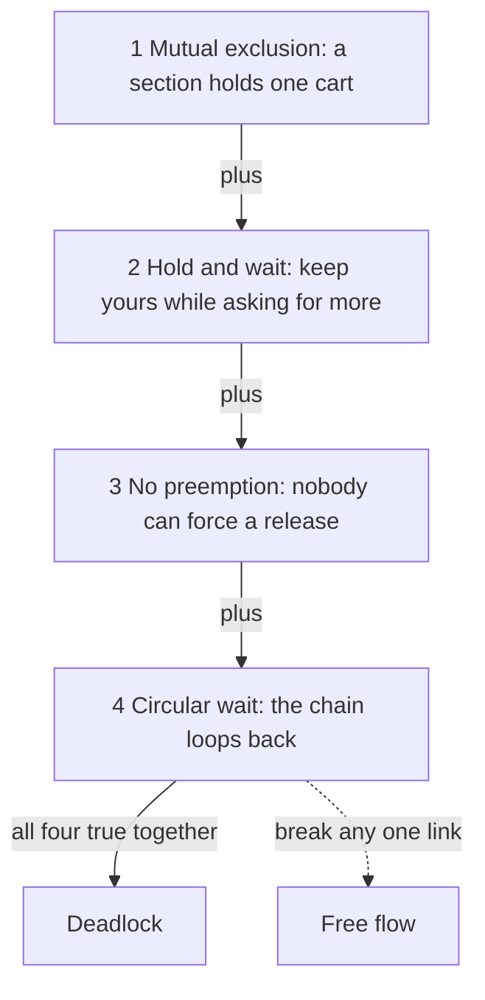

</details>

**Why this list matters for play.** Each of your interventions breaks one of these conditions. A *hold* at the entrance prevents hold-and-wait from ever forming a loop. A *loan* (we get to it shortly) breaks the "the holder is stuck behind someone" chain. The game has an optional **anatomy overlay** that lights each condition up *on the diagram* once the board satisfies it, so you learn the names *after* you've seen the thing.

### Livelock: two polite people in a hallway

A deadlock is everyone frozen. A **livelock** is the opposite-looking cousin: everyone is busy and nobody gets anywhere.

Imagine two people meeting head-on in a narrow hallway. Both step left. They are still blocked. Both step right. Blocked again. Both step left. They are being perfectly polite, they are not frozen, and they will do this forever.

In software, this happens when workers are written to "back off and retry" on a conflict. If both back off by the *same* amount and retry in the *same* order, they collide the same way every time. A deadlock detector sees nothing wrong, because no one is stuck waiting. But no progress is ever made.


*The polite loop: both carts release and retry identically, and only a stagger breaks the symmetry.*

<details><summary>Mermaid source</summary>

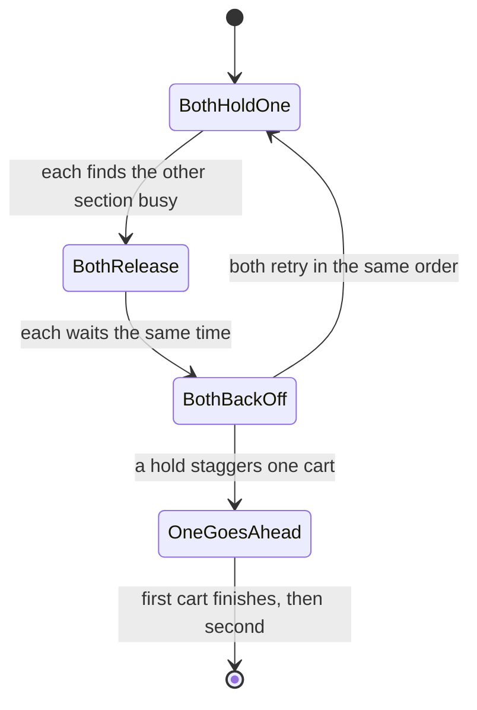

</details>

**The fix is asymmetry.** One of the two has to wait a beat longer, so the other gets through the hallway first. In the game, that is your **hold**: it delays one cart's retry past the other's attempt.

**How the engine spots it.** For each cart it records a *progress signature*: where it is on its to-do list, what it is holding, whether it is blocked. If that exact signature repeats three times with no cart finishing, the board declares **livelock**. (This is exact for the boards shipped. The architecture notes say the full certifier would find the same thing as a "strongly connected component with no accepting step", which is the grown-up name for "a loop you cannot leave and that never finishes".)

### Priority, and the third failure: priority inversion

Not all workers are equally important. A system gives each a **priority**: a high-priority worker (say, "keep the spacecraft's radio alive") should run before a low-priority one ("log some weather data"). The **scheduler**, the part that decides who runs next, always picks the highest-priority worker that is able to run.

Now the trap. Suppose three workers:

- **Low** has locked a shared resource.
- **High** wakes up and needs that same resource. It must wait for Low to finish and unlock.
- **Medium** wakes up. It does not need the resource at all. It just has more priority than Low.

The scheduler picks Medium over Low (Medium outranks Low) and Medium hogs the processor. Low never gets a turn to finish and unlock. High is stuck behind Low, and Low is stuck behind Medium. **The highest-priority worker is effectively being outranked by a medium one.** The priorities have been *inverted*.


*The inversion: Medium starves Low, which holds the lock High needs. Lending High's priority to Low frees the whole chain.*

<details><summary>Mermaid source</summary>

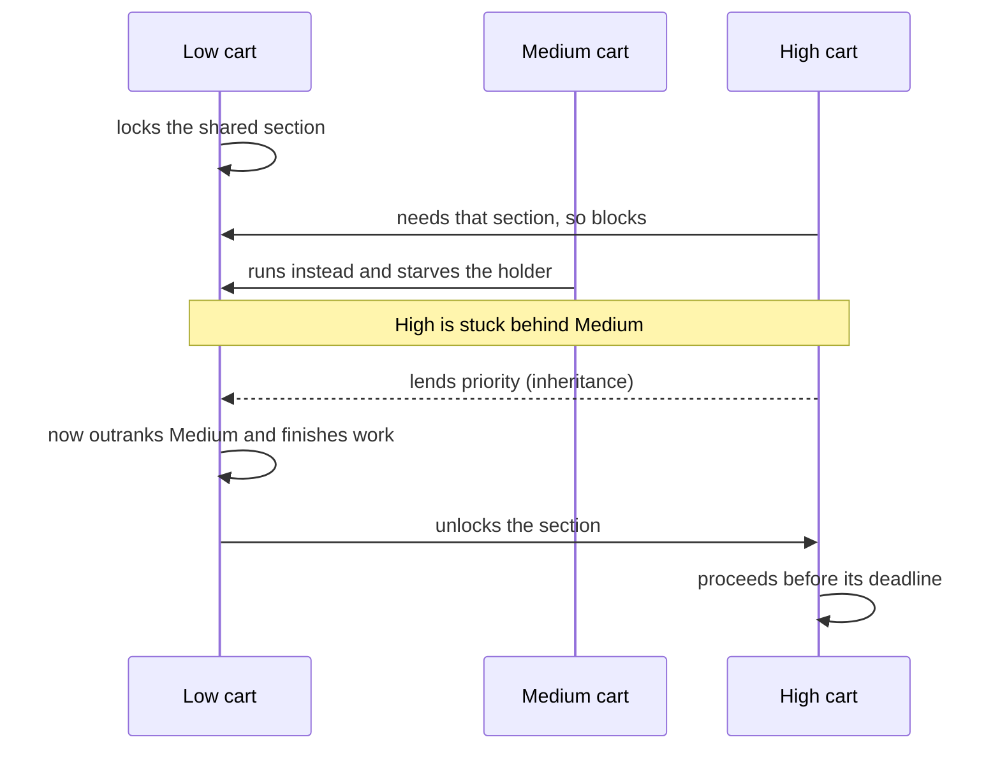

</details>

### The true story: the Mars Pathfinder freeze

In July 1997 NASA's *Mars Pathfinder* lander touched down on Mars and began sending back pictures. A few days in, it started **resetting itself** at random. Engineers on Earth had to work out why from tens of millions of kilometres away.

The cause was exactly the three-worker story above:

- A **high-priority** task managed the shared "information bus" the spacecraft used internally. It needed the bus lock.
- A **low-priority** task gathered weather data and held the bus lock while it worked.
- A **medium-priority** communications task ran long and kept pre-empting the low-priority one.

A watchdog timer noticed the high-priority bus task had not run for too long, decided something was badly wrong, and rebooted the computer. That was the reset. The system was not broken in any dramatic way. It had simply let a medium task starve a low one while a high one waited.

The fix was already built into the operating system, switched off. Engineers radioed a patch to flip one setting on that lock: **priority inheritance**.

### Priority inheritance: lend your VIP pass to whoever is blocking you

**Priority inheritance** is a rule: *while a low-priority worker holds a lock that a higher-priority worker is waiting for, the low-priority worker temporarily inherits the higher priority.* Think of it as the waiting VIP handing their VIP pass to the person blocking the door, so that person can hurry up, finish, and get out of the way. As soon as they release the lock, the borrowed priority goes back.

Now the medium-priority worker can no longer starve the holder, because the holder temporarily outranks it. The holder finishes, unlocks, and the high-priority worker proceeds.

Two points the game turns into rules:

1. **The loan goes to the holder, not the waiter.** Boosting the blocked worker does nothing, since it cannot run anyway while it is waiting. Boosting the *medium* worker makes things worse. You must identify who is holding the thing you are stuck behind.
2. **It is temporary.** The boost is a *lease*. It expires, so it is not a permanent upgrade, just a short loan that lets the holder get out of the way.

## 1B. How the game works

### The setting: a 1960s Swiss interlocking board

A **Stellwerk** (Swiss railway interlocking) was a physical control panel in a station signal box. A dispatcher watched a schematic of the track on a dark instrument panel, with ivory lines, brass levers and red and green lamps. Sections of track were occupied or free. Signals were red or clear. A train standing in a section *was* a lock. A signal held red *was* a worker waiting.

This is why the theme isn't just paint: a railway interlocking already **is** a resource-allocation diagram. The board shows exactly what a programmer's debugger would, but in a form that is easy to read.

### What you see and what you cannot do

You are the **dispatcher**. You do **not** drive the carts and you cannot edit what they plan to do. Each cart has a visible **tape**, a row of chips such as `lock A`, `lock B`, `travel 2`, `unlock A`, and the current chip is lit. There is no hidden information. The difficulty is how the tapes interact, not guessing what is in them.

Each cart also shows a **priority** and a **connection time** (a deadline: arrive by then or you've missed your train).

You win if **every cart reaches its terminus before its connection time**. You lose on:

- **Deadlock**: the wait-for graph becomes a closed loop covering every unfinished cart.
- **Livelock**: the same progress signature repeats three times with no cart finishing.
- **Missed connection**: a deadline passes.

### Your two tools: two different currencies

| Tool | What it does | What it is really teaching |
| --- | --- | --- |
| **Hold** | Delays one cart's next dispatch by a fixed number of ticks. The cart keeps whatever sections it already holds. | *Scheduling*: changes **when** something runs, not what it owns. |
| **Loan** | Gives the **holder** of a named section the priority of the highest-priority cart waiting for it, for a limited lease. If that cart holds nothing, the loan does nothing. | *Priority inheritance*: changes **who is allowed to run** to unblock a waiter. |

Why two currencies instead of one generic "power-up"? In the design notes the reasoning is blunt: if both were "one token", the game would collapse into "spend a token". A hold is cheap in authority but costs time (it can make a cart miss its connection). A loan is cheap in time but scarce and easy to waste on the wrong cart. Some boards give you zero holds and one loan, others the reverse, so you learn the difference by being **prevented from using the wrong tool**.

(One honest note: in the prototype the loan adds a fixed `+3` priority step so the readout stays easy to read. The production rule is full inheritance, `max(own priority, highest waiter's priority)`. The certifier's interface is the same.)

### Two ways the scheduler picks who goes: "disciplines"

The game announces which rule the board uses, because it changes what is possible.

- **Lockstep**: every runnable cart takes one step per tick, at the same moment. Used for the ring and polite-retry boards, so every cart grabs its *first* section before any cart asks for its *second*. This is what lets a ring deadlock actually form.
- **Priority preemptive**: exactly one cart runs per tick, the highest effective priority. Used for the inversion board so Medium can really starve Low.

This is part of the level, not a hidden detail. (Early on, design review caught that a plain priority scheduler can accidentally serialise the ring: the top-priority cart grabs two sections before anyone else runs, and the deadlock never forms. Making the discipline explicit fixed that.)

### The six boards

| # | Board | Failure | Par | The lesson |
| --- | --- | --- | --- | --- |
| 1 | **The Ring** | Deadlock | 1 | Break the cycle *before* the first lock, not after |
| 2 | **Inversion** | Priority inversion | 1 | Lend to the **holder**, not the waiter |
| 3 | **The Polite Ring** | Livelock | 1 | Progress can stop without anybody being blocked |
| 4 | **The Dining Switchyard** | Deadlock, four carts | 1 | The same verb scales from three parties to four |
| 5 | **Convoy Cascade** | Two cycles at once | 2 | A wait-for graph can contain more than one loop |
| 6 | **Double Inheritance** | Two inversions | 2 | Inheritance is per holder, so budget may force two loans |

**Par** means *the smallest number of interventions that can possibly win*. It is not a human's guess. The certifier computes it (more below).

### The early design that taught us the main lesson

In the first build of the prototype, the three carts were placed on the board and the player watched. The loop closed at **tick 5**. And the only interventions that could have saved the board all had to happen **before the first lock**. Players decided the game was broken.

It wasn't broken. That's what a deadlock *is*: **you don't repair a deadlock, you avoid it.** Once the circle has closed, nothing is moving and no move helps. So the board now shows an explicit **open window** (the loop has not yet closed; interventions still work) and a **closed window** (the loop is closed; only reset remains). After a failure the panel states the timeline in words: *"the cycle closed at tick 5; a hold placed after tick 2 has no effect on this cycle."*


*The window of opportunity: a hold early enough lets the next cart take two sections and unwind the ring; waiting until the loop closes is too late.*

<details><summary>Mermaid source</summary>

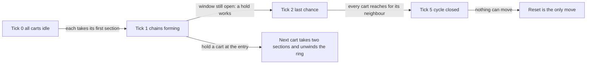

</details>

**Why a hold works on the Ring.** If one cart is held back at the entrance, the cart before it can take *both* the sections it needs, finish, and release them. Then the next cart can do the same, and the ring unwinds like a zip. You never needed every cart to wait, only to break the symmetry.

### The three wrong clicks (deliberately legible)

Part of the design is that wrong moves fail visibly:

- **Boosting the waiter** does nothing. It cannot run anyway.
- **Boosting the medium cart** makes the inversion worse, since it starves the holder harder.
- **Holding the holder** on the inversion board makes it worse, since the section stays occupied longer.

### Hold vs Priority Loan, in one comparison

| | Hold | Priority Loan |
| --- | --- | --- |
| Aimed at | A cart that is about to make things worse | The cart **currently holding** the contested section |
| Best on | Ring, Polite Ring, Dining Switchyard | Inversion, Double Inheritance |
| Wasted when | The cart already holds the section the loop needs | The target holds nothing, or the target is the waiter |
| Real-world cousin | Staggering retries; "back off with jitter" | Priority inheritance (Pathfinder's fix) |

## 1C. How the certifier proves every board is fair

### Step 1: describe everything as one big state machine

Each cart is a little state machine (its position on its tape). The **resource monitor** is another (who owns what, who is waiting, which timers are running). Multiply them together and you get the **product automaton**: one giant state machine whose every situation says *"cart 1 is at step 3, cart 2 is at step 1, cart 3 is waiting, section A is held by cart 1"* and so on. The set of situations the board can reach is its **state space**.

### Step 2: search it for a winning plan, cheapest first

The certifier explores that state space, branching at each tick: *just run a tick, or hold cart X, or loan to cart Y?*

```text
frontier  = queue of (state, plan so far), cheapest first
repeat:
    take the cheapest state
    if everyone finished in time  -> CERTIFIED, here's the plan
    if deadlock / livelock / missed -> this branch is dead
    otherwise add: run one tick, or any allowed hold, or any allowed loan
```

Cost is counted **in interventions first, ticks second**. A plan with one hold and a long wait beats a plan with two holds and a quick finish. That matches the promise of the game: *par is the number of things you had to do, not the number of ticks you watched.*

A cute engineering detail: every step costs either **0** (just let a tick pass) or **1** (spend a hold or a loan). So instead of a general-purpose priority queue the prototype uses a **0–1 BFS**, one waiting line per intervention count. That is exact, and it made a four-cart search run in milliseconds instead of seconds, which is what makes it practical for the in-browser level generator.


*The certifier's search tree: each branch is a different choice of "do nothing / hold / loan", and every branch ends in a win or a named failure.*

<details><summary>Mermaid source</summary>

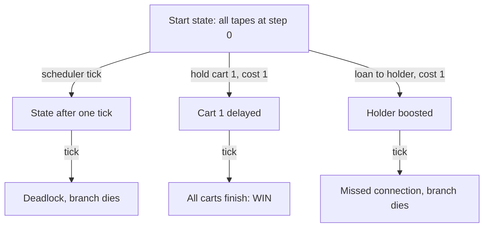

</details>

### Step 3: reject boards that are not good puzzles

A board is only shipped if all of these hold:

- A winning plan exists and **1 ≤ par ≤ budget** (not unwinnable, not trivially won with zero interventions).
- The default run with no interventions really does end in deadlock, livelock or an inversion (otherwise there is nothing to fix).
- The window of opportunity is at least 2 ticks wide (not a pixel-perfect click).
- The only winning plan is not the degenerate "hold every cart and serialise the whole thing".

### Step 4: generate new boards from a seed

A **seed** is just a short text label such as `RAIL-101`. A pseudo-random number generator started from that seed produces the same "random" numbers every time, in every browser. So `#deadlock/gen:RAIL-101` in the URL regenerates *exactly the same yard*, and the same certified par. The link carries the seed, not the answer. The browser re-proves the board itself. This is the point of "browser-only": a link can't carry a stale or forged certificate because it carries no certificate.

### What the headless report checks

`prototypes/cs-formalisms/scripts/certify.mjs` lifts the exact engine code out of `index.html` and runs it in Node. It checks, board by board, that the certificate exists, fits the budget, and replays to a win. The recorded run passes **490 checks** across the curated boards (6 Deadlock, 4 Byzantine, 2 Garbage Collector) and 60 generated ones (20 seeds per game). Because it reuses the page's own engine rather than a rewrite, if a rule changes in the page the report changes (or fails) with it.

---

# Game 2. Byzantine Choir

> **Say it in one breath.** *When some members of a group may lie, and may lie differently to different people, honest members can fail to agree even though each one is behaving correctly. Mathematics says you need at least three honest-ish members for every liar. In the game you are a signals officer closing shutters on semaphore links so every honest tower ends up with the same order.*

## 2A. The real-world ideas, from scratch

### Why agreement is hard: the coordinated attack

Imagine several army divisions camped around a city. They will win only if **all attack together**, and they will lose if only some do. The generals can talk only by messenger. The question: can they reliably agree on a plan (*Attack* or *Retreat*)?

With perfect, honest messengers it is easy. Now suppose **some generals are traitors**. A traitor does not just refuse to cooperate. It can send **Attack** to one neighbour and **Retreat** to another. This tactic, saying different things to different people, is called **equivocation**, and it is the heart of the matter.

This is the **Byzantine Generals Problem**, introduced by Leslie Lamport, Robert Shostak and Marshall Pease in 1982. ("Byzantine" is a nod to the empire's reputation for scheming court politics.) It is the abstract version of a real engineering problem: **how can a group of computers agree on something when some of them may be broken or malicious?** Banks, aircraft flight controllers and blockchains all face versions of it.

### Distributed consensus: the goal

A group of computers that must agree on one value is solving **consensus**. For the Byzantine problem we want two guarantees:

1. **Agreement.** All *loyal* (honest) members choose the same action.
2. **Validity.** If the commander is loyal, the loyal members choose **the commander's actual order**.

Note the difference. If the commander is a traitor, loyal members only need to agree with each other on *something*. Obeying a traitor is not a virtue. The game keeps these two requirements separate on every board because the theorem depends on it.

### Why three generals cannot handle one traitor

This is the famous impossibility. Take a commander and two lieutenants, A and B, with **oral messages**. "Oral" means anyone can claim "the commander told me X", and nobody can prove it.

Look at what lieutenant A experiences. A hears the commander say **Attack**. Then B tells A, "The commander told me **Retreat**." Now A faces two possible worlds:

| World | Who is lying | What A *should* do |
| --- | --- | --- |
| 1 | **The commander is the traitor.** It told A "Attack" and B "Retreat". B is honest and is reporting accurately. | Any choice that matches B's choice |
| 2 | **B is the traitor.** The commander honestly said Attack to both, and B is lying to A. | **Attack**, because the loyal commander's order must be obeyed |

A's observations are **identical in both worlds**. A literally cannot tell which world it is in, but the correct answers differ. Whatever rule A follows, it fails in one of them: obey the commander, and in world 1 A and B end up split; side with B, and in world 2 A defies a loyal commander. The same argument holds for B. **No rule works.** Therefore three generals cannot beat one traitor with oral messages.


*The split: a traitor tells each loyal general something different, and each loyal general sees a contradiction it cannot resolve.*

<details><summary>Mermaid source</summary>

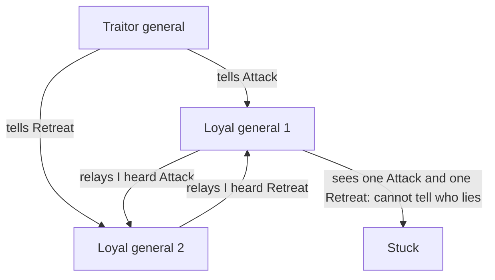

</details>

### The 3f + 1 rule

Lamport, Shostak and Pease proved the general version: with oral messages you can tolerate **f** traitors only if the total number of participants **n** satisfies

> **n ≥ 3f + 1**

| Traitors f | Minimum participants n | Why |
| --- | --- | --- |
| 1 | 4 | Three can be out-voted by the traitor's confusion; four leaves two honest witnesses to cross-check |
| 2 | 7 | Same idea, scaled |
| 3 | 10 | And so on |

**Intuition:** for the honest members to out-vote the lies, there must be enough honest cross-checking. Each honest member's decision depends on hearing from others, and a traitor can distort up to f of the voices. You need the honest ones to outnumber the distortion by a wide margin.

**The escape hatch: signatures.** If messages can be *signed* so that nobody can forge "the commander said X", the impossibility goes away. A traitor can no longer claim the commander said something different. (This is why real systems use cryptographic signatures.) The game's design notes propose a **sealed order** as a second resource for the full game, but it is **not in the prototype**. The prototype shows the oral-message world, where the threshold bites.

### The algorithm in two rounds

The classic approach is simple to state:

1. **Round 1.** The commander sends its order to every lieutenant.
2. **Round 2.** Every lieutenant **relays** what it heard to every other lieutenant.
3. **Decide.** Each lieutenant takes the **majority** of what it heard directly plus what the others relayed.

With enough honest members, traitors' lies get out-voted. In the game, a tie goes to **Retreat** (the safe default).


*Two rounds of messages: the commander speaks, everyone relays, a traitor sends different lies to different towers, and each honest tower takes a majority.*

<details><summary>Mermaid source</summary>

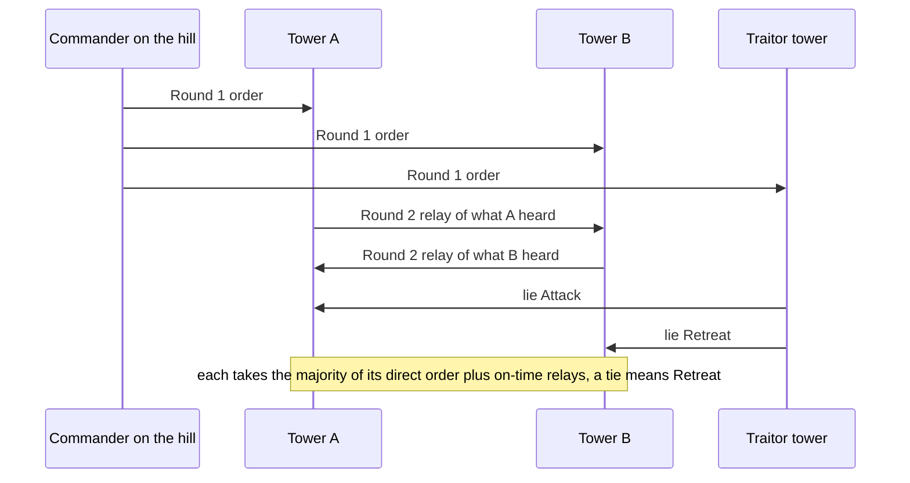

</details>

## 2B. How the game works

### The setting: a Napoleonic optical semaphore at night

Before the telegraph, armies and governments relayed messages with chains of **semaphore towers**: tall masts with movable arms, each tower within line-of-sight of the next, an operator copying the arm positions with a telescope and repeating them onward. It's a perfect model of an oral-message network: a signal is spoken, repeated, and can be misquoted, and a flag has no signature.

On the board you see a night map: a commander on a hill, lieutenants on ridges and in valleys. Each tower has a mast whose arms show its message (both up = **ATTACK**, both down = **RETREAT**). Missing links are hills or forests, and cut links show a red cross.

### Why the game isn't just the textbook algorithm

If the network is *complete* (everyone can see everyone) and `n ≥ 3f + 1`, the classic algorithm already works and there is nothing for you to do. So the game **weakens the network**: some line-of-sight links are missing, a tower may have only two sources of information, and the decision deadline makes late messages unusable for relaying. The puzzle becomes: *which link carries the contradiction, and can I remove it without also removing the last honest witness?*

### Your two tools: Cut and Delay

You are the signals officer. You cannot forge or speak for a tower. You can only change links.

| Tool | What it does | What it costs the honest side |
| --- | --- | --- |
| **Cut** | The link is removed in both directions. The message **never arrives**. | The recipient loses an honest witness too, so it leaves a hole in the choir. |
| **Delay** | Messages on the link arrive **one round late**. | See below, this is not just a softer cut. |

**The precise meaning of Delay** (this is the subtle bit):

- A delayed **round-1** message (the commander's direct order) arrives at the end of round 2. The lieutenant **can still count it** in its own decision, but it arrived **too late to be relayed** onward.
- A delayed **round-2** relay arrives after the decision, so it is **dropped**.

So delay is a real trade-off. You can still *inform* the recipient but you remove the recipient's ability to *inform others*. It is an interrogation tool and a quarantine tool at once. The board labels `LATE` and `DROPPED` differently.


*Four fates of a message: open, cut, delayed in round 1, delayed in round 2. Delay is not just a gentle cut.*

<details><summary>Mermaid source</summary>

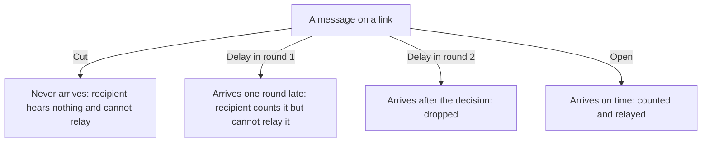

</details>

**Why cutting is not "delete the traitor".** If you could simply cut every link of a known traitor, Byzantine agreement would become network housekeeping. So cuts are budgeted, they remove honest messages on the same wire, and the honest lieutenants must still hear enough to decide. The real decision is *which single edge carries the contradiction*.

### The traitor is a real adversary, not a script

If the traitor followed a fixed script, you could memorise the level. Instead the traitor uses **minimax**: it picks its lies to cause the **worst possible outcome for you, given your best response**.

*Minimax* is a general idea from game theory. You choose an action to make your worst case as good as possible. The adversary chooses its action to make your result as bad as possible. A **minimax brain** assumes the opponent is clever. Here it means the traitor tries every combination of "what do I tell each neighbour?" and picks the one that splits the honest towers.

How the certifier handles it:

1. For each candidate cut/delay action within your budget...
2. ...enumerate every allowed traitor placement and every assignment of messages...
3. ...compute what each honest lieutenant would decide...
4. ...if any combination splits the honest towers (or contradicts a loyal commander), the action is **unsafe** and that combination is the **witness**: the proof that it fails.

It returns one of three verdicts:

- **SAFE**: the action works against every possible lie, and it comes with a certificate.
- **UNSAFE**: here is a specific set of lies that breaks it.
- **IMPOSSIBLE**: no action within budget can work (for example, a board below the 3f+1 line).

### Known suspect vs. blind traitor: which "for all"?

A subtle point the game labels carefully. If you know *who* the traitor is (a **tribunal** board), you only need your plan to survive that one traitor's lies. If you do not know (a **blind** board), your plan must survive *every possible placement* of f traitors, which is much harder. The panel always states which version is in force. A game that silently switched between them would be lying about its theorem.

### The boards

| # | Board | Setup | Lesson |
| --- | --- | --- | --- |
| 1 | **The Schism** | 5 towers, 1 traitor, two missing links | The eastern tower has two sources and the traitor can tie it. Cut the lie's link, **not** the honest witness's |
| 2 | **The Empty Chair** | 4 towers; the **commander** may be the traitor | Loyal lieutenants must agree even if the order-giver is not trustworthy. Often the best move is to remove one of the commander's contradictory links |
| 3 | **The Pyrenees Relay** | 6 towers, 1 traitor, par 1 | One tower of slack over 3f+1; cutting the suspect is the single winning move |
| 4 | **The Rhine Frontier** | 7 towers, 2 traitors, par 2 | Exactly at 3f+1; the only safe action cuts **both** traitor links |

The architecture notes also describe a fifth, theorem-style board (**The Threshold**: 3 towers, 1 traitor, where the certifier says "no strategy exists"). In the prototype that idea lives in the live **threshold panel** below rather than as a separate level. Any board can be judged against 3f+1.

### The threshold panel

The tribunal panel shows `n`, `f`, `3f+1` and a live verdict: **slack 1**, **exact**, or **impossible**. At `n = 4, f = 1` you are exactly at the limit and must find the precise edge. At `n = 5` you have one tower of slack. If a board ever had `n = 3` with one traitor, the panel would say impossible. The theorem is now a number you can watch.

### Reading the Adversary Lie Tree

When you press **Reveal witness**, the game shows the traitor's worst-case plan as an **Adversary Lie Tree**:

- one branch per dispatch the traitor tailors for one honest neighbour;
- each branch shows **recipient**, **value** sent, and **arrival** (on time or late);
- a `CONTRADICTION` marker appears when the **same tower tells two neighbours different things**, which is the equivocation itself;
- clicking a branch highlights that link on the map.

How to read it: look for a tower with two branches carrying different values. That tower is the equivocator. Then ask: *which of those two links, if cut, leaves every honest tower with the same majority?* The tree is generated from the exact same data the certifier uses, so it can never disagree with the verdict.

The witness is hidden by default on purpose. If the answer were always on screen, the dispatch table would stop being evidence you read and become an answer key.

### A worked mini-example (the Pyrenees Relay)

The eastern tower **E** has lost its direct order from the commander and two of its relays. It hears only from the suspect **S** and one honest witness **W**. Suppose the true order is Attack. W honestly relays "Attack"; S, the liar, sends E "Retreat". E now has one Attack and one Retreat: a tie, and ties default to **Retreat**, so E disagrees with every other honest tower.

- **Cut S→E**: E hears only W, who is honest. E says Attack. The choir agrees.
- **Cut W→E** (the tempting mistake): E hears only the liar and still says Retreat. Worse, you removed the only honest voice.

That is why the design notes call cutting the honest witness a *legible, tempting mistake* rather than a random failure.

## 2C. How the browser proves the board is fair

- **Minimax witness solver.** For each action, enumerate placements and message assignments, build the two-round message tree, evaluate agreement and validity, and keep the worst failing witness. Two performance shortcuts do not change the verdict: messages sent to *another traitor* are removed from the search (no honest decision counts them), and the search stops at the **first** failing witness. Only a safe action is searched exhaustively. On the 7-tower, 2-traitor board that dropped a 34-second check to under a second.
- **Seeded networks.** `New seeded network` samples a topology of 4 to 6 towers with one known suspect, **starves** one honest tower of information, runs the solver, and rejects: networks that are already safe (no puzzle), networks with no safe action (unwinnable), and the degenerate answer "cut every commander link".
- **What it does not claim.** Generated boards are known-suspect with n ≤ 6. The blind-placement version and the 7-tower, 2-traitor case are carried by the curated boards, not the generator. And there is no proof in the link; the seed is re-checked in your browser.

---

# Game 3. Garbage Collector

> **Say it in one breath.** *Programs constantly claim memory and abandon it. A garbage collector finds the abandoned memory and returns it. The catch is that the program keeps changing things while the collector works, and that free memory can be scattered in pieces too small to use. In the game you pause a running program for a strictly limited time, clean up, and must get it finished before it starves.*

## 3A. The real-world ideas, from scratch

### Memory is a long row of numbered boxes

A computer's working memory is like a very long shelf of identical numbered boxes. Each number is an **address**. When a program needs room to store something (a list, an image, a user's name), it asks the system for a **block**: a run of neighbouring boxes. This area, where a program's blocks live while it runs, is called the **heap**.

Asking for a block is called **allocating**. The program is supposed to say when it has finished with a block, so the space can be reused. Forgetting to do that is called a **memory leak**.

### What is a pointer?

A block often needs to refer to another block: a playlist refers to its songs, a song refers to its cover art. The reference is a **pointer**: an arrow that says *"the thing I need is over at address 4812"*. Pointers are what let programs build rich structures out of many blocks.

Pointers also create the central question of garbage collection: **how do we know whether a block is still needed?**

### Roots, reachability and "garbage"

Some pointers live in the program's immediate working area (variables it is using right now). These are called **roots**. A block is **reachable** if you can get to it by starting at a root and following pointers. Anything you can reach might still be used. Anything you **cannot** reach by any chain of pointers is **garbage**: no part of the program can ever touch it again.

Analogy: a library where every book is on loan to someone, but the only way to find a book is through a chain of reference slips starting at the front desk. A book with no slip leading to it from anywhere is unreachable. It can never be borrowed again, so the shelf space is wasted until somebody reclaims it.

A **garbage collector** is the janitor that finds unreachable blocks and gives their space back.

### Mark and sweep: the two-step clean-up

The simplest collector does exactly what the name says:

1. **Mark.** Start at the roots and follow every pointer, marking every block you reach as "alive".
2. **Sweep.** Walk the whole heap. Anything not marked is garbage. Free it.

### Dijkstra's tri-colour marking: white, grey, black

If you mark everything in one uninterrupted pass, that is easy. But in a real program, a long pause freezes everything, which is unacceptable for, say, a game or a phone call. So collectors work **incrementally**: mark a bit, let the program run, mark a bit more. To keep track of progress, Edsger Dijkstra and colleagues (1978) proposed painting every block one of three colours:

| Colour | Meaning | Analogy |
| --- | --- | --- |
| **White** | Not yet visited. If it is still white at the end, it's garbage. | Rooms nobody has checked |
| **Grey** | Found and reachable, but its pointers have not been followed yet. | Rooms on the inspector's to-do list |
| **Black** | Found, and all of its pointers have been followed. | Rooms fully inspected |

The algorithm: shade the roots grey. Repeatedly pick a grey block, shade all of its white children grey, then turn it black. When no grey blocks remain, everything still white is garbage.


*A block's life during a collection: white until found, grey while queued, black once scanned; blocks still white at the end are swept away.*

<details><summary>Mermaid source</summary>

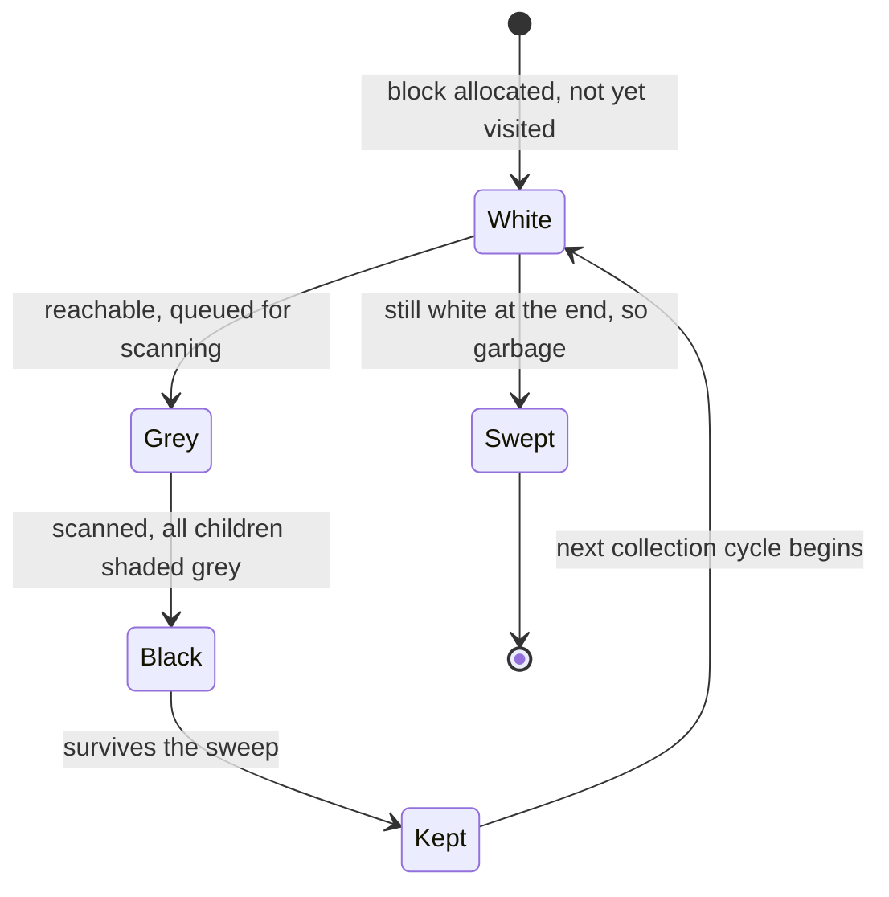

</details>

**The golden rule (the tri-colour invariant):** *no black block may point directly at a white block.* If it did, that white block would be reachable only through a black block that the collector has already finished with, so the collector would never discover it and would wrongly throw it away.

### Write barriers: what if the program rewires pointers while the janitor's back is turned?

Here is the danger. Suppose the collector has scanned block B, which is now black. B pointed to nothing new. Then the running program (called the **mutator**, because it *mutates*, or changes, the heap) does two sneaky things:

1. Makes the black block B point to a white block W.
2. Deletes the only other pointer to W.

Now W is alive (B uses it) but the collector will never look at B again, since B is black, and no grey block leads to W. When the sweep runs, W is white, so it is thrown away. B is left holding a **dangling pointer**, an arrow pointing at freed memory. The program corrupts or crashes.


*The danger and the cure: a black block gains a pointer to a white one; a write barrier notices and shades the target grey so the collector will visit it.*

<details><summary>Mermaid source</summary>

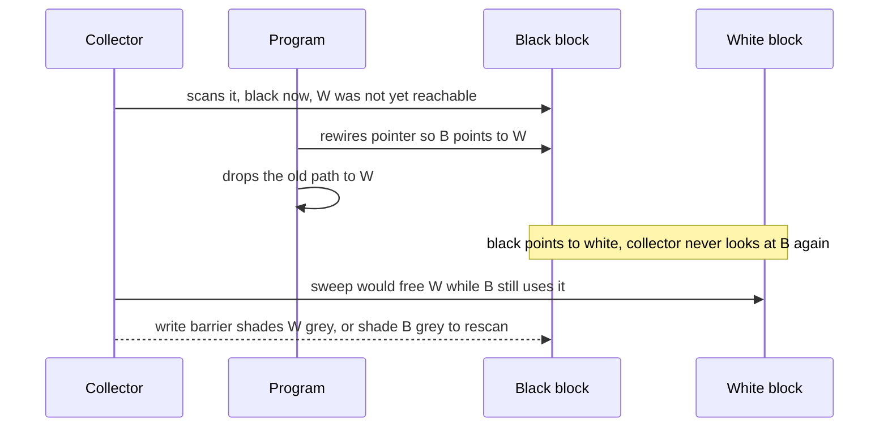

</details>

The cure is a **write barrier**: a small piece of code that runs on every pointer write during marking. If someone is storing a pointer to a white block into a black one, the barrier immediately shades the target (or the source) grey, so the collector will visit it again. It costs a little extra time on every write, which is why it isn't free.

### Fragmentation: having room is not the same as having usable room

Collecting garbage frees blocks wherever they happen to be. After a while the heap looks like a street with parked cars and gaps: live, free, live, free, live. This is **fragmentation**.

Suppose you have 6 free boxes in total, but they sit as three separate gaps of 2. A program asks for a block of 5 boxes in a row. There are *enough* free boxes but **not enough neighbouring ones**. Allocation fails. Sweeping alone doesn't help, because it creates holes but never merges them.

### Sliding compaction: pushing everything to one end

The cure is **compaction**: slide all live blocks to one end of the heap, like pushing books to the left of a shelf, so all the free gaps merge into one big run on the right.

But moving a block changes its address, and every pointer to it now points at the wrong place. So the collector keeps a **forwarding table** ("old address → new address") and rewrites every pointer. Done by hand this would be tedious bookkeeping, so the game does the rewriting automatically and shows you the forwarding table as the visible truth.


*From scattered holes to one usable run: sweep frees garbage, sliding live blocks left and fixing pointers merges the gaps.*

<details><summary>Mermaid source</summary>

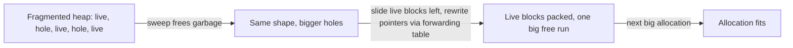

</details>

**Why moving is expensive.** Compaction costs time proportional to how many live cells move. Pausing the whole program for that long can be unacceptable. So real collectors sometimes compact only part of the heap.

### Pause budgets: why the janitor can't just take as long as it likes

While the collector pauses the program (a **stop-the-world pause**), the program doesn't respond. If the pause is long enough, a video stutters or an aircraft's control loop misses its deadline. So there's a **pause budget**: the longest allowed single pause. A perfect but slow collector has still failed the program.

## 3B. How the game works

### The setting: a 1984 CRT logic analyser

Picture an engineer's bench instrument: beige case, a dark green phosphor screen with a measuring graticule, cyan and amber traces, chunky keys, a rotary knob, scanlines and a gentle afterglow. The heap is drawn as a **linear row of cells** across the screen. The program's behaviour is a scrolling **trace strip** along the bottom with a playhead, like an oscilloscope. A segmented LED bar shows your pause budget.

### What you see

- **Blocks** with IDs and sizes laid out across the cells. Free cells are hatched.
- **Roots** are arrows from a register panel; **pointers** are arcs between blocks.
- Every block shows its **colour** (white / grey / black) with a legend.
- The trace shows the **next four events** the program will do. Nothing is hidden; the challenge is planning, not memory.
- Status messages name failures plainly: `PAUSE OVERRUN`, `ALLOC FAIL`, `DANGLING POINTER`, `TRACE COMPLETE`.

The program's script, the **trace**, is a fixed list of events: `alloc` (claim a block), `store` (write a pointer), `rootAdd` / `rootDrop` (start or stop holding something at the front desk), and `retire`.

### Your operations

| Operation | What it does | Cost |
| --- | --- | --- |
| **Pause / Resume** | Freeze the program at a safe point, or let it run again | Resets the pause meter |
| **Mark roots** | Shade every root grey | Cheap (1) |
| **Scan** | Take a grey block; turn it black and shade its white children grey | The block's size (the incremental unit) |
| **Shade** | Manually turn a block grey: the hand-operated write barrier | 1 |
| **Sweep** | Free every white block and merge adjacent free runs | Number of blocks removed |
| **Compact** | Slide live blocks left (fully, or up to a chosen **seam**), rewriting pointers through the forwarding table | Number of live cells moved |
| **Barrier on/off** | Automatically shade the target of any store into a black block, in exchange for **debt** | +1 per catch, charged to the next pause |

**Refusals that teach.** Sweep is refused while a *black → white edge* exists, which is precisely the golden-rule violation. The game shows an alarm in words, such as *"black → white: the sweep would lose this block"*, so you see the live object about to be lost instead of having to deduce it from colours.

### Why you can't just "compact every time"

If compaction is cheap and total, the best policy is "always compact", and there is no puzzle. The game removes that with two levers:

1. **Partial compaction (the seam).** Click a point on the heap to slide only the blocks before it. The cost is proportional to the cells moved, so a well-chosen seam creates just the run you need at a fraction of the price.
2. **Timing.** Compact when the live set is small, or just after a sweep when garbage is gone.

### The win condition is finishing, not cleanliness

A perfect collector that pauses too long has failed the program. You win by getting the **whole trace to complete** without any pause over budget, any failed allocation, or any dangling pointer. You can win with garbage still on the heap. The goal is the program staying alive, not an immaculate memory.

### The boards

| # | Board | What it teaches |
| --- | --- | --- |
| 1 | **Three Colours** | Mark, sweep, compact in order. Marking costs more than one pause, so you must split it; sweeping alone leaves holes; a full slide eats a whole pause |
| 2 | **The Write** | Incremental marking meets a mutator. A store creates a black → white edge: shade and rescan, or switch on the barrier and pay debt |
| 3 | **Synthesized Workload** (seeded) | A generated trace with two holes and a large allocation equal to the total free space, so it fits only after a slide. This is where the **seam** decision (partial compaction) matters most |

The design notes also describe a hand-built board called *The Seam* for partial compaction. In the prototype the seam is exercised through the generated workloads.

### The fragmentation and locality panel

A second readout compares the **current** heap with the **projected** heap after a full slide:

- `largestRun`: the biggest usable free run (what an allocation actually sees);
- `fragmentation = 1 − largestRun / freeCells`: how much free memory is unusable;
- `pointerSpan`: total distance all live pointers must cross; `maxSpan`: the longest single arc.

The difference between the columns is the **pointer-span tension** a slide would remove. It is recomputed from the real heap on every render, not replayed from a script. (A bonus: sliding live blocks together also shortens pointers. In real computers that helps speed, since related data sit near each other, a property called *locality*.)

## 3C. How the browser proves the schedule exists

### The invariants (the rules the certifier checks at every step)

- **I1 (tri-colour):** during a mark, no black block points to a white block, and no root is white.
- **I2 (ownership):** every block occupies exactly one address range, and ranges don't overlap.
- **I3 (reachability):** nothing reachable from a root is ever swept.
- **I4 (pause):** every pause stays within budget.
- **I5 (allocation):** an allocation succeeds only if some **contiguous** free run is big enough; the run is chosen first-fit, deterministically.

### Planner plus replay: a certificate that is a real run

The architecture describes a full search over *when to pause* and *what to do inside each pause*. The prototype uses a lighter, still-honest approach:

1. A **constructive planner** follows a deterministic policy: run the program until the next allocation won't fit; pause; mark and scan what fits; resume if the pause is full; sweep when the mark is complete; then slide (fully if the live set fits the pause, otherwise to the cheapest seam whose resulting free run satisfies the allocation).
2. A **replay certifier** takes the planner's schedule and runs it again from a fresh heap. It accepts the board only if the replay reaches `TRACE COMPLETE` with its *measured* peak pause inside budget.

So the certificate is **a concrete run**, not "trust me, my policy works". **Auto-collect** replays that same proof.

### What gets rejected

A generated workload is dropped if: it can be solved with no compaction at all (no spatial decision), it needs zero pauses (trivial), it has no solution, or it needs fewer than two pauses (no timing choice). The preferred board splits the mark across two pauses *and* needs a partial compaction.

### What it does not claim

The planner finds **a** feasible schedule, not the best one. The production design keeps a full frontier search for optimality. The report's checks cover that the replay completes, the peak pause is in budget, a slide happens, the mark is split over at least two pauses, and a projected slide never lengthens a pointer span.

---

# Part 4. What the three games share

All three are the same kind of object at different scales:

| | Deadlock | Byzantine Choir | Garbage Collector |
| --- | --- | --- | --- |
| **State machine of** | carts × resource monitor | message tree with a lying sender | program trace × heap × collector |
| **What you spend** | holds and loans | cuts and delays | pause time |
| **The failure** | circular wait | split decision | lost or unusable memory |
| **When it is invisible** | until all four conditions line up | until a liar equivocates | until memory gets fragmented |
| **How it is certified** | search product states for a winning plan | minimax over all lies | planner + replay |
| **Link format** | `#deadlock/gen:RAIL-101` | `#byzantine/gen:RELAY-201` | `#gc/gen:HEAP-301` |

**The design test they all passed:** *remove the theme; does the mechanic still exist?* A deadlock without railways is still a wait-for cycle. A traitor tower without a night map is still equivocation. A CRT without phosphor is still tri-colour marking. The formalism is the board, not decoration on it.

**Why "browser-only" matters.** Every board is a seed. The browser generates it, certifies it, and plays it, with no server asking "is this solvable?". A shared link is a shared puzzle *and* a shared proof, because the proof is recomputed locally.

---

# Glossary (plain-language)

| Term | Meaning |
| --- | --- |
| **Address** | The number of a memory box |
| **Allocate** | Ask for a block of memory |
| **Automaton / state machine** | A list of situations plus rules for moving between them |
| **Byzantine fault** | A member that may behave arbitrarily, including lying differently to different people |
| **Certifier / certificate** | A checker that searches for a proof, and the proof it returns |
| **Coffman conditions** | The four ingredients of a deadlock |
| **Compaction** | Sliding live memory together to merge free gaps |
| **Consensus** | A group agreeing on one value |
| **Deadlock** | Everyone waiting on someone else in a closed loop |
| **Equivocation** | Telling different recipients different things |
| **Forwarding table** | Old-address-to-new-address map used during compaction |
| **Fragmentation** | Free memory split into pieces too small to use |
| **Garbage** | Memory no root can reach |
| **Heap** | The region of memory for dynamically allocated blocks |
| **Livelock** | Everyone busy, nobody progressing |
| **Minimax** | Choosing the option whose worst case is best, against a clever opponent |
| **Mutator** | The running program (it *mutates* the heap) |
| **Mutex** | A "one at a time" lock |
| **Par** | The certified smallest number of interventions that wins |
| **Pointer** | A reference to another block |
| **Priority inheritance** | A blocker temporarily borrows the priority of the worker it blocks |
| **Priority inversion** | A lower-priority worker effectively blocks a higher one |
| **Product automaton** | The combined state machine of all parts of a system |
| **Root** | A pointer the running program holds directly |
| **Seed** | A text label that regenerates the same "random" level |
| **Tri-colour marking** | White / grey / black progress tracking for a collection |
| **Wait-for graph** | Arrows from each waiter to the holder it waits on |
| **Write barrier** | Code that runs on pointer writes to protect the collector's invariant |

---

# Cheat sheet: explaining each game out loud

**Deadlock (30 seconds).** *"Three trains each sit on a piece of track and each need the next piece. Everybody's waiting on somebody, so nobody moves. That's deadlock. You get one or two interventions: delay a train, or lend a stuck train's importance to whoever's blocking it. The catch is you have to act before the loop closes, because afterwards no move helps. The computer checks every possible future to prove each puzzle is winnable and tells you the minimum number of moves."*

**Byzantine Choir (30 seconds).** *"A commander sends an order through relay towers, and one tower is a liar who tells different towers different things. Honest towers vote on what they heard. You can cut a link or delay it. Cut the lie and you win. Cut the honest witness and you lose. There's a famous theorem that you need at least 3 loyal-ish towers per liar plus one, so three towers with one liar is flat-out impossible, and the threshold panel tells you exactly where each board sits."*

**Garbage Collector (30 seconds).** *"A running program keeps grabbing memory and abandoning it. You're the cleaner. You can pause the program for a limited time, mark what's still reachable, sweep the rest, and slide everything together so there's one big gap. But the program keeps rewiring things while you work, and if you're sloppy you'll throw away something it still needs. You win by letting the program finish."*

**One line for all three.** *"Each is a real way software fails silently, turned into a puzzle whose solution the browser can prove."*
