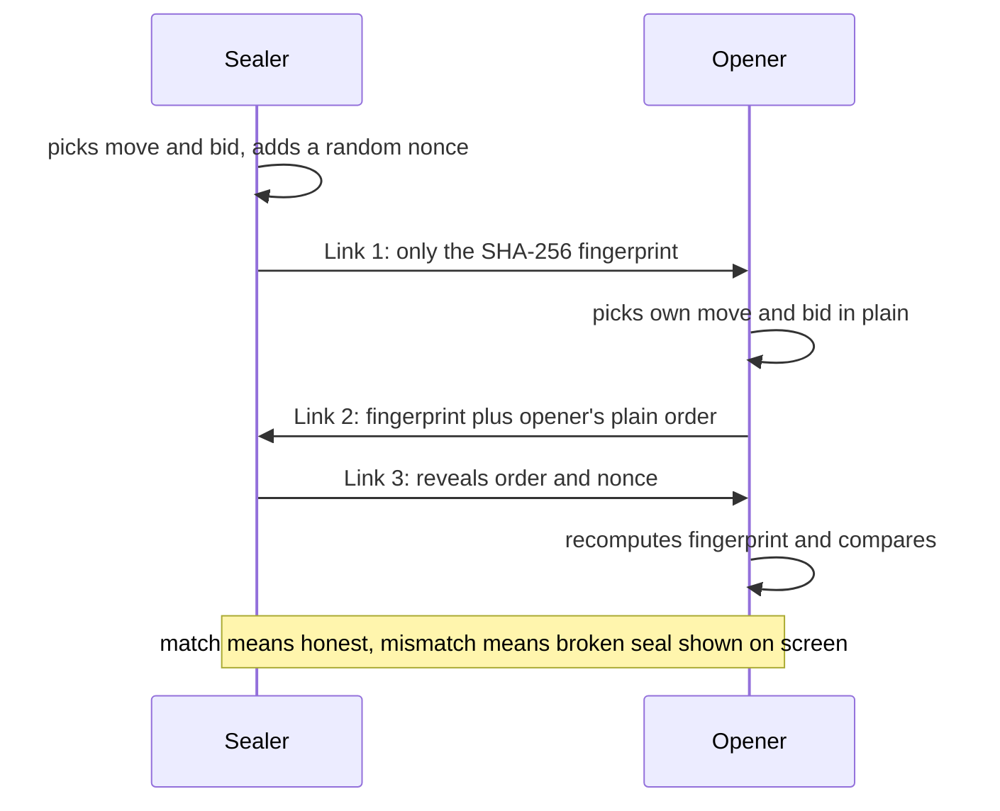
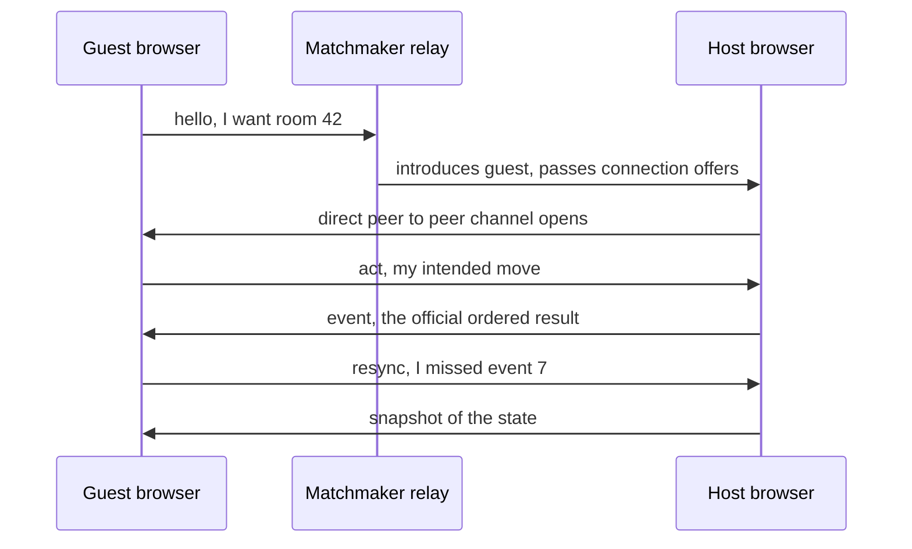
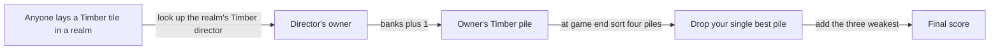
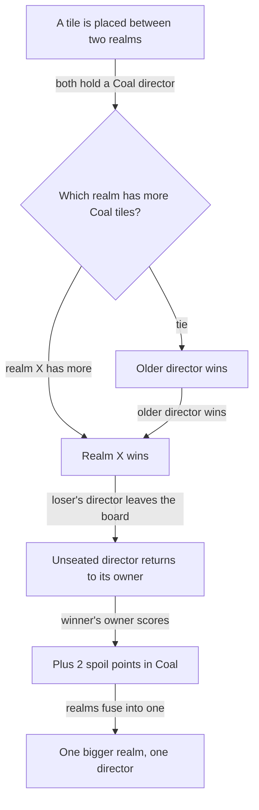
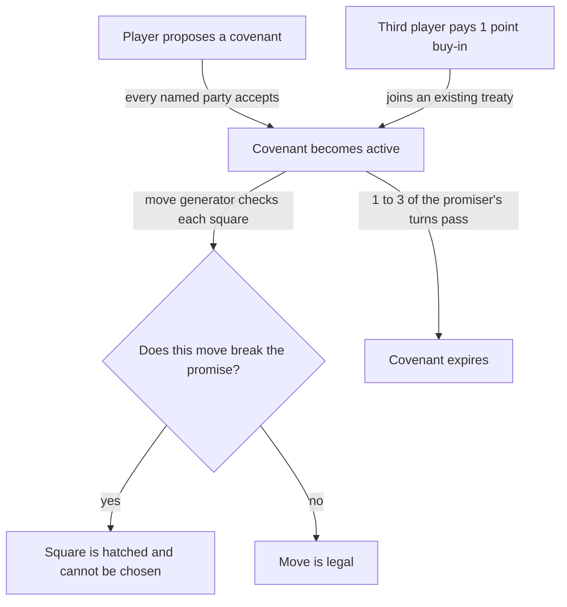
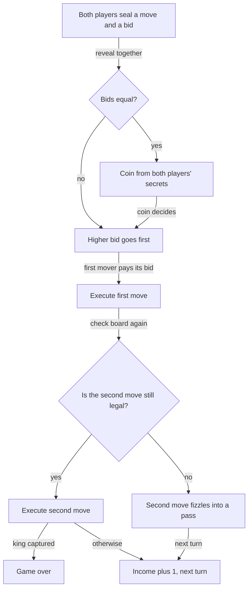
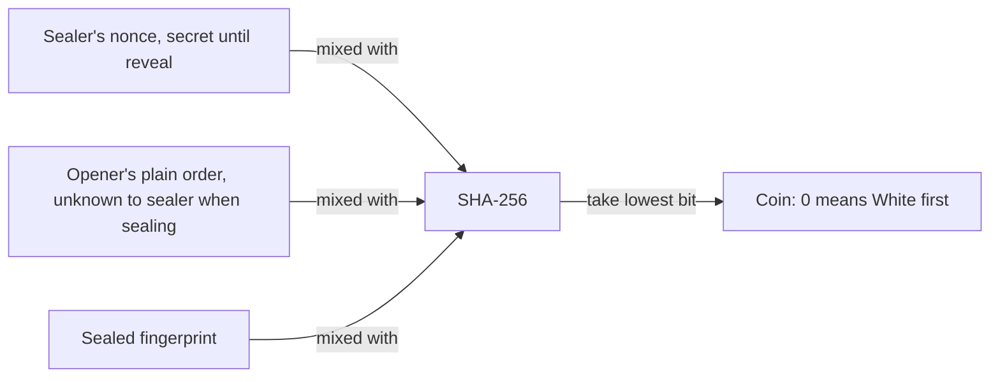
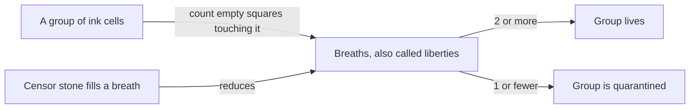
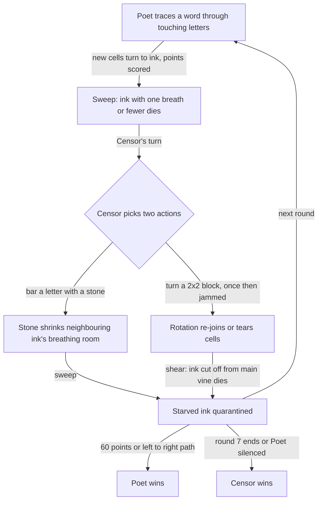
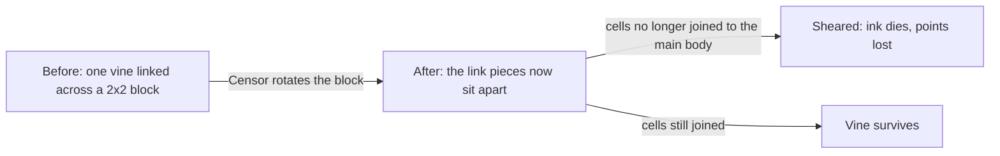

# Hybrid Board Games: a guide for people who know nothing about board-game theory or cryptography

*Three two-to-four-player games, each fused from older games, that run entirely in a web browser with no game server. How they work, why they are built that way, and what playtesting taught us.*

This guide covers `prototypes/hybrid-boardgames/`:

| Game | Parents | Players | How it connects | Look and feel |
| --- | --- | --- | --- | --- |
| **Cartel of Cartographers** | *Carcassonne* + *Tigris & Euphrates* + *Sidereal Confluence* | 3–4 | Peer-to-peer (WebRTC); one browser acts as host and deals | Gilded-Age railroad stock certificate |
| **Shadow Bidding** | Gardner's 5×5 minichess + *Modern Art* + *Diplomacy* | 2 | Secret moves sealed inside links, or live peer-to-peer | Venetian counting-house ledger |
| **Lexicon Quarantine** | *Boggle* + *Go* | 2, asymmetric roles | The whole history in the link, or live peer-to-peer | Samizdat typewriter zine |

You do not need to know what a "hash" or a "peer" is. We start from everyday pictures and add the technical names only after the idea is clear.

**How to read this guide.** Part 1 explains the shared machinery (how a game can have secrets without a server). Then each game has: the parent games from scratch, how the hybrid plays, and what the harness (the robot playtester) revealed. A glossary and a talk-through cheat sheet are at the end.

---

# Part 1. How serverless multiplayer works in a browser

## 1.1 What "no server" means, and why it is hard

Most online games work like a casino with a referee. Every player talks to a central **server**, which holds the real state of the game, knows everyone's secret cards, and decides what is legal. You can never see another player's hand because it simply is never sent to your computer.

These games deliberately have **no such referee**: no account service, no game server, no hosted database. The whole game is a web page, and the web page runs on *your* computer. That is wonderful for cost and privacy, but it creates a problem.

### Why you can't just hide a secret in a normal web page

A web page is a set of instructions that your browser downloads and runs. Anything your browser can use, **you** can look at. Tools built into every browser (the "developer tools") let you read the page's code and see every value it is holding in memory.

So imagine a game that says: *"My secret move is stored in the page, and I promise not to show it to my opponent."* Their browser has a copy of the same page. If the secret were in there, a determined opponent could dig it out. As the repository's earlier design notes put it bluntly: **if the browser can grade a move, the answer is in the browser.**

The games therefore solve secrecy **in how messages travel**, not by trying to hide things in the page. There are three different tactics, one per game:

| Game | How secrecy is handled |
| --- | --- |
| Shadow Bidding | A **cryptographic commitment**: you send a sealed fingerprint of your move now, and open it later |
| Cartel of Cartographers | A **host** who deals tiles privately and never shares the bag |
| Lexicon Quarantine | There is no secret at all: the whole board is public |

And one principle covers all three: **cheating is made visible, not impossible.** A serverless game cannot stop a determined cheater with a hacked browser. It can make tampering show up on the other player's screen as a broken seal or a mismatching fingerprint, which is the most any serverless game can honestly promise.

## 1.2 Commit-reveal: the locked box

### The everyday picture

You and a friend want to settle who picks the restaurant by each secretly choosing a number, then comparing. Problem: whoever speaks second can cheat by adjusting their number after hearing yours.

The fix: you each write your choice, **lock it in a box**, and hand the locked boxes over *before* anyone opens anything. Neither of you can change what is in your box now. Once both boxes are exchanged, you open them. Nobody could react to the other's choice, and nobody could change theirs. This is **commit-reveal**: *commit* (lock the box), then *reveal* (open it).

The computer version needs a "locked box" made of mathematics.

### A digital fingerprint: what a hash is

A **hash function** is a machine that takes any text and produces a short, fixed-length scramble called a **hash** (or **digest**, or fingerprint). The one used here is called **SHA-256**. It has four properties that matter:

1. **Same input → same output, always.** Feed it "attack at dawn" a million times, you get the same scramble.
2. **A tiny change → a totally different output.** "attack at dawn" and "attack at dusk" produce hashes that look completely unrelated.
3. **It only goes one way.** Given the scramble, there is no practical way to work backwards to the text.
4. **Different inputs almost never collide.** Two different texts will not accidentally produce the same fingerprint.

So a hash works like a locked glass box: you can show it to someone as a promise ("I have *a* secret and this is its fingerprint"), they can't read it, and you can't later claim your secret was something else, because a different secret would give a different fingerprint.

### The trap: when the box is too easy to guess

Suppose your move is chosen from fewer than a thousand legal options. An opponent could simply hash all thousand moves themselves and see which one matches your fingerprint. That is called **brute-forcing**, and with so few options it takes a blink.

The fix is a **nonce** ("number used once"): a long random number, 128 bits, that you mix into the text before hashing. Now the opponent would need to guess *the move and the nonce*, and the nonce has far more possibilities than there are atoms you could ever count. The nonce stays in your browser until you reveal. The test harness checks that the sealed link contains neither the move nor the nonce before the reveal.

*The three-link dance: seal with a fingerprint, answer in plain, reveal the move and nonce, and the opener recomputes the fingerprint to check.*

Mermaid source

### Why the secret travels inside a link

In Shadow Bidding's "stateless" mode, the entire match lives in a **URL**, the address you could paste into a chat. After the `#` sign (called the **fragment**), the address carries the full history of the game, a few bytes of cryptographic chaining, and at most one pending step. A 12-turn game fits in about 152 characters.

The fragment is chosen on purpose: a browser **never sends the part after `#` to a web server**. So no server or CDN (content delivery network) even sees the game. Players simply pass links to each other in whatever messaging app they like. It is like playing correspondence chess by post, where the postcard is the whole game.

Three links make one turn (the cost is real: roughly 75 exchanges for a 25-turn game, so this is slow, correspondence-style play):

1. **Link 1 (sealed).** The "sealer" picks a move and a bid, adds a nonce, and sends only the fingerprint.
2. **Link 2 (answered).** The "opener" sees the fingerprint, picks their own move **in plain**, and sends it back along with the fingerprint.
3. **Link 3 (revealed).** The sealer sends the move and nonce. The opener's browser recomputes the fingerprint. If it matches, the turn resolves. If not, a **broken seal** is shown on screen, side by side, and the verify button stays disabled.

The roles alternate every turn, so neither player is always the one who sees the other's move first.

### History that can't be quietly edited: the hash chain

The game history is protected by a **hash chain**: each turn's fingerprint is computed from the *previous* fingerprint plus that turn's data. Change anything in the past and every later fingerprint breaks. It's like a ledger where each page's seal depends on the previous page's seal. An edited link simply fails to open ("history chain broken").

An honest limit the notes record: the chain covers the **move history**, not the match header (starting settings), so those could be altered without the chain noticing.

### The one thing that cannot be prevented: walking away

The sealer, having committed, will learn the result before the opener does. A sealer who dislikes the outcome could simply never send Link 3. No protocol can force a person to send a message. The design handles this socially: Link 2 is, in effect, a signed record of what the opener played and what the sealer committed to, and the opener can show it. Alternating who seals makes the option symmetric rather than one player's advantage.

## 1.3 Peer-to-peer: WebRTC in plain English

Links are slow. For live play the games can instead connect browsers **directly to each other** using **WebRTC** (Web Real-Time Communication), the same technology behind in-browser video calls.

### The picture

Normally, to talk to a friend through a website, every message goes browser → server → friend's browser. In **peer-to-peer** (P2P), after a brief introduction, your browser talks straight to theirs.

The introduction needs a go-between: a small **matchmaker** (the "signalling" or "relay" service) that says "this browser wants room 42; here is how to reach it". After that handshake the matchmaker steps out of the way and the two browsers talk directly.

### Who is in charge? The host

Without a central referee, two browsers might disagree about what happened. The games use **host-authoritative replication**: one browser is the **host**. Guests send their **intent** ("I want to play this move"), and the host puts moves into one official order and broadcasts the result. Every browser then replays the same ordered log of events and arrives at the same board. Nobody ever sends a whole board, only events.

If a guest notices it missed an event (say, it jumps from event 6 to event 8), it sends **resync** and the host replies with a **snapshot**.

*A room: the matchmaker introduces guest and host, then the browsers talk directly; guests send intent, the host orders events, and a snapshot repairs gaps.*

Mermaid source

### Determinism: why replaying works

Every game's engine is a **pure function** of `(seed, ordered moves)`. That means: no clock, no ambient randomness, nothing hidden. Give two computers the same starting **seed** (a short text that starts a pseudo-random number generator) and the same ordered list of moves, and they will arrive at exactly the same game state, bit for bit. This is why a link containing a move history can be replayed on any device, and why host-and-guest never drift apart.

## 1.4 Playtesting by robot

Each game has a **harness** (`harness.mjs`): a script that makes bots play thousands of games under different rules and prints statistics. It treats the bots as probes, not as opponents. The question is never "who wins?" but **"does this rule change anything?"** One rule is switched off at a time (an **ablation**) and the results are compared.

That is how two silent failures were caught: a table of identical rows (a map where nothing ever merged) and a column of zeros (a capturing rule that never captured). If no bot ever exercises a rule, the rule has not been tested. You will see these findings in each section below.

---

# Game 1. Cartel of Cartographers

> **Say it in one breath.** *You and two or three rivals build a map together on a 7×7 grid. You don't own land; you own the **bosses** (directors) who run it, and you score whenever anyone lays a tile in a territory your boss rules. When someone's tile joins two territories, the rival bosses fight, the loser is fired, and you can sign binding promises that the software enforces by physically blocking moves that would break them.*

## 1A. The three parent games, from scratch

### Carcassonne: building a shared map

*Carcassonne* (Klaus-Jürgen Wrede, 2000) is a tile-laying game. On your turn you draw a square tile showing roads, fields and cities, and you place it so its edges match tiles already on the table. The map grows from the middle outward and **belongs to nobody**: all players build the same landscape. You also place one of your small wooden people (a "meeple") on a feature to claim it, and score when it is finished.

What Cartel borrows: **the shared, growing map** built from tiles, where every placement changes the landscape for everyone.

### Tigris & Euphrates: you own the bosses, not the land

*Tigris & Euphrates* (Reiner Knizia, 1997) turns the usual idea of ownership upside down. Players do **not** own territories. Instead:

- The board is a map of tiles in four colours, each colour a kind of thing (such as temples or farms).
- Each player has a few **leaders** (our "directors") in those colours. A leader sits in a kingdom and *represents its colour there*.
- **Your score comes from other people's tiles too.** When anybody places a tile of a colour into a kingdom, the owner of that kingdom's leader of that colour banks the point.
- When one tile **joins two kingdoms**, a **conflict** begins. The sides compare their strength and the loser's leader is removed from the board.
- The final score is based on your **weakest** colour, so you can't just pile everything into one thing.

This is the key idea for Cartel. In T&E, *a placement can be an attack* and *other people's tiles score for you*. The game is about politics and timing as much as building.

### Sidereal Confluence: promises are part of the game

*Sidereal Confluence* is a trading and negotiation game in which players, as alien species, constantly make deals: "I'll give you this resource now if you give me that one". Deals can be **binding** and are part of how the game is played. It's a game where **a promise is an object** with value, not just words.

What Cartel borrows: **making promises into game pieces**. Because the software can enforce them, a promise is not just talk.

### Why these three, together?

The design notes give a hard test: *"A hybrid earns its place only if removing one parent breaks the game."* Here is how it holds up:

- Remove T&E: the map is a solitaire, nobody can attack anybody.
- Remove the covenants: it is T&E on a free grid, noisy and brutal (8.6 directors unseated per game).
- Remove Carcassonne's free placement: *measured*, and nothing happens at all (more below).

The covenants only matter because a hostile merger is a real threat. Each parent holds up the others.

## 1B. How the game works

### The board and pieces

- A **7×7 map**.
- Four **commodities**: Coal, Timber, Cattle, Grain. Every tile shows one.
- A shared **bag** of 12 tiles per commodity, shuffled from a seed.
- A **hand** of 3 tiles per player; you draw one after each turn.
- Each player has **directors**, one per commodity, that they can seat on the board.

A group of touching tiles is a **realm** (a territory). A realm may contain at most **one director of each commodity**. A director sits on a tile of its own colour.

### A turn

On your turn you may **seat a director** (put one of your directors on a tile), and then **lay one tile** from your hand. Placement is free: any empty square is legal, and a tile by itself founds a new realm.

### Scoring: other people's tiles pay you

When *anyone* lays a tile of commodity *c* in a realm, **the owner of that realm's *c* director banks one point in *c***. Not the person who laid the tile. So laying a Timber tile in a realm where an opponent runs the Timber director scores *for them*. You are hoping to hold the directors that others will feed.

*Points flow to the director's owner, not the tile-layer; at the end you drop your single best pile and add the three weakest.*

Mermaid source

### The hostile merger (the corporate war)

Because the map is free-form, two realms can sit apart and then be joined when someone lays a tile that touches both. If both realms contain a director of the same commodity, that is a **hostile merger**:

1. Compare the number of tiles of that commodity in each realm (before the merger).
2. The realm with **more** wins. A tie goes to the **older** director.
3. The loser's director is **unseated**: removed and returned to its owner's reserve.
4. The winner's owner earns **+2 spoil points** in that commodity.
5. The realms fuse into one.

*A hostile merger: compare strength, the stronger director stays, the loser is unseated, and the winner banks two spoil points.*

Mermaid source

Notice the twist from T&E: the player who lays the connecting tile might be neither of the two combatants. A placement can be a weapon aimed at someone else, or a favour.

### Covenants: binding promises, enforced by the move generator

Players can sign **covenants**: short promises of a fixed form. There are three kinds, on purpose:

| Covenant | Plain meaning |
| --- | --- |
| **No-merge** | "I will not merge any realm holding *your* director." |
| **Embargo** | "I will not build beside *your* kingdoms." |
| **Feed** | "I will feed commodity *c* into *your* *c* realm", obliging me to lay tiles that score for you. |

They last 1–3 of the promiser's own turns, and each player may be bound by at most two. **A covenant exists only when everyone named has accepted the same offer**. Until then it is a proposal and filters nothing.

**How enforcement actually works.** The game doesn't ask you to remember your promise. It is a **filter on the list of legal moves**. When the engine produces the squares you may play, it removes any that would break one of your covenants and **hatches them on your own board**. You can see which squares your own promise has struck out; you simply cannot pick them. (The design notes say why this matters: *"a promise you cannot see is not a mechanic"*.)

So the protection your counterpart enjoys is real: the person who promised not to merge cannot do it, because the move does not exist for them.

Why only three templates? A free-text "promise anything" box can't be enforced by software. Three templates can: each is a precise yes/no test on `(game state, proposed move)`.

*From proposal to filter: a covenant needs every party's acceptance, then removes breaking moves from the promiser's legal list until it expires; a third party can buy in.*

Mermaid source

**The escape hatch.** Discarding a tile is never blocked, so you can always step out of a bind by paying a tile. The consequence the notes draw honestly: *a covenant's enforcement strength is the value of one tile placement, not infinity*. The harness found zero covenant deadlocks in 450 games for exactly this reason.

### The hidden bag: who deals?

Hands are secret. If the bag order were derived from a seed that every player knows, every player could compute every hand. So **the host deals**: tiles are sent already drawn, to the one player who draws them. The host's browser holds the bag; other players receive a move and a count, never a tile that isn't theirs. Nobody but the host holds the future. (The same pattern appears in the repository's *Azul* game.)

## 1C. What playtesting taught us

The notes record the failures plainly, with numbers. Each one changed a rule.

### Failure 1: "The map was one blob" → free placement

**First draft:** every tile had to touch an existing tile (like Carcassonne). **Result:** in the first harness run every row showed **0.0 mergers**, and all five rows came out identical. A single growing blob has nothing to merge, so the Tigris & Euphrates parent was dead on arrival.

**Fix:** placement is free. Now a game averages **7.8 hostile mergers and 8.6 directors unseated**, nearly every director on the board. Free placement is the spark that creates separate realms that can later collide.

### Failure 2: scores stuck near zero → count the *three* weakest

The T&E rule "your weakest colour counts" produced a final score of essentially **zero**. With four colours and about fifteen tiles each, the average lowest pile was **0.00**, so every game fell through to the tie-break. Counting the *two* weakest still averaged only **1.2** points.

Four fixes were tried, one at a time (120 games each, with a simple greedy bot):

| Rules | Average final score | Best seat | Spread (best vs worst seat) |
| --- | --- | --- | --- |
| First draft (hand 2, spoil 1, two weakest) | **1.2** | 2.8 | 2.7 |
| + hand of 3 | 1.2 | 3.0 | 2.9 |
| + hand 3, spoil 2 | 1.2 | 3.1 | 3.0 |
| + **three** weakest count (shipped) | **5.9** | 13.7 | 12.9 |

**The surprising lesson.** The bigger hand and the bigger spoil did essentially nothing for the average. The real problem wasn't that points were scarce. A player banks about **17 points a game**, but they pile them into one or two colours (the gap between a player's best and worst colour averages about 10). A rule that counts the two weakest colours sees almost none of that. Dropping *only* your single best colour and counting the other three sees most of it. **The scores were never sparse. They were concentrated.** Final averages now sit in a healthy 4–9 band with a wide spread, so games are decided rather than tied.

(A tiny scoring cartoon: the earlier rule is like grading a student by their two worst subjects when they have all their marks in one subject.)

### Failure 3: the treaty tax → the one-point buy-in

Pairwise covenants let two players protect each other and **expose the third**. In a measured table of two diplomats and one greedy player, the greedy seat won **50%** of games against 21% and 27%, with a final of 8.0 versus 5.0 and 4.7. The signers had removed their own options, while the non-signer paid nothing. Call this the **treaty tax**.

**Fix:** a **buy-in**. A third player may join an existing mutual treaty between two others by paying **1 point** (burned, taken from their lowest non-empty colour), provided both members have a covenant slot free. It makes the third player a party to the treaty, paying a real price, rather than a free-rider on the others' restraint.

**Measured result:** a bot that does nothing but buy in when threatened (it bought in 2.2 times a game) dropped from 50% to **40%** wins and a final of 5.8. The tax was **cut, not removed**: ten of fifty points came back. The notes say that a cheaper buy-in is the next thing to test, and note that some of the remainder is simply the seat effect, below.

### Failure 4: the leader runs away, and seat 1 wins too often

A hostile merger removes a director and pays the winner, so one early large realm can snowball. An early claim that the first seat had an advantage looked like an artefact of how wins were counted (the harness had binned wins by bot *kind*, not by seat). Counting by seat: **44% / 29% / 27%** for seats 1, 2 and 3 under shipped rules. A flat point handicap for later seats (+2/+4 or +3/+6) barely moved it (41% / 35% / 23%), because the first seat wins through **variance**, not a higher average: it is the only seat that can place a director before any realm exists. The notes mark this **open**: the fix needs to change the opening (such as a reverse-order director draft), not the total.

### Failure 5: peace is a legitimate outcome, but it is a different game

At a table where every player signs everything (all-diplomat), the game freezes: **16.2 treaties, 1.5 mergers, 0 directors unseated**, and the spread between best and worst seat shrinks from 12.9 to 3.5. That is not a bug, but it means covenants are strong enough that a table of cooperators plays a quieter, tighter game.

---

# Game 2. Shadow Bidding (Blind Auction Chess)

> **Say it in one breath.** *It's chess on a tiny 5×5 board where, every turn, both players secretly write down a move **and a bid**. Reveal together. The higher bid moves first and pays. What you're buying is not the move; it's **who lands first when the two moves collide**. On quiet turns, bid nothing.*

## 2A. The three parent games, from scratch

### Gardner 5×5 minichess

Chess on a full 8×8 board takes a long time. In 1969 the writer Martin Gardner described a small version on a **5×5** board, with fewer pieces, which plays fast and still feels like chess. Shadow Bidding uses a variant: no castling, no *en passant*, pawns that reach the far rank become queens, and importantly **there is no "check"**: a king can simply be captured, and capturing it wins. That keeps the rules compact enough to run in a sealed-message protocol where every turn costs real waiting time.

### Modern Art: the closed-fist auction

*Modern Art* (Reiner Knizia, 1992) is a game about running an art market. Among its auction styles is one where every bidder **secretly holds a hand of money in a closed fist**; everyone reveals simultaneously, and the highest bid wins. The thrill comes from guessing how much your rivals will pay when you can't see them.

What Shadow Bidding borrows: **sealed, simultaneous bids** and the poker-face guessing they produce.

### Diplomacy: everyone writes secret orders

*Diplomacy* (Allan B. Calhamer, 1959) is a famous strategy game with no dice. During each turn **all players write their orders in secret at the same time**, then orders are revealed and resolved together. Orders can conflict, and one player's move can bump another's.

What Shadow Bidding borrows: **simultaneous secret orders**, where moves can collide, so what matters is who "wins" the collision.

### Why these three, together?

- Remove Modern Art: it's chess with fizzles, effectively a coin flip on contested squares.
- Remove Diplomacy's simultaneity: the bid has nothing to resolve.
- Remove chess's board: the bid has no consequence.

All three are load-bearing; chess is the one you feel first.

## 2B. How the game works

### One turn, step by step

1. **Both players secretly write an order**: a move *and* a bid (a whole number of coins from 0 up to their treasury; or a pass).
2. **Reveal together.**
3. **The higher bid moves first** and **pays its bid** (to the rival, in the default "ledger" mode, or into a centre pot in the "pot" variant).
4. The other player's move is then **re-checked against the board the first move produced**. If their piece was captured, or their path is now blocked, their move **fizzles** and becomes a pass. Their bid was never paid.
5. If a king is captured, the game ends immediately and the second move is not executed.
6. Otherwise everyone gets **+1 coin income**; the treasury is capped at **9** (the vault limit), with overflow burned.

*One turn from sealed orders to income: bids decide who goes first, the first mover pays, the second move is re-validated and may fizzle.*

Mermaid source

Treasuries are public so that everyone can audit the money.

### The key idea: you aren't paying to move

This is the thing people get wrong at first. **The bid does not buy a move. Both players always get to *try* their move.** The bid buys the **order** in which the two moves happen: **initiative**.

Example. Suppose you want to capture a rook with your knight, and your opponent wants to move that same rook away. If *you* go first, you take the rook and their move fizzles (the piece is gone). If *they* go first, the rook has already left and your capture fizzles. The order is worth a whole rook. That is the kind of collision worth paying for.

Now suppose you are both just developing pieces in separate corners. Whichever goes first, both moves happen identically. The order is worth **nothing**, so the right bid is **0**. That is why the bid is "a poker face and not a tax": on quiet turns you spend nothing.

### The un-cheatable tie-break coin

If both bid the same, a coin decides who goes first. But whose coin? If one player could influence it, they could cheat.

A naive design would derive the coin from the sealer's own secret nonce. The trap: a sealer could **grind**: try nonce after nonce until the coin comes out in their favour. The shipped design mixes in the **other** player's information:

> coin = lowest bit of SHA-256(sealed fingerprint ‖ the opener's plain order ‖ the nonce)

The sealer picks their nonce without knowing what the opener will play. The opener plays without knowing the nonce. **Neither can steer the result**, because each controls only a part of it that they chose blind. The harness checks that changing *only* the opener's bid changes the coin stream, and White won the tie coin **48%** of 3,579 tie turns, which is statistically fair.

*The tie-break coin is a hash of three inputs, two of them secret from the other side at the time of choosing, so neither player can grind it.*

Mermaid source

### Link mode vs live mode

- **Link mode (commit-reveal over URLs):** three links per turn as in Part 1. Slow but needs no connection.
- **Live mode (peer-to-peer):** both sides send a `seal` first, then both `reveal`. Two round trips settle a turn instead of three links, and neither side can see the other's order before sealing. The host does not decide anything; it just orders messages.

The **link desk** on the page opens whatever link you paste, works out which of the four stages it is (seal, respond, reveal, verify) and offers exactly the one thing that link is waiting for. A broken seal is displayed, not played.

## 2C. What the math showed

### Initiative is worth more than money (for bots that don't think)

A bot called **Greedy** never bids. A bot called **All-in** bids its entire treasury every turn. All-in beats Greedy **100–0**. A one-coin bid beats any zero-bidder, so against a naive player the game is over on move one. The interesting game only exists between players who *model each other's bids*.

A smarter bot, the **Economist**, predicts its rival's move, simulates both orderings, and bids what going first is worth. It beats Greedy 100–0 and All-in **66–35**. In an Economist mirror only **36%** of turns involve a payment, and a game moves a total of just **3.4 coins**. The economy is thin. The notes are careful: they do not claim the sealed bid is deep for *human* players.

### Does the money snowball?

In the default ledger mode, bids are transfers, so wealth could pile up in the winner. Without a vault limit the peak treasury reached **22.9** coins; with the limit of 9, **9.0**. And yet the **win rate did not move**, because the bots bid only the minimum to win the order. The cap stays as insurance against human hoarding, not as a measured necessity.

### Ledger vs pot

In "pot" mode every bid goes to a centre pot taken by the next player to capture a piece, so a bid becomes a bet on capturing. Games shrink from **16.4 to 10.4 turns**, and kings are captured in **94%** of games versus **71%**. Pot makes captures explosive; ledger is the default.

### The Equilibrium Evaluator: pricing what going first was worth

After every turn, the page prints something like: *"Going first on this turn was worth +X material; the equilibrium bid mix was [lo..hi] coins. You bid b, they bid c."* plus a verdict. Here is what that means from scratch.

**A payoff matrix.** Imagine a table: rows are all the (move, bid) choices White could have written, columns are all of Black's. Each cell holds how many points of material White gains in that combination, once orders are revealed and resolved. It's a **zero-sum** game: what White gains, Black loses.

**Equilibrium.** In a guessing game like rock-paper-scissors, there's no single best choice; the best you can do is *mix*, choosing randomly with certain frequencies so the opponent can't exploit you. For rock-paper-scissors that's one third each. The mix that nobody can improve on is an **equilibrium**.

**Fictitious play.** The evaluator finds it by a simple trick: both sides repeatedly pick the best reply to the other's *history*. After many rounds, the frequencies converge to the equilibrium mix. (Checked in the harness: matching pennies converges to 50/50, rock-paper-scissors to thirds.) The whole solve takes 10–30 milliseconds, so it runs after every turn.

**What "worth" means.** For the two moves actually played, `value(you first) − value(they first)`. On a quiet opening, that is 0 and the equilibrium bid is 0. On a collision, it can be large.

**The verdict** compares your bid with the best bid *in hindsight* against what your rival actually sent:

| Verdict | Meaning |
| --- | --- |
| **sharp** | Nothing better was available (bidding 0 on a quiet turn counts) |
| **overpaid** | You paid more than the order was worth, or more than needed |
| **underbid** | A higher bid would have won an order worth more than it cost |

**What it revealed (24 games a row, both seats analysed every turn):**

| Pairing | Going first matters (≥ 0.5) | Decides the game | Equilibrium bid on those turns |
| --- | --- | --- | --- |
| Economist mirror | 35% | 9% | 4.3 coins |
| Economist vs Greedy | 30% | 6% | 3.6 coins |
| All-in vs Economist | 31% | 6% | 0.9 (All-in has already spent its purse) |

So the bid is **a real decision on about a third of turns and a ritual on the other two thirds**. On collision turns, equilibrium wants about four coins, but the Economist pays far less, so it underbids about a quarter of the time and never overpays. The earlier "the economy is thin" conclusion was upgraded: *it is thin because the bots underbid, not because there's nothing to bid for.*

One big assumption: each coin is counted as **0.5 material**. On a rook-for-rook collision (worth 10) the equilibrium bid is the whole purse at 0.15 material per coin and collapses to **1 coin** at 1.5. *The price of going first is only as high as the price you put on money.* The page says so under its bars.

**Limits the notes admit:** the evaluator looks one move ahead and values only material, so it can't see a bid that buys a pin or a king-side attack. "Overpaid" is a statement about this turn's material only.

---

# Game 3. Lexicon Quarantine

> **Say it in one breath.** *A 7×7 grid of letters. The **Poet** traces words and each word spreads violet ink; the ink must grow from what's already there, left to right across the page. The **Censor** drops black stones and rotates 2×2 blocks to starve and sever the ink. Ink with no room to breathe, or cut off from the main vine, dies.*

## 3A. The two parent games, from scratch

### Boggle: tracing words through a letter grid

In *Boggle* (Allan Turoff, popularised by Parker Brothers in 1972) a grid of lettered cubes is shaken, and players race to find words by tracing **chains of touching letters**, going in any direction including diagonally, never using the same cube twice in one word. Longer words are worth more.

What Lexicon borrows: the **Poet's verb**. Your action is tracing a word through connected cells, and the word is simultaneously a **score** and a **shape** on the board.

### Go: surrounding groups and taking away their breathing spaces

*Go* is an ancient board game played on a grid with black and white stones. The rules that matter here:

- Stones of one colour that touch **up/down/left/right** (not diagonally) form a **group**.
- The empty points directly adjacent to a group are its **liberties**, informally its *breaths*.
- If a group's liberties are all filled in by the opponent, the group is **captured** and removed.

So the heart of Go is a battle over breathing space: *surround to suffocate*.

What Lexicon borrows: the **Censor's verb**. Stones that fill breaths and starve ink.

*The Go idea in one picture: count the empty squares touching a group; fewer than two and the group is quarantined.*

Mermaid source

### The weld

Boggle sets the Poet's verb; Go sets the Censor's. They meet on the same 49 cells, which is the point: **a word is simultaneously a score and a group with air.** The game's own "anchor" rule (below) is what fuses the two, and it exists in neither parent.

## 3B. How the asymmetric battle works

The two players have **different roles with different rules**, which is called an **asymmetric** game. (Chess is symmetric: both sides have the same pieces. Here the roles are totally different.)

### The Poet

- Traces a word of 3–6 letters through **touching** cells (diagonals count; no cell twice in one word) from a 3,199-word dictionary.
- Every **new** cell the word passes through becomes **violet ink**. The Poet scores the letters' values (common letters 1, middling 2, rare 3) plus a **length bonus** of `2 × (length − 3)`.
- **The anchor rule.** After the first word, every new word must pass through at least one already-inked cell. A poem **grows from itself like a vine**. It can't pop up randomly elsewhere.
- **Ink groups connect orthogonally** (up/down/left/right only), even though *words* trace diagonally. This difference is the crack the Censor exploits: a word is a chain of diagonal joints, and diagonal joints do not count as connections for the ink groups.
- **Poet wins** at **60 points**, or by inking a connected path from the **left edge to the right edge**.

### The Censor

Has **two actions a round**:

1. **Bar** an un-inked letter with a stone (a black rectangle that blocks it).
2. **Turn** any 2×2 block a quarter-turn clockwise. This costs one of the two actions, and the turn then **jams** for a round: at most one turn per round and then a cooldown.

**Censor wins** if the Poet has no legal word at the start of a round (silenced), or when round **7** passes.

### The air floor (the Go layer)

- An ink group with **one breath or fewer** is **quarantined**: the cells die and their points go.
- A stone group with none is lifted.
- Poet suicide: a word that leaves its own new ink at or under the floor is illegal, exactly as in Go.

Sweeps happen in a fixed order so everything is deterministic: after a Censor action, **shear (turns only), then ink, then stones**. After a Poet word: stones only, then the suicide check on the new ink.

*One round: the Poet's word and sweep, then the Censor's two actions (stone or rotation) and sweep, until a win condition triggers.*

Mermaid source

### The rotation and the shear: how a turn becomes a weapon

When the Censor rotates a 2×2 block, cells swap places. If that **tears ink that was part of the main body away from it**, the torn ink **dies and its points vanish**. This is called **shear**.

The **main body** is the biggest orthogonally connected ink group (ties broken by more points, then lowest cell index). A turn doesn't need any breath to be low. It just needs a joint in the poem, and Boggle poems are made of joints.

*Shear: after a rotation, ink no longer joined to the main body dies and its points are lost.*

Mermaid source

For the Censor's comfort, the page **hatches the cells a turn would cut** as the pointer moves over the block. For the Poet, loose ink is drawn with a dashed outline.

## 3C. What playtesting taught us

### Failure 1: it was a Poet's game

With 12 rounds and a target of 30, the Poet won **100%** and finished in two rounds against all three early Censor bots (random, hunter, scrambler). Even a one-ply "denial" Censor, which takes whichever stone or turn most reduces the Poet's best word, did no better.

### Failure 2: the Go layer never fired

Under the first rules the Poet lost only **0.1 cells of ink per game** to encirclement even against a Censor hunting the weakest group. A Boggle word is a chain of diagonals, so it inks small orthogonal groups with three or four breaths each. **Nobody was playing Go.** The notes call this the exact failure the repository warns about: *"the novelty is decoration"*.

Two changes (measured against the Denier Censor, 60 seeds):

| Rules | Poet wins | Ink quarantined per game |
| --- | --- | --- |
| v1: no anchor, no air floor | **92%** | 0.1 |
| + anchor only | 58% | 0.3 |
| + air floor of 1 | **50%** | 1.7 |
| air floor of 2 | 28% | 5.2 |

The **anchor** is what makes Go relevant. A Poet who must keep passing through existing ink cannot sprawl, so its groups have a frontier the Censor can squeeze. The **air floor** makes the squeeze lethal at one breath instead of none, so the Censor no longer needs to surround; it needs to *threaten*. A floor of 2 is brutal (28%) and not the default.

### Failure 3: the rotation was useless, until it was made to cut

The first rotation moved letters, ink and stones together, so it changed *who sat next to whom* and nothing else. The harness ran the same match with and without it: **50% both ways** against the Denier. The Scrambler Censor (which rotates) did five points *worse* than the stone-only Hunter. The verb was decoration.

(The ablation itself was caught leaking: `rotCool: 99` still allowed one free turn on round 0, so it never was a true stone-only Censor. It was fixed so that `rotCool ≥ 99` removes the verb entirely.)

The redesign: **a turn cuts.** Ink in the block that was part of the main body and no longer is, dies. Measured one switch at a time (Careful Poet vs Denier, 60 seeds, seven rounds):

| Turn behaviour | Poet wins | Cells sheared / game |
| --- | --- | --- |
| Rotation removed entirely | **78%** | 0 |
| Moves things, as in the first draft | 72% | 0 |
| **Cuts ink it severs from the body (shipped)** | **43%** | 3.9 |
| Kills all ink in the block outside the body | 25% | 6.0 |
| Shipped, but no jam (turn every round) | 13% | 6.7 |

And the cleanest one-line proof, with the same Poet and the same seeds, rotation on versus off (120 seeds):

| Censor | Poet win rate, rotation removed → on | What the turn is worth |
| --- | --- | --- |
| Denier vs Careful Poet | **83% → 41%** | about **43 ± 11** percentage points |
| Scrambler vs Careful Poet | 96% → 71% | about 25 ± 9 points |

That is the headline result: **before the shear rule, rotation changed nothing; afterward it moves the Poet's win rate from 83% to 41%.** The harness fails the build if the lower end of that gap is not above zero.

The two stronger variants are not the default because they are too strong. Seven rounds (not six) was needed once turns cut, because at six rounds the Poet won only 27% and the verb alone swung the match.

### Failure 4: a Poet that knows about shear still doesn't escape

A "Wary Poet" bot counts ink outside the main body as a liability. It did no better: **41%** against the Denier, the same as the Careful Poet, and 10 points *worse* against the Scrambler (within noise). Avoiding loose ink costs about what it saves. The notes are honest that a **human** might do better, which is why the page hatches loose ink and previews the cut.

### Open problems

- **The crossing win dominates.** About 25% of *all* games end with a poem that crosses the page, which is roughly three Poet wins in five, so the 60-point target is the minor road. The second win condition is much easier than the first.
- **Skill range is lopsided.** Against a random Censor the careful Poet wins 100%; against the Denier 43%. A greedy Poet versus the Denier wins only 23%. The Censor's skill range (100% → 43%) is far wider than the Poet's, so **the Poet is the beginner's seat and the Censor is the expert's**. The notes call this a feature when named, and the page says it in its role switch.
- **No hidden information.** The whole position is public. Lexicon needs no commit-reveal; the history is the whole state, and in link mode it is just `seed + moves`, replayable by anyone. "Undo" is simply not sending the link.

---

# Part 4. What the three games share

| | Cartel of Cartographers | Shadow Bidding | Lexicon Quarantine |
| --- | --- | --- | --- |
| **Secret information** | Hands and bag (host deals) | Orders (commit-reveal) | None |
| **Connection** | Peer-to-peer, host-authoritative | Links, or peer-to-peer | Links, or peer-to-peer |
| **Core hybrid trick** | Other people's tiles score for you, plus enforceable promises | You bid for the *order* of collision, not the move | A word is a score and a group with air |
| **Biggest early failure** | Map was one blob (0 mergers) | Naive tie coin could be ground | Go layer and rotation both did nothing |
| **The fix** | Free placement; count 3 weakest; 1-point buy-in | Mix both players' inputs in the coin | Anchor rule; air floor; shear on rotation |
| **Headline number** | Average final 1.2 → 5.9 | White wins 48% of ties | Poet wins 83% → 41% |

**Shared principles from the design notes:**

1. The engine is a **pure function of `(seed, ordered moves)`**: no clock, no ambient randomness.
2. **Secrecy is solved by how things travel**, not by hiding things in the page.
3. **Cheating is detected, not prevented.**
4. **A hybrid earns its place only if removing one parent breaks the game.**
5. **A rule that no bot can exercise is a rule nobody has tested.**

---

# Glossary

| Term | Meaning |
| --- | --- |
| **Ablation** | Testing by switching one rule off and comparing |
| **Anchor rule** | After the first word, every Poet word must pass through existing ink |
| **Asymmetric game** | Players have different roles and rules |
| **Bag / hand** | The face-down supply of tiles / the tiles you hold |
| **Commit-reveal** | Lock a choice now, open it later, so nobody can change it |
| **Covenant** | A binding promise the software enforces by removing breaking moves |
| **Director** | Cartel's piece that represents one commodity in one realm (T&E's "leader") |
| **Equilibrium** | A mix of choices no player can profitably deviate from |
| **Fictitious play** | Both sides repeatedly best-reply to the other's history until frequencies settle |
| **Fizzle** | A second move that is illegal after the first resolves, becoming a pass |
| **Fragment (`#`)** | The part of a URL a browser never sends to a server |
| **Hash / SHA-256** | A one-way fingerprint function |
| **Hash chain** | Each fingerprint depends on the previous one, so history can't be edited |
| **Host-authoritative** | One browser orders all events; guests send intent |
| **Initiative** | Who gets to act first when two actions collide |
| **Liberty / breath / air** | An empty square touching a group |
| **Minichess** | Chess on a small board (here 5×5) |
| **Nonce** | A one-time random number mixed into a hash |
| **P2P / WebRTC** | Browsers talking directly to each other |
| **Realm** | A connected group of tiles in Cartel |
| **Seed** | A text label that starts a repeatable pseudo-random sequence |
| **Shear** | Ink cut off from the main body by a rotation dies |
| **Spoil** | Two bonus points for winning a hostile merger |
| **Treaty tax** | The advantage a non-signer gets from others' self-restraint |
| **Zero-sum** | One player's gain is exactly the other's loss |

---

# Cheat sheet: explaining each game out loud

**How do secrets work without a server? (30 seconds).** *"You lock your choice in a digital box: a fingerprint of it, plus a long random number so nobody can guess it. You send only the fingerprint. Later you open the box and your opponent re-computes the fingerprint to check you didn't change your mind. All of that rides inside a web link, so no server ever sees it. For live play the browsers talk directly to each other and one of them acts as referee."*

**Cartel of Cartographers (30 seconds).** *"You build a map together, but you don't own land. You own the bosses, and whenever anyone lays a tile in a territory you boss, you score. If a tile joins two territories, the bosses fight and the loser is fired. You can sign promises the software enforces by greying out illegal squares. We learned the map has to allow free placement or nothing ever fights, and that counting your three weakest colours fixed a scoring problem we'd misdiagnosed."*

**Shadow Bidding (30 seconds).** *"Mini chess where both players secretly write a move and a bid. Higher bid goes first. You're not buying the move, you're buying who lands first if the moves collide. On quiet turns the right bid is zero. The tie-break coin is built from both players' secrets so nobody can rig it, and after each turn a little maths engine tells you what going first was actually worth."*

**Lexicon Quarantine (30 seconds).** *"One player, the Poet, traces words on a letter grid and spreads ink from left to right. The other, the Censor, drops stones and rotates blocks to starve or cut off the ink. Our robot testers showed that rotation was useless until we made it cut disconnected ink, which moved the Poet's win rate from 83% to 41%."*
