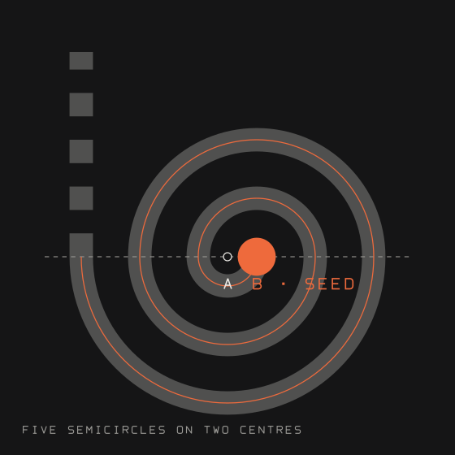
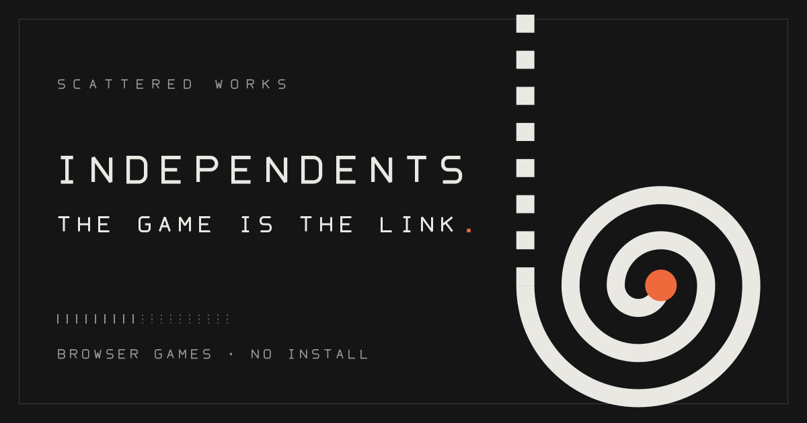
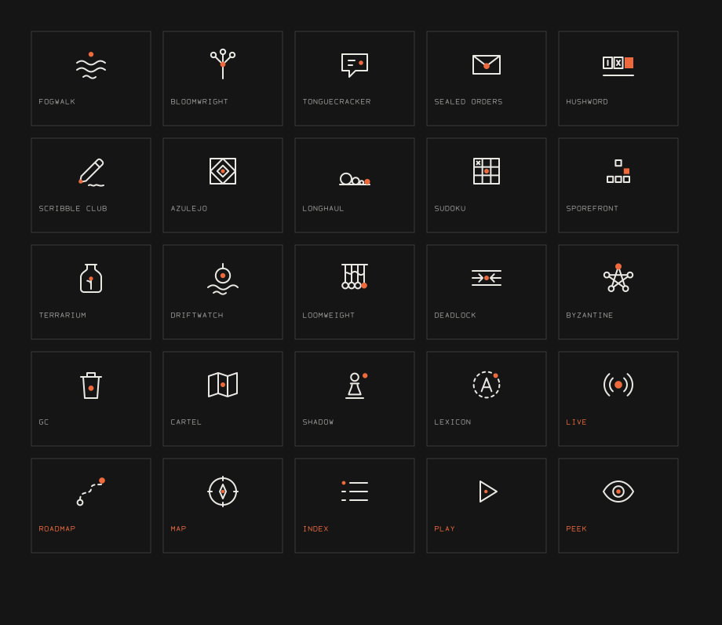

# 05 · Brand and icon system

The identity for **INDEPENDENTS**: what it says, how it looks, and how every mark is built. Everything below is generated by one script, [`brand/build.cjs`](../root-explorer-minimal/brand/build.cjs), and wired into [`root-explorer-minimal/index.html`](../root-explorer-minimal/index.html).

```
node prototypes/root-explorer-minimal/brand/build.cjs     # rewrites every SVG and the inline sprite
node prototypes/root-explorer-minimal/verify.cjs          # 102 certificates, incl. the brand section [9]
```

## 1. Strategy: what the brand is for

Independents is a shelf of small games that each hold a strange rule. The things that make it different are also the brand:

| Truth about the product | What the brand does with it |
|---|---|
| A game is a link. Some carry their whole state in the address. | The headline says so: **The game is the link.** |
| Nothing sits between you and the play: no store, no account, no install. | Voice is short and declarative. No marketing verbs. |
| The work is scattered and independent, not a platform. | A single hairline thread connects things; nothing is boxed in a "product" frame. |
| Some games are live, some are in the workshop. | The thread is **solid while LIVE and dashed once it is ROADMAP**. The same rule drives the logo, the page and the icons. |

Personality: a record-shop sleeve, a field notebook, a lab bench. Matte, quiet, one hot colour used sparingly. If a mark is loud, it is wrong.

## 2. The hero title and copy

**Chosen**

> # The game is *the link.*
> Odd little worlds with rules of their own, folded into a web address. Open a link and you are already playing, with no install and no account.

Why it works:

- It names the real mechanism of the product (a game that lives in a URL) instead of counting things or describing a format.
- It is short enough to set at 56px in two lines (`The game is` / **`the link.`** in ember).
- It contains **no number and no "record" talk**. The 09 / 10 counts live only on the LIVE and ROADMAP buttons, where they are data, not a pitch. `verify.cjs` fails if a digit or a number word, or `record`, `disc`, `lp`, `side a`, `side b`, ever appears in the headline, lede, eyebrow, `<title>` or meta description.
- Eyebrow: `BROWSER GAMES · NO INSTALL`. `<title>`: `Independents — the game is the link`.

### Five alternative directions

Each pair obeys the same rules (no numbers, nothing about a record, nothing about "sides"). To swap one in, edit **four** strings in `index.html` (`<title>`, `meta[name=description]` / `og:title`, the `#cover h1`, the `#cover .lede`) and mirror them in `SITE` in `content.js`; keep the `<em>` on the second half of the headline for the ember accent. Update the regex in `verify.cjs` section [4] (`/^The game is the\slink\.$/`) to the new headline.

| # | Headline | Sub-copy | Reads as |
|---|---|---|---|
| A | **Open a link. *Meet a rule.*** | Small worlds that play by their own logic, kept inside a web address. Nothing to download, nobody to sign you up. | Instruction. The most playful of the set; good if the page should feel like a game already. |
| B | **Nothing between you *and the play.*** | Every game opens the moment you click it. No store, no sign-up, no waiting room. Just a strange little rule and your move. | Promise. The most literal and the most "product". |
| C | **Strange rules, *a click away.*** | Self-contained games that fit in a browser tab and a single sentence. Pick a plate and begin. | Invitation. Safest wording; least distinctive. |
| D | **Small worlds, *loose on the web.*** | Scattered works from an independent studio of odd ideas. Some are ready to play. The rest are being built in the open. | Atmosphere. Leans into "scattered works" and the workshop idea. |
| E | **Somebody's strange idea, *running in your tab.*** | These games keep their whole world inside a link, so they travel by message and start in a blink. | Voice. The most human, longest headline: it needs a smaller headline size. |

Copy rules: second person, present tense, one claim per sentence, no exclamation marks, no "revolutionary / seamless / powerful", no engineering words (the `BANNED` list in `verify.cjs` still applies page-wide).

## 3. The crest: the Rising Spiral



The page is a spiral that never stops climbing, so the logo is that spiral, reduced to the least geometry that still reads.



**Geometry** (all in a 64 × 64 grid; `d` = 4):

- Two centres, **A** at `(-d, 0)` and **B** at `(0, 0)` relative to the seed. B *is* the seed.
- Five semicircles of radius `d, 2d, 3d, 4d, 5d`, alternating centre A, B, A, B, A. Each arc ends exactly on the far end of the previous diameter, so the line is continuous and the turns are an even `2d = 8` apart.
- Line weight `0.8d = 3.2`, so each gap (4.8) is wider than the line. Butt caps, round joins.
- The seed is an ember disc of radius `2.6` (`0.65d`) sitting on centre B.
- The fifth arc ends heading straight up. The thread leaves through a **dashed tail** of length `7d = 28`, dashes and gaps equal to the line weight. Solid is LIVE, dashed is ROADMAP.
- The drawing is 40 × 48, centred in the 64 grid (12 px margin left and right, 8 px top and bottom).

**Scales**

| Use | File | Notes |
|---|---|---|
| 512 px hero, print, social | `logo-mark.svg` | the full mark |
| Header (28 px) | `<use href="#i-mark">` | `currentColor` for the thread, `var(--acc)` for the seed; it turns a quarter turn on hover |
| 16 to 64 px tab icon | `favicon.svg` | 32 grid, charcoal tile with a chalk hairline, **three** arcs (`d = 3.4`), heavier `3.0` line, shorter tail, seed `2.3`, so the turns survive at 16 px |


**Clear space and minimum size.** Keep a margin of `d × 2` (8 units in the 64 grid) clear on every side. Never go below 14 px, and below 24 px use the favicon geometry. Do not recolour the seed, outline the line, add a drop shadow, rotate it past the hover quarter turn, or place it on anything lighter than mid grey.

## 4. The wordmark and the lockup


The wordmark is **drawn**, not typed, so it never depends on an installed font. Twelve monoline capitals on one 12 × 16 cell, stroke 2, butt caps, with the corners of C, D, G, O, Q, S and U rounded at radius 3 to 4 (every plate on the spiral is a rounded rectangle). Tracking is `+8` cell units, so the letters stand 20 units apart: a deliberately wide, label-printer spacing. Acute joins (A, M, N, V, W) are bevelled (`miterlimit 1.6`) so they do not spike.

Lockup: the 64 px crest, a 32 px gap, then the wordmark at scale 1.5 (cap height 24), optically centred on the crest. The full alphabet (A to Z plus `- / · .`) lives in `build.cjs` as `G`, and also draws every label in the icon sheet and the poster.

## 5. The poster



`brand-poster.svg` (and the rasterised `brand-poster.png`, which `og:image` points at) is 1200 × 630: matte `#151516`, a hairline frame inset 28, the wordmark at scale 2.6, the tagline in chalk with an ember full stop, a row of tick marks (nine solid, ten dashed, the page's own rail), and the crest at 8.4× bleeding off the top edge on its dashed tail. All lettering is drawn paths. `og:image` is a relative URL; make it absolute at deploy time.

Re-export the PNG after changing the poster:

```
node -e "const p=require('playwright');(async()=>{const b=await p.chromium.launch(),g=await b.newPage({viewport:{width:1200,height:630}});await g.goto('file://'+process.cwd()+'/prototypes/root-explorer-minimal/brand/brand-poster.svg');await g.screenshot({path:'prototypes/root-explorer-minimal/brand/brand-poster.png'});await b.close()})()"
```

## 6. The icon system: 25 monoline emblems



**Rules.** 24 × 24 grid, **1 px** line (`stroke-width="1"`), round caps and joins, no fills except the ember mark, content kept inside a 2 px safe margin, and **exactly one ember mark per icon** (a `.ac` element) as the single point of life. `.o` is a charcoal fill used only to knock a line out behind a node. Colour comes from `currentColor`, so an icon turns ember on hover, chalk on a card, mute in a footer.

**Use.** `<svg class="ic"><use href="#i-fogwalk"/></svg>` with the sprite inlined once at the top of `<body>`. Size with `.ic` (20 px default; 30 px on the card title; 22 px in index rows). `icons.svg` carries the same 26 symbols for use outside the page.

### The 19 project emblems

Ids follow the track slug in `content.js`; three tracks carry an explicit `icon` (`pictionary` is `scribble-club`, `azul` is `azulejo`, `boards` is `sudoku`).

| Icon id | Game | The idea | Ember mark |
|---|---|---|---|
| `fogwalk` | Fogwalk | three bands of fog, one walker above | the walker |
| `bloomwright` | Bloomwright | a stem that forks into three, the rule | the fork |
| `tonguecracker` | Tonguecracker | a speech bubble holding unknown glyphs | a letter dot |
| `sealed-orders` | Sealed Orders | an envelope, flap closed | the wax seal |
| `hushword` | Hushword | letter boxes, one blacked out | the redacted box |
| `scribble-club` | Scribble Club | a pencil and its scribble | the lead |
| `azulejo` | Azulejo | a tile, a diamond in a diamond | the tile centre |
| `longhaul` | Long Haul | a shrinking pile of stones on a floor | the hauler |
| `sudoku` | Sudoku & Tic-Tac-Toe | a grid with one cross in it | the chosen cell |
| `sporefront` | Sporefront | a glider on a cell grid | the newest spore |
| `terrarium` | Terrarium Hash | a jar and a sprout | the bud |
| `driftwatch` | Driftwatch | a bathysphere on a tether over waves | the porthole |
| `loomweight` | Loomweight | warp threads, weft, four hanging weights | the heavy weight |
| `deadlock` | Deadlock | two trains nose to nose on two rails | the standoff |
| `byzantine` | Byzantine Choir | five towers in a pentagram | the liar |
| `gc` | Garbage Collector | a bin | the one object kept |
| `cartel` | Cartel of Cartographers | a folded map | the capital |
| `shadow` | Shadow Bidding | a pawn | the bid |
| `lexicon` | Lexicon Quarantine | a letter inside a dashed wall | the breach |

### The 6 UI and status icons

| Icon id | Where it appears | Drawn as |
|---|---|---|
| `live` | LIVE switch and cover button, card badge, index heading | an ember dot with two broadcast arcs each side |
| `roadmap` | ROADMAP switch and cover button, card badge, index heading | a dashed route from a hollow start to an ember destination |
| `map` | MAP button | a compass ring with a needle |
| `index` | INDEX button | a list with leaders |
| `play` | the open button on a LIVE card | a play triangle |
| `peek` | the open button on a ROADMAP card | an eye |

## 7. Where each mark lives on the page

| Surface | Mark |
|---|---|
| Browser tab | `favicon.svg`, via `<link rel="icon" type="image/svg+xml" href="brand/favicon.svg">` |
| Header, left | the crest (`#i-mark`, 28 px) before the letter-spaced `INDEPENDENTS` |
| Header, right | `live` / `roadmap` in the switch; `map` and `index` before their labels |
| Cover | `live` / `roadmap` at the head of each of the two buttons |
| Liner card | project emblem beside the title, `live` / `roadmap` badge top right, `play` / `peek` inside the open button |
| Index sheet | `live` / `roadmap` section headings, and each of the 19 rows begins with its own emblem |
| Share image | `brand-poster.png` through `og:image` |

### The cover buttons

LIVE and ROADMAP share **one parent grid**, `.sidebtns`, and each `.sideBtn` is a `subgrid` of it:

```
[20px icon] [max-content label] [max-content count] [6px dot] [1fr caption] [18px arrow]
```

Because the columns belong to the parent, `09` and `10` are tabular, right-aligned in the same column and share a left and right edge to within a sub-pixel (the label column is as wide as `ROADMAP`, so `LIVE` leaves air before its count). Hover only changes colour and nudges the arrow; it never shifts the row, which would break the column. `verify.cjs` measures this on desktop and on the 390 × 844 phone.

## 8. Colour and type

| Role | Value | Rule |
|---|---|---|
| Charcoal | `#151516` | the page, the tile, every background. Matte, never pure black |
| Chalk | `#EAE8E3` | all primary lines, headline, wordmark |
| Mute | `#9C9B97` | captions, labels, ROADMAP ticks |
| Ember | `#EE6A3C` | **one accent per surface**: the seed, the headline's second half, the live dot, the current tick. Never a large fill, never a background |

The four are the only colours any brand SVG may contain (`verify.cjs` greps the files). The per-project plate colours (`look` in `content.js`) belong to the plates, not to the identity.

Type: **IBM Plex Mono** (500, 600, 700), with Space Mono and system monospace as fallbacks. Headline 600, sentence case, tight tracking (`-0.01em`). Everything that behaves like a label is UPPERCASE with open tracking: `.24em` on controls, `.36em` on eyebrows, `.62em` on the wordmark in the header. Hairlines are 1 px at 18% and 38% chalk. Corners are small (2 to 3 px) or fully round; nothing in between.

## 9. Brand architecture


*One soul, one build script: the crest, copy and icons all come from the same idea, and `build.cjs` writes every file.* Source: [`diagrams/brand.mmd`](../root-explorer-minimal/diagrams/brand.mmd), rendered with ondine:

```
cd prototypes/root-explorer-minimal && npx ondine@0.0.3 diagrams/brand.mmd
```

## 10. Checklist before shipping a change

1. `node prototypes/root-explorer-minimal/brand/build.cjs` and commit the generated files.
2. `node prototypes/root-explorer-minimal/verify.cjs` is green: no number in the hero, LIVE / ROADMAP only, `09` and `10` aligned, the favicon wired and loading, 26 symbols, every `<use>` resolving, zero console errors.
3. New game? Add an entry to `ICONS` in `build.cjs` (24 grid, 1 px, one `.ac`), add `icon` to its track only if the slug differs, rebuild, and update the `26` and `19` counts in `verify.cjs` section [9].
