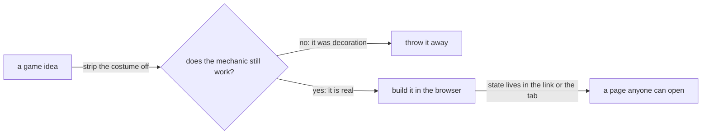
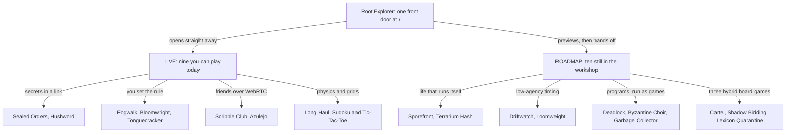

# The Independents Guides

*A friendly, start-from-nothing tour of nineteen small browser games, and of the ideas hiding inside each one.*

You do not need to know how to code. You do not need to know what a "cellular automaton" or a "hash" is. You do not even need to like games very much. These guides assume you know **nothing** and then, one patient step at a time, build up to the interesting parts. Whenever a new word appears, it gets explained the moment it shows up, in everyday language, usually with a picture or a comparison to something you already know.

If you ever feel lost, that is a bug in the guide, not in you.

---

## 1. What is "independents"?

`independents` is a collection of small, self-contained games that all run **inside a web browser tab**. You open a link and you are playing. There is nothing to install, no account to create, and no company's computer sitting in the middle keeping score.

That last part is the whole point, so let us slow down on it.

### Why "no server" is a design superpower

Most online games work like a restaurant. You (the customer) sit at a table, and every decision you make is carried to a kitchen (the **server**), which cooks the result and sends it back. The kitchen is run by someone else. It costs money to keep open, it can close, it can be hacked, it can change its rules, and it knows everything you did.

The games in this collection work more like a **board game in a box**. Everything needed to play is already in your hands the moment the page loads. The "kitchen" is your own browser.

That sounds like a limitation. It is actually a source of creativity, because it forces some clever questions:

| If there is no server... | ...then the game has to answer |
| --- | --- |
| Who remembers the game between sessions? | **The link does.** A web address can carry a whole puzzle, a whole garden, or a whole duel inside it. |
| Who stops me from cheating in a two-player game? | **Mathematics does.** A "sealed" move, locked with a cryptographic fingerprint, can be proved honest later without anyone refereeing. |
| Who makes sure two people see the same thing? | **Determinism does.** If two computers follow exactly the same rules from exactly the same starting number, they land on exactly the same result. No one has to send the result across. |
| Who pays the bills? | **Nobody**, because there are no bills. A page that is just files can sit on the internet more or less forever. |

So "browser only" is not a corner we were backed into. It is a *constraint we chose on purpose*, the way a poet chooses a sonnet, because constraints make ideas sharper. Almost every clever trick in these guides (the 40-character garden, the sealed move, the replayable duel) exists *because* there was no server to lean on.


*The one test every idea in this collection had to pass before it was built.*

<details><summary>Mermaid source</summary>



</details>

### "If the mechanic survives removing the theme, it was never the mechanic"

This sentence appears in the project notes, and it is the closest thing the collection has to a motto. Here it is in plain English.

Every game has two layers:

- **The costume (the theme).** Pirates. Wizards. A Japanese weaving shop. An ocean. Space. This is what the game *looks and sounds like*.
- **The skeleton (the mechanic).** The actual rule that makes decisions interesting. "You can only act at certain moments." "You can't see the whole board." "Both players choose at the same time in secret."

A weak game idea is *all costume*. Imagine a chess variant where the pieces are called "quantum particles" but they still move exactly like chess pieces. Remove the word "quantum" and nothing changes. The novelty was paint.

A strong idea passes the **costume test**: imagine peeling the theme off completely. Does the skeleton still stand up on its own and still make you think? If yes, the theme is a bonus, a nice coat on a sturdy body. If no, the idea was never really an idea, just a coat on a coat hanger.

You will see this test applied again and again in the later guides. When a loom weaves your mistakes into cloth, that is not decoration; the cloth *is* the score. When a garden's whole recipe fits in a link, that is not a gimmick; the link *is* the save file.

---

## 2. A few words you will meet often

Here is a small glossary. You can skip it and come back, because every guide re-explains these as it goes.

- **Browser-only / no backend.** Everything happens on your own device. Nothing is sent to a game company to be processed.
- **Prototype.** A working demonstration of an idea, built to test whether it is fun and sound before it becomes a polished product. In this collection, "LIVE" games are finished apps; "ROADMAP" games are playable prototypes still in the workshop.
- **URL / link / address.** The text at the top of your browser, such as `https://example.com/page`.
- **URL fragment.** The optional last chunk of an address, after a `#` sign: `https://example.com/page#this-part`. Here is the neat trick: **the browser never sends the fragment to any server.** It stays on your device. That makes it a perfect, private backpack for a game to carry its state in.
- **Deterministic.** "Always gives the same answer from the same starting point." A recipe is deterministic: same ingredients, same steps, same cake. A coin flip is not.
- **Seed.** A starting number that makes a deterministic process unfold in one specific way. Different seed, different (but repeatable) world.
- **Hash.** A fingerprint for data. You feed in anything (a word, a book, a game move) and out comes a short jumble like `9f86d081...`. Change even one letter of the input and the fingerprint changes completely; and you cannot work backwards from the fingerprint to the input. **SHA-256** is one very trusted way of making such a fingerprint.
- **Commit and reveal.** Sealing a secret choice in an envelope (the commit) and opening it later (the reveal). A hash is what makes the envelope tamper-proof.
- **Peer-to-peer / WebRTC.** Two browsers talking to each other directly, like a phone call, instead of via a middleman.
- **SVG.** A picture made of shapes and text instead of pixels. It stays crisp at any size. All diagrams in these guides are SVG.

---

## 3. The map of all nineteen

Nineteen projects live in this collection. Nine are **LIVE**: finished, playable apps. Ten are on the **ROADMAP**: playable prototypes, each answering a design question. The numbers below are the same numbers you see on the front page.


*The whole collection at a glance: one front door, two groups, and the families of ideas inside them.*

<details><summary>Mermaid source</summary>



</details>

| # | Game | Family | One-line idea | Status |
| --- | --- | --- | --- | --- |
| 01 | Fogwalk | Rules and search | A maze where you never know exactly where you are | LIVE |
| 02 | Bloomwright | Rules and search | You write the rule a plant grows by, not the plant | LIVE |
| 03 | Tonguecracker | Rules and search | A brand-new language, invented fresh every round | LIVE |
| 04 | Sealed Orders | Secrets in a link | Three secret moves, locked inside a link | LIVE |
| 05 | Hushword | Secrets in a link | A word game where some clues are blacked out | LIVE |
| 06 | Scribble Club | Friends online | Draw it, they guess it | LIVE |
| 07 | Azulejo | Friends online | Lay tiles, build the wall | LIVE |
| 08 | Long Haul | Physics | Eat the stones, then dump them behind you | LIVE, arriving soon |
| 09 | Sudoku & Tic-Tac-Toe | Grids | One grid that solves itself, one grid inside a grid | LIVE |
| 10 | Sporefront | Living systems | Scatter spores and watch a living board decide | ROADMAP |
| 11 | Terrarium Hash | Living systems | A glass garden whose recipe lives in its web address | ROADMAP |
| 12 | Driftwatch | Low-agency timing | Ride the ocean current with a single valve | ROADMAP |
| 13 | Loomweight | Low-agency timing | Keep a loom weaving in time; you never steer it | ROADMAP |
| 14 | Deadlock | Programs as games | Keep the trains from waiting on each other forever | ROADMAP |
| 15 | Byzantine Choir | Programs as games | A line of signal towers, and a few of them lie | ROADMAP |
| 16 | Garbage Collector | Programs as games | Tidy a messy memory before the pause clock runs out | ROADMAP |
| 17 | Cartel of Cartographers | Hybrid board games | Draw the realms, sign the treaties, break them | ROADMAP |
| 18 | Shadow Bidding | Hybrid board games | Chess where you bid for the right to move first | ROADMAP |
| 19 | Lexicon Quarantine | Hybrid board games | Words against walls | ROADMAP |

*Long Haul is finished but has not landed on the main branch yet, so its button on the front page says "arriving soon".*

---

## 4. The guides

Each guide is written to be read on its own, but they are happiest in order. Every diagram is a small picture with a caption, and the text underneath each one always explains the picture in words, so you never have to decode a diagram alone. If you are curious how a diagram is made, open the **Mermaid source** fold under it.

| Guide | What it teaches | Games it covers |
| --- | --- | --- |
| [00. The Front Door](00-landing-page-designs.md) | How the home page was designed, three times; how a 3D spiral works; how a page hands you off to a game | The Root Explorer (the page at `/`) |
| [01. Life Ecologies](01-life-ecologies.md) | Cellular automata from absolute scratch; why raw Life is not a game; how to tame it; a garden saved in a link | Sporefront (10), Terrarium Hash (11) |
| [02. Submissive Systems](02-submissive-systems.md) | Why one button can be a deep game; ocean currents; looms and rhythm | Driftwatch (12), Loomweight (13) |
| [03. Live CS Formalisms](03-cs-formalisms.md) | The ways running software goes wrong, explained from scratch: deadlock, byzantine failure and garbage collection | Deadlock (14), Byzantine Choir (15), Garbage Collector (16) |
| [04. Hybrid Board Games](04-hybrid-boardgames.md) | Three two-to-four-player games fused from older games, with secret choices kept honest by cryptography | Cartel of Cartographers (17), Shadow Bidding (18), Lexicon Quarantine (19) |
| [05. Brand and Icon System](05-brand-and-icon-system.md) | The identity for INDEPENDENTS: the copy, the mark, the palette and the icon set, all generated by one build script | The whole collection (the front door) |

**Still to come** (the same format, the same patient pace):

- *Secrets and Seals*: commit-reveal, hashing, and fair play without a referee (Sealed Orders, Hushword).
- *Rules You Write*: grammars, plants and belief states (Fogwalk, Bloomwright, Tonguecracker).
- *Friends and Boards*: peer-to-peer play and the remaining tabletop designs (Scribble Club, Azulejo, Sudoku & Tic-Tac-Toe, Long Haul).

---

## 5. How to read a guide

Every guide follows the same gentle shape.

1. **The one-sentence version.** What this is, in one line.
2. **From scratch.** Any background idea you need (what is a current? what is a loom?) is built up from everyday life first.
3. **The problem.** Every good design starts as an annoyance. We name it.
4. **The fix.** The clever idea that answers the annoyance.
5. **Why it works.** The underlying principle, so you can spot it elsewhere.
6. **A small glossary** of any new words.

And a promise about numbers: when a number shows up (a 64 by 64 grid, a 640 millisecond beat), it is there because it is *real*, taken from the design notes the game was built from. If you want to go deeper, each project's `ARCHITECTURE.md` file holds the full engineering detail.

---

## 6. Where everything lives

```text
apps/                     the nine finished games, each fully independent
prototypes/               the ten roadmap games and the front door
  root-explorer/          front door, version two: the Fish Night spectral ocean
  root-explorer-minimal/  front door, version three: the rising spiral
  life-ecologies/         Sporefront and Terrarium Hash
  submissive-systems/     Driftwatch and Loomweight
  cs-formalisms/          Deadlock, Byzantine Choir, Garbage Collector
  hybrid-boardgames/      Cartel, Shadow Bidding, Lexicon Quarantine
  guides/                 you are here
docs/                     the original design notes and philosophy
```

Happy reading. Start with **[the front door](00-landing-page-designs.md)** if you like pictures and buildings, or jump to **[Life Ecologies](01-life-ecologies.md)** if you want to watch something come alive.
