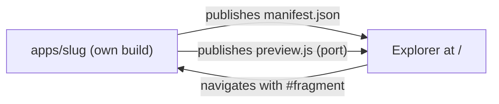
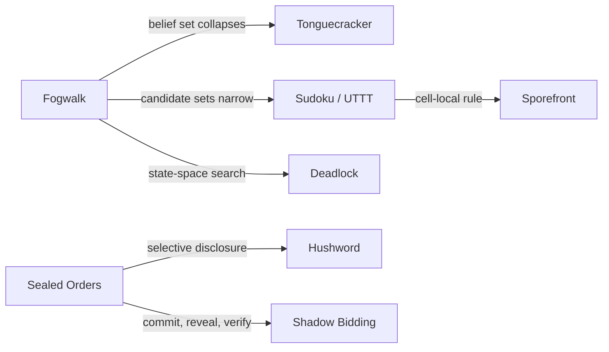
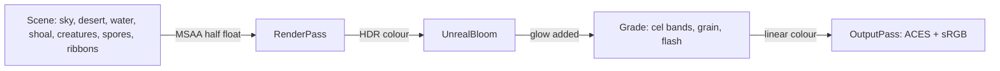
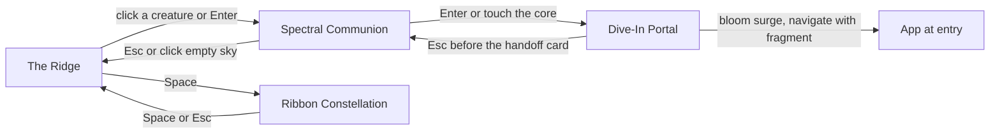

# Root Explorer — architecture

Status: design + interactive mock (`index.html` in this folder). Nothing here is wired
into `apps/*`. The mock contains in-file stand-ins for the pieces described below so the
contract can be felt before it is built.

**The visual rebuild.** The first mock was a drafting table of plinths and boxes. It is
replaced by the **Fish Night Spectral Ocean**: a flooded desert at night, a lone watcher on a
dune, and above them a colossal vortex of thousands of bioluminescent fish. Each of the nineteen
games is a large translucent X-ray creature swimming the currents; its glowing organ is the game's
own deterministic session. Everything in §1 (the site contract), §3 (manifest, port, handoff),
§4 (falsifiable lineage) and §6 (the ten games) is unchanged by the rebuild. Sections §2 and §5
below are new.

Run the mock: `python3 -m http.server -d prototypes/root-explorer 8080`, open
`http://localhost:8080`. It needs network once, for the three.js import map (jsDelivr, pinned
`three@0.170.0`, including the post-processing addons) and for two Google Fonts (Anton and Barlow
Condensed, with system fallbacks). The shipped version vendors both, see §7.


## 1. Where it lives, and what it may not do

The Root Explorer is the site at `/`. It is not an app. It sits beside `apps/`, not inside
it:

```
/
├── index.html              the Explorer (static, no build)
├── explorer/               ES modules + vendored three (see §7)
├── catalog.json            ["fogwalk", "bloomwright", …]  one slug per line, hand-edited
├── proposals/              <slug>.manifest.json for games that do not exist yet
├── scripts/lint-manifests.mjs   plain Node, no dependencies
└── apps/<slug>/            untouched; each keeps its own package.json, lockfile, build
    └── independents.manifest.json   ← the only new file an app owes the root
```

Three rules keep the repository's philosophy intact (README: "no shared framework, no
monorepo tooling, no build orchestration"):

1. **Apps never import from the Explorer, and the Explorer never imports from an app.**
   The only coupling is data (a manifest) and one optional, self-built ES module (the
   preview port, §3). If you delete `/` every app still runs.
2. **The Explorer has no build step.** `index.html` plus ES modules, served as-is. There
   is no `package.json` at the root, so there is nothing to install and nothing for
   `pnpm` to orchestrate.
3. **The Explorer is a progressive enhancement over a link list.** Every game is a real
   `<a href>` in the DOM before any WebGL starts (the `#atlas` list, reachable with Tab).
   Middle-click, no-JS, no-WebGL, screen readers, and `prefers-reduced-motion` all work
   because the night sky is a second view of the same list, not the only way in.

How the apps reach the user is a deploy decision the manifest hides behind one field,
`entry`:

| Mode | `entry` value | Trade-off |
| --- | --- | --- |
| **A. Independent deploys** (default) | absolute URL of the app's own deployment | No coupling at deploy time, matches today's per-app `vercel.json`. Dive-in is a top-level navigation; the handoff survives it because it lives in the URL fragment. Needs `Access-Control-Allow-Origin: *` on the manifest and preview module. |
| **B. One assembled site** | `/apps/<slug>/` | One origin, so previews load without CORS. Costs a copy step: build each app, copy its `dist/` into `site/apps/<slug>/`. That is assembly, not orchestration, but it is the only place the repo would run every app's build. Do it only if a single domain matters. |

The Explorer's runtime is identical in both modes.


*Caption: apps expose data and one module upward; the Explorer reads them; nothing flows
down into an app except a URL fragment.*

<details><summary>Mermaid source</summary>



</details>

## 2. Why a night sky, and what it must not lie about

The old critique still stands (the concept's weaknesses, and the fixes, are in the git history of
this file). What changes is the metaphor, and the new one has three honesty rules:

| Risk | Why it bites here | Rule adopted |
| --- | --- | --- |
| **Decoration posing as state.** A school of fish is beautiful and means nothing. | CONCEPTS.md: "if the mechanic survives removing the theme, it was never the mechanic." The same holds for the front door. | The **shoal is scenery and says so**: it is the sky. A game is only ever a *creature*, and a creature's organ changes only when its port changes. |
| **Beauty as the bottleneck.** Nineteen hand-modelled marine animals is an art-asset treadmill. | Games arrive in batches. | Creatures are **procedural**: nine species, each a few dozen lines of geometry, one shader family. Game #20 picks a species and ships a manifest and a port. |
| **Spectacle as the only door.** A vortex is a bad menu. | Discoverability, search, keyboard, links, battery. | The `#atlas` link list, `/` search, deep links (`/#a=fogwalk`, `/#ribbons`), `[` `]` stepping, a `prefers-reduced-motion` path, and a static list when WebGL is absent. |

### 2.1 The five families, as colours of light

The mechanism key now chooses a creature's light, not a row of a grid. The four fish colours of the
reference are the family colours; the fifth is a periwinkle so lockstep stays distinct.

| Key | Light | Hex |
| --- | --- | --- |
| `seal` | electric cyan | `#24F0E8` |
| `p2p` | crimson coral | `#FF3358` |
| `automata` | warm amber | `#FF9B3E` |
| `cellular` | venom emerald | `#5BFF62` |
| `lockstep` | periwinkle | `#7C8CFF` |


## 3. The pattern: Manifest, Port, Handoff

A small zero-dependency contract. Three artifacts per app, one of them mandatory.

### 3.1 `independents.manifest.json` (mandatory, static facts)

```json
{
  "manifest": 1,
  "slug": "fogwalk",
  "name": "Fogwalk",
  "tagline": "Plan a path without knowing where you are.",
  "status": "shipped",
  "entry": "https://fogwalk.example/",
  "mechanism": { "primary": "automata", "tags": ["belief-set", "synchronizing-word"] },
  "network": "none",
  "formal": [{ "name": "Synchronizing word", "cite": "Černý 1964" }],
  "look": { "accent": "#7fe0d0", "projection": "grid" },
  "preview": { "module": "./independents.preview.js", "protocol": 1, "seed": 7 },
  "handoff": { "param": "s", "accepts": ["seed", "state"] },
  "lineage": [
    { "to": "tonguecracker", "via": "automata",
      "note": "Both collapse a set of hypotheses with evidence.",
      "evidence": ["apps/fogwalk/src/…", "apps/tonguecracker/src/…"] }
  ]
}
```

* `status`: `shipped | incoming | prototype | proposal`. A `prototype` is a game that has a
  runnable page next to the Explorer (the ten new games, under `prototypes/`) and gets a live
  port plus a Dive In that really navigates. A `proposal` has no code; it lives in
  `proposals/` and renders as a dormant, stilled silhouette. The mock currently has none: the ten games
  that started life as placeholder bays are all real prototypes now (section 6).
* `mechanism.primary` is one of five keys (below). `tags` are free text. Primary is
  mandatory so a creature's light can be chosen; tags are what the ribbons can use when the
  five-way split is a poor fit (Sudoku / Ultimate TTT is the honest example: its primary
  is `cellular` because rules are cell-local and consequences global, which is a stretch,
  and the tags say so).
* `network`: `none | link | webrtc`. Shown as a chip so a visitor knows what a game
  touches before opening it.
* `lineage` edges are declared by the app the idea flows *from*. An edge exists if either
  end declares it; both slugs must exist.

The five mechanism keys, with their colours in the mock:

| Key | Family | Shipped / incoming | New prototypes (live ports) |
| --- | --- | --- | --- |
| `seal` | Commit-Reveal Crypto | Sealed Orders, Hushword | Byzantine Choir, Shadow Bidding |
| `p2p` | WebRTC P2P | Scribble Club, Azulejo | Cartel of Cartographers |
| `automata` | Automata / Grammars | Fogwalk, Bloomwright, Tonguecracker | Deadlock, Garbage Collector |
| `lockstep` | 60 Hz Fixed-Point Sim | Long Haul / Ballast (not yet on `main`) | Driftwatch, Loomweight |
| `cellular` | Cellular / Emergent | Sudoku / Ultimate TTT | Sporefront, Terrarium Hash, Lexicon Quarantine |

Hushword is filed under `seal` because its link carries the secret and the contract, and
selective redaction is the same shape as Merkle disclosure. Long Haul / Ballast is not on
`main`; its port is written from `apps/longhaul` and `docs/BALLAST.md` in the author's
working tree, and the entry is marked *incoming*.

A game's row is the mechanism that decides it, not the full tag list. Byzantine Choir is
tagged `automata` and `crypto` but sits in `seal` because its whole question is whether
peers can be made to agree despite lies, which is what commitments exist to prevent.
Lexicon Quarantine is tagged `automata` and `link` but sits in `cellular` because Go
liberties are the textbook cell-local rule with a global consequence. The tags keep the
other readings, so the lineage graph still draws both edges.

### 3.2 `independents.preview.js` (optional, the "Port")

A **headless, deterministic session** built by the app's *own* build into one ES module
(for example a second Vite lib entry beside the app, `pnpm build:preview`). It re-exports
the app's real engine, not a reimplementation, so the artifact cannot drift from the
game. Hard limits, enforced by the linter:

* ≤ 24 KB gzipped, ESM, no external imports, no DOM, no `Date`, no `Math.random`.
* Pure function of `(seed, action tape)`.

```ts
export const protocol = 1;
export function create(seed: number): Session;

interface Session {
  actions: { id: string; label: string; key?: string; arg?: "int" | "uv" }[];
  do(id: string, arg?: unknown): Event[];   // pure transition, returns what changed
  tick?(): void;                            // only lockstep ports: one 1/60 s step
  snapshot(): Json;                         // canonical state, projection-shaped
  hash(): string;                           // 8 hex of SHA-256(canonical JSON)
  readout(): [label: string, value: string][];
  fragment(): string;                       // base64url state for the handoff
}
```

Why this shape:

* **The HUD is generated from `actions`.** The Explorer draws buttons and key hints from
  the declaration, so micro-controls cost the app nothing.
* **Determinism is checkable.** The Explorer (and CI) replays a recorded tape into a
  fresh session and compares `hash()`. The mock runs this self-test at load for all nineteen
  ports and shows the result in the spec drawer.
* **The Explorer owns pixels.** A port returns numbers in a projection (a set of cells, a
  rewrite string, a list of ints). The painter maps them to a canvas, the organ shader to light. A port never touches
  three.js, so the Explorer can change renderer without touching any app. (This rebuild is the proof: the
  renderer went from a table of plinths to a vortex of fish and not one port changed.)
* **Safety and cost.** The final version runs ports in a module `Worker` created from a
  blob URL, so a slow or buggy engine cannot hitch the 3D frame, and the Worker inherits
  the page's CSP (`connect-src 'self'` plus the catalog origins). Ports load lazily, only
  on the first communion with that creature. Failure leaves the creature dormant, never
  broken.

Lockstep ports are the strongest case. A 60 Hz fixed-point sim stepped by the Explorer's
accumulator is the same sim the game runs, so what you see move in the organ is what the
game computes. Every port ships a pure `DRAW(ctx, view, w, h, t)` painter and a `pick(u, v)` that turns a
click on the painted canvas into an action. The canvas is the creature's **organ** (§5). `DRAW`
reads a view and keeps no state, so it cannot change a game outcome. The ten newer ports carry
their own painter and `pick`; the nine that began as 3D toys got the same pair in the Explorer
(`DRAW.fog`, `DRAW.sealed`, … and a `PICK` table) so that all nineteen share one organ pipeline.

Idle behaviour is part of the port, not the painter. After 300 ticks (5 s) with no `do()`, each
new port starts an autopilot that is itself a pure function of the tick count (a lookahead
bot for Sporefront, the BFS solver for Driftwatch, the "Skinner" bot from `BALLAST.md` for
Long Haul), so the organ is alive without a visitor and the self-test still replays
byte-identically. Any `do()` resets the idle counter and stops it.

### 3.3 Handoff (state crosses the portal in the URL fragment)

Diving in (through the creature's glowing core) is a navigation to `entry + "#from=root&v=1&s=<fragment>&h=<hash8>"`. For the
ten prototype pages the entry already has a route fragment, so the handoff is appended with
`&`: `../life-ecologies/index.html#sporefront&from=root&v=1&h=<hash8>`, plus `&s=<fragment>`
when the page can restore it. Sporefront and Terrarium Hash can (their ports emit the page's
own `s1r.` / `t1p.` links), so Dive In reopens the exact plate or case; the other eight just
open at the right game.

* The **fragment** is never sent to a server, which matches the repo's no-backend rule,
  and it survives cross-origin navigation (mode A).
* `s` is `session.fragment()`: the state the visitor reached in the organ. A game that
  declares `handoff.accepts` may restore it (the Fogwalk belief set, the Bloomwright
  grammar, the Hushword contract). A game that ignores it loses nothing.
* `h` lets the app verify the state before trusting it, since a fragment is user input.
  Apps must treat the payload as untrusted and validate it with their own engine.
* Return path: the app may link back to `/#fogwalk`, which reopens the communion with the
  same seed. No cookies, no storage keys shared across origins.

## 4. The Constellation, made falsifiable


*Caption: one slice of the graph. Arrow means "the idea flows to"; the label is the shared
formal object.*

<details><summary>Mermaid source</summary>



</details>

* **Edge = (from, to, via, note, evidence).** `via` is one of the five mechanism keys, so
  the ribbon's third strand takes that colour. Cross-family edges are the interesting ones and get
  extra brightness.
* **Linter** (`scripts/lint-manifests.mjs`, plain Node): every slug in `catalog.json`
  resolves, every `to` exists, every edge has a note ≤ 140 characters and at least one
  evidence path that exists on disk, and every port is within budget and replays
  deterministically. CI failure beats a stale graph.
* **Layout.** There is no force layout any more: the creatures live where the vortex puts them
  (§5, a Vogel spiral of rigidly rotating orbits), and the ribbons go to wherever the two
  creatures happen to be. Same catalog gives the same sky at the same time, so screenshots are stable.
* **Proposals** would be unborn creatures: a dim, stilled silhouette with dashed ribbons (none in the
  mock now; the ten original bays became real games). The graph still answers "what should be
  built next": any proposal with edges into two or more shipped families is a good candidate.
* Ribbons draw on from `from` to `to`, and the light pulse along them runs the same way. That
  pulse is one of the few animations that is not driven by a session; it carries meaning
  (direction of influence), so it is allowed. The shoal itself is scenery and is honest about it:
  nothing in it claims to be a game.

## 5. The Fish Night Spectral Ocean


*Caption: every layer of the night is drawn into one half-float target, glowed, graded, then
tone-mapped; the arrows are the data handed between passes.*

<details><summary>Mermaid source</summary>



</details>

### 5.1 The set

| Layer | How it is made | Notes |
| --- | --- | --- |
| **Sky dome** | One GLSL sphere that follows the camera (`gl_Position.z = w`). Ultramarine gradient, bands that spiral around the eye of the vortex (`sin(angle·5 + log(r)·7.5 − t)`), hash-cell stars, a stepped palette. | The sky function is shared with the water, so the water mirrors the same swirl. |
| **Desert** | A 230×150 height grid from a deterministic value-noise `terrainH(x, z)`. Fragment: three flat cel bands from a sky-ward light, engraved contour hatching (`fract(height·2.1 + noise)`), aerial haze toward the horizon blue, near ground sinking to silhouette. | Layout: a bench the camera stands on, a flooded plain with islands, a knoll for the watcher, an island for the station, dark foreground shoulders. |
| **Water** | A transparent plane at `y = 0`. Fragment mirrors `skyCol(reflect(V, ripple normal))`, adds hard glints along the vortex axis, a banded stripe, Fresnel alpha. | No depth texture, so no shoreline foam; the islands carry the horizon. |
| **The watcher and the station** | Capsule and sphere silhouettes in near-black with a thin luminous back-face rim. The watcher's head tilts with your gaze. | Pure scenery. The station's window and mast beacon are the only warm lights on the ground. |
| **The shoal** | One `InstancedMesh` of 4 400 fish (2 600 on phones). Every per-fish attribute is static; position, heading, roll, size and fin wiggle are computed in the vertex shader from `uTime` (§5.2). | Cyan, crimson, amber and emerald in a 34 / 24 / 22 / 20 split; 36 hero fish at 5.4 units. |
| **Currents** | 2 400 hairline streaks (`LineSegments`, 10 segments each) on the same flow law, trailing the same streams, additive. | These are Image 3's thousand strokes. |
| **Spores** | An 1 800-slot ring buffer of additive points. Emitters: the hand's trail, the fin tips of every creature (slow), and the selected creature (fast). | CPU-stepped, one `Points` draw. |
| **Creatures** | Nineteen groups of hull, bones, organ, membrane, heart (§5.3). | The only things that are *games*. |
| **Ribbons** | One mesh of 28 edges × 3 strands × 84 segments; the curve is evaluated in the vertex shader from a `uPos[19]` array of creature positions. | §5.5. |

### 5.2 The current

Each fish is a point on a logarithmic-spiral funnel. With `u ∈ [0, 1)` from rim to eye:

```
r(u)  = R1 · exp(−L · u),           L = ln(R1 / R0)
θ(u)  = arm + spin · t + K · L · u
pos   = C + U · r cosθ + V · r sinθ + N · ( −depth · (1 − (r/R1)^0.7) )
u     = fract(u0 + t · rate · speed)
```

`C, U, V, N` are the vortex frame: `N` points at the ridge, so the funnel opens toward the
watcher and its eye is far away (Image 3). Five arms, a lateral jitter per fish and a small depth
spread give the thick braided streams. Because `u` is linear in `ln r`, fish speed up toward the
rim and bunch near the eye, so the glow concentrates where the sky is brightest. Heading is the
finite difference `pos(u + 0.006) − pos(u)`, so it follows the flow and bends around obstacles.

**The hand in the current.** Moving the pointer makes a screen-space cone around the pointer ray
(angular radius 0.115 rad on the ridge, 0.07 in communion). Inside it, fish are pushed to the cone's
rim and swirled about the ray, and glow and grow (`inf²` falloff). Hold `Shift` (or the right button)
and the sign flips: the cone pulls fish in. The same function is applied to the heading sample, so
the school visibly parts and curls. The hand also drops red and cyan **spores** that trail the
cursor.

**Parting around a creature.** In communion a sphere centred between the camera and the creature
(radius 0.64 of the distance) projects every fish inside it onto its surface, so the school flows
around the creature and the camera sits in a clear bubble. Fish within 26 units of the camera shrink
to nothing for the same reason.

### 5.3 A spectral creature

Nine species, all authored at unit length with the head toward `+x` and the flank in the XY plane
facing the viewer:

| Species | Games | How it is built |
| --- | --- | --- |
| Armored fish (placoderm) | Sudoku / Ultimate TTT, Byzantine Choir | Plated tube, three fins, forked tail |
| Manta ray | Scribble Club, Driftwatch | Flat tube whose wings spread in the picture plane; wings flap toward the viewer |
| Nautilus | Sealed Orders, Shadow Bidding | A logarithmic-spiral shell tube; fourteen trailing tentacle tubes |
| Plesiosaur | Long Haul / Ballast, Cartel of Cartographers | One long S-neck tube, four paddles |
| Jellyfish | Hushword, Terrarium Hash | Lathe bell, oral arms and twenty tentacles; pulses |
| Angler | Tonguecracker, Garbage Collector | Bulb body, jaw polygons, a glowing lure on a stalk |
| Sea-serpent | Fogwalk, Loomweight, Lexicon Quarantine | A 1.0-long tube with a bulge where the organ sits, dorsal frill |
| Crinoid | Bloomwright, Sporefront | Stalk, calyx, ten feathered arms |
| Trilobite | Azulejo, Deadlock | Segmented dorsal shield, axial lobe, genal spines, eyes |

Every creature is five meshes sharing one set of uniforms, drawn in this order:

1. **Ink hull** (opaque). The body geometry again, back faces only, pushed out along its normal by a
   screen-constant `uInk`, and *discarded where the original normal faces the camera*. What survives
   is a thin dark ring at the silhouette, which is the Moebius contour; the interior stays glass.
2. **Bones** (additive). The glowing X-ray skeleton: spine, ribs, skull, fin rays, tentacle lines,
   as screen-space ribbons (two quads per segment, expanded perpendicular to the segment in pixels).
   Amber for the structural bones, cyan for the fine detail, with a pulse that travels along the spine.
3. **Organ** (alpha). A subdivided quad textured with the live canvas of the game (`DRAW[adapter]`).
   Closed, it is a soft oval tinted to the family light so the game state reads as a bioluminescent
   organ. Open, it blooms to 2.6× and to a true-colour rectangle with scanlines: a playable screen.
4. **Membrane** (alpha, double sided). Fresnel with four stepped bands, a flank speckle of
   hash-cell spots (Image 1 panel 1), a scan band travelling along the spine, a dark edge term for
   fins, and alpha that falls to 28 % when the organ opens so the game stays legible.
5. **Heart** (two additive sprites). The creature's glowing core, and the way in.

All five call the same GLSL `deform(p)`: spine sway, wing flap, bell pulse and tentacle drape, driven
by `uTime` and a few per-creature uniforms. Because the function is positional (it needs no vertex
attributes) hull, bones, organ and membrane can never disagree about where the body is.

**Orbits.** Creatures sit on a Vogel spiral (`r = 26 + 62·√((i+½)/19)`, golden-angle phase) in the
same funnel, all with the same angular rate, so no one ever overtakes anyone and the spacing is
permanent. Each creature faces the ridge (its flank vector is `normalize(ridge − position)`), and
its screen heading is mirrored through a spring on `scale.x` so a creature never swims upside down.
The organ counter-mirrors, so text is never reversed.

### 5.4 The three states and the overlay


*Caption: the three camera states; each arrow is labelled with its trigger. `Space` toggles the
ribbon constellation from the ridge only.*

<details><summary>Mermaid source</summary>



</details>

All camera motion is spring-driven (semi-implicit integration with 8 ms substeps), so interrupting a
move re-aims instead of snapping.

| | 1. The Ridge | 2. Spectral Communion | 3. Dive-In Portal |
| --- | --- | --- | --- |
| Camera | Standing on the bench, FOV 62 (70 / 82 on squarer / taller screens), looking about 21° up into the vortex. Pointer parallax ≤ 0.035 | Glides up beside the creature, FOV 46, framing the body and its opened organ clear of the caption box | Plunges into the heart; FOV 46 → 118; bloom 0.38 → 3.2; the grade pass floods mint |
| Spring | k = 28–34, ζ = 1 | k = 26–30, ζ = 0.95 | k = 14–20, ζ = 1.1 (accelerating) |
| Live | The vortex flows, every organ repaints at 5–12 Hz, lockstep ports tick at 60 Hz | The creature slows to a hover and freezes its orbit; its organ repaints at 30 Hz and takes input; spores stream from its fins | State frozen; the fragment is computed once |
| Input | Move = hand in the current, `Shift` = pull, drag / scroll = tilt the gaze, hover = tag glow, click = commune, `/` = search | Click or drag on the organ, port keys, `[` `]`, `Enter`, `Esc`, click the heart | `Esc` cancels until the handoff card lands |
| Exit | → 2 (click), → ribbons (`Space`) | → 1, → 3 (heart or `Enter`) | → app (navigate), → 2 (`Esc`) |
| Deep link | `/` | `/#a=fogwalk` | n/a (it leaves the page) |

### 5.5 Ribbon constellation (`Space`)

Weaves one braid per lineage edge: three strands (cyan, amber and the edge's family colour) that
twist round a quadratic Bézier between the two creatures (helix phase `7·s + strand·2.094 + 0.45·time`, with `s` the position along the curve),
bowed toward the viewer and away from the eye. Each strand is a camera-facing ribbon whose pixel
width is set in the vertex shader. They draw on from the source creature to the target with a
travelling pulse, the shoal dims to 38 % and the creatures slow to 35 %. Hovering a creature
isolates its ribbons and lists its neighbours; hovering a ribbon reads its note and the formal object
it shares. `Space` or `Esc` releases them. Entering from communion first returns to the ridge.

### 5.6 Cel shading, ink and the grade

* **Cel bands.** Terrain light, the sky gradient, fish belly/back and the membrane Fresnel are all
  quantised to a few flat steps. A final grade pass posterises luminance into six levels (20 % mix),
  lifts shadows toward ultramarine, adds a faint chromatic edge, a vignette and grain.
* **Ink.** Creature contours are the inverted hull; fins and the manta's wings use an `aEdge`
  attribute (0 on the polygon boundary, 1 at the centroid) to draw an edge term inside the fragment;
  fish darken where `1 − |N·V|` is high; the terrain carries engraved lines.
* **Typography.** Titles in Anton, body in Barlow Condensed, set uppercase in flat boxes with a hard
  offset shadow, tags like speech bubbles, a slight tilt on the title card and the caption box.
* **Glow.** UnrealBloom (strength 0.38, 0.30 in communion, threshold 0.9) plus HDR values above 1 on
  bones, hearts and the hottest fish. ACES tone mapping at exposure 0.72 keeps the night deep.


## 6. The ten new games (live organs, real Dive In)

The first mock of the Explorer showed ten placeholder bays (Dead Drop, Cold Deck, and so on)
that had no code behind them. They are replaced by the ten games that now exist under
`prototypes/`. Each has a headless deterministic port inside its creature, an autopilot, a `DRAW`
painter, a self-test tape, lineage edges, and a Dive In that opens the real prototype page.

| Slug | Family | Mechanism tags | The micro-play in the organ | Dive In opens |
| --- | --- | --- | --- | --- |
| `sporefront` | cellular | cellular | Full 64×64 torus, prototype rule presets, eight edge seed-drums, three radius-7 rule lenses, 3-action budget; certifies at generation 24 | `../life-ecologies/index.html#sporefront` |
| `terrarium` | cellular | cellular, link | Same Life engine with an 18-bit B/S genome, health and disturbance, mist / prune / stir; the genome is the link | `../life-ecologies/index.html#terrarium` |
| `driftwatch` | lockstep | sim60 | Integer sim at 60 Hz in Q 0.1 mm, one valve and a pulse, a BFS-certified leg and a shift budget | `../submissive-systems/index.html#driftwatch` |
| `loomweight` | lockstep | sim60, automata | 3-beat treadle against a 4-beat card, 12-pick supercycle, tangles, splice, three tears halt the loom | `../submissive-systems/index.html#loomweight` |
| `deadlock` | automata | automata | The prototype's three boards, hold and loan, wait-for cycle, deadline and livelock detection | `../cs-formalisms/index.html#deadlock` |
| `byzantine` | seal | automata, crypto | OM(1) over every traitor assignment; cut and delay links until the worst case still agrees | `../cs-formalisms/index.html#byzantine` |
| `gc` | automata | automata | Tricolor mark, scan, sweep and compact with a pause budget and a write barrier; the invariant is checked | `../cs-formalisms/index.html#gc` |
| `cartel` | p2p | webrtc | 5×5 board, three seats, mergers, a two-turn no-merge covenant that deletes moves; peer link is an in-memory channel | `../hybrid-boardgames/index.html#cartel` |
| `shadow` | seal | crypto, link | 5×5 Gardner chess, real `SHA-256` sealed bids, reveal, tamper, ledger-mode first move | `../hybrid-boardgames/index.html#shadow` |
| `lexicon` | cellular | automata, link | 6×6 Boggle chains for the Poet, one-ply Go-style Censor, liberty capture, 58-word lexicon | `../hybrid-boardgames/index.html#lexicon` |

**Long Haul / Ballast** is no longer written from a guess. The earlier mock invented a ship
with cargo and ballast tanks; the real project (`apps/longhaul` and `docs/BALLAST.md`) is a
rooms-and-corridors maze chase. The port reuses the app's world generator (rooms, one-tile
corridors, extra loops), its four pursuer kinds with their target functions and the
up-left-down-right tie-break, the scatter/chase schedule that pauses under fright, and the
slide-until-wall hauler. The ballast layer from `BALLAST.md` is added on top: each stone is
+1 load (cap 30), speed is `base × (1 − 0.012 × load)`, **dump** drops the whole load as a
heap-wall behind you after a 0.4 s stand-still, a charge burns the whole load, and walking
into a heap re-eats half of it. Differences from the app: the maze is 36×22 instead of
96×64, the pursuers move on a per-mille speed accumulator (750/1000 of the hauler's base, as
in the doc's 75% against 100%) rather than every second tick, and the ballast layer does not
exist in the app engine yet. The port will be replaced by a re-export of the real engine
once `apps/longhaul` lands.

### Honest simplifications

* **Terrarium Hash** is a B/S Life genome, not an L-system fern; the port follows the page.
  The prototype only labels a case Alive, Failing or Pressed, so the port's CERTIFIED
  condition (age ≥ 200, health ≥ 60, disturbance < 45, six species) is the port's own.
* **Loomweight** is endless in the prototype; the port adds a 120-pick goal and a restart.
* **Shadow Bidding** uses pseudo-legal moves (a king is captured, there is no check), as the
  prototype does, because a check rule would break simultaneous turns. The sealed hash covers
  the whole order including the bid.
* **Cartel** is 5×5 with six tiles per commodity and only the no-merge covenant has a button.
  **Lexicon Quarantine** is 6×6 with a target of 30 points and a 58-word embedded lexicon.
* **Byzantine Choir** carries the prototype's two known-suspect sheets, not hidden-traitor
  enumeration. **Deadlock**'s autopilot plays the prototype's par move per board.

### The prototype pages learned to route

A Dive In to `#terrarium` would have shown Sporefront and one to `#byzantine` would have shown
Deadlock, so each target gained a few lines of fragment routing (ignoring anything after the
first `&`): `life-ecologies` opens the tab and restores `s=`; `cs-formalisms` opens the
specimen; `hybrid-boardgames` accepts `#shadow` as an alias of its `bidding` route (its `index.html` is rebuilt from `src/ui.js` with `node build.mjs`); `submissive-systems` scrolls
to the section. Nothing else in those pages changed.

The ribbons wire the new games into the old ones on purpose (Sudoku / UTTT → Sporefront,
Sealed Orders → Shadow Bidding, Fogwalk → Deadlock, Long Haul → Driftwatch), so it shows where
a game *fits* and not only where it swims.

## 7. Performance, risks, and open questions

* **Weight.** Core three.js is the biggest cost (~170 KB gzipped) plus the post-processing addons
  (~25 KB). The final site vendors pinned copies and both fonts under `explorer/vendor/` (the mock
  uses CDNs only so it runs without setup), preloads them with `modulepreload`, and renders the DOM
  list first. Budget: Explorer code ≤ 80 KB gzipped, ports lazy.
* **GPU cost.** One 4 400-instance draw for the shoal, one line draw for the currents, nineteen
  creatures × five draws, MSAA ×4 on a half-float target and a bloom chain. It is aimed at a
  mid-range laptop at device-pixel ratio ≤ 1.75. On phones the fish drop to 2 600, the streaks to
  1 100 and the pixel ratio to 1.5. A frame-time governor that steps these down is not in the mock.
* **GLSL discipline.** `smoothstep(a, b, x)` is undefined when `a ≥ b` in GLSL ES; every call is
  written `1.0 − smoothstep(b, a, x)` instead, and the ribbon and bone quads are double-sided so a
  strand's winding never matters.
* **The five-key taxonomy is lossy.** Sudoku / Ultimate TTT shows it. Resolution: primary
  key for the light, tags for the ribbons; if a sixth family keeps appearing in proposals,
  add a key rather than stretch an existing one.
* **Long Haul / Ballast.** The port mirrors `apps/longhaul` and `docs/BALLAST.md`, scaled
  down. Replace it with a re-export of the real engine as soon as it lands on `main`.
* **File weight.** With nineteen ports and nineteen painters inlined the mock is about 350 KB.
  The real site loads each port lazily in a Worker, so this is a property of the single-file mock only.
* **Nineteen sessions tick at 60 Hz** in the mock whether or not they are visible. Organs repaint at
  5 Hz idle, 12 Hz hovered and 30 Hz communing, and not at all under ribbons; the real site would only
  tick the selected port plus a few visible neighbours.
* **Accessibility.** The atlas list is a real list of real links; hover tags are buttons;
  `prefers-reduced-motion` stiffens every spring, removes parallax and stops spore emission. The
  canvas itself is not described to screen readers beyond a label, because the list is the content.
* **Verification.** `window.__independents` exposes the registry, creatures, springs and the dive
  hook (`__independents_nav`) so a headless run can assert the same things a human sees. The harness
  used for this rebuild loaded the page in headless Chromium (software GL), checked that all nineteen
  self-tests are green and the console is clean, played a game through a real organ click, and followed
  a dive through to the handoff URL.
* **Open:** which deploy mode (A or B)? The Explorer works with either; the only
  difference is CORS headers on two files. Also open: whether the shoal should react to the
  *selected game's* state (a Sporefront certification as a ripple through the school). It would be
  honest, but it would also make the sky depend on one app.
