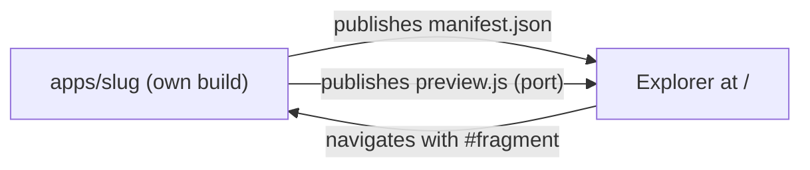
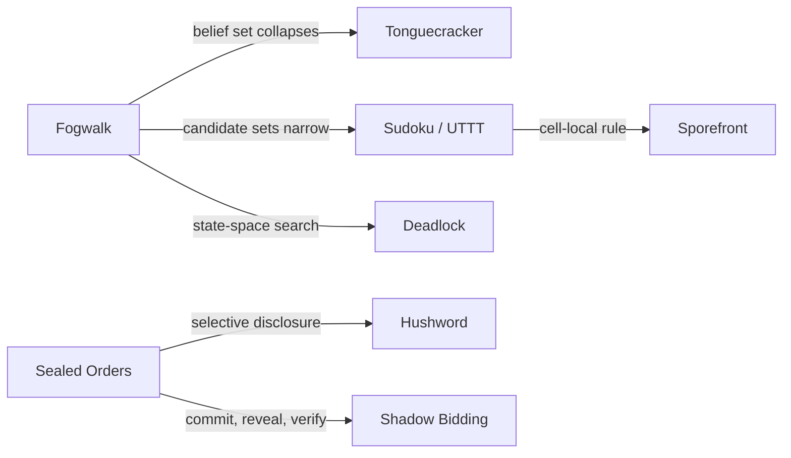
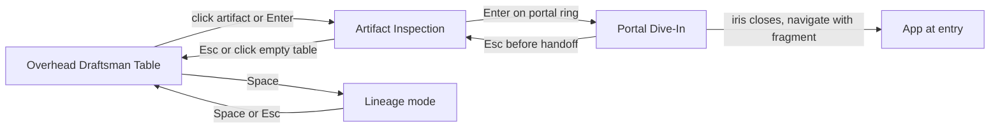

# Root Explorer — architecture

Status: design + interactive mock (`index.html` in this folder). Nothing here is wired
into `apps/*`. The mock contains in-file stand-ins for the pieces described below so the
contract can be felt before it is built.

Run the mock: `python3 -m http.server -d prototypes/root-explorer 8080`, open
`http://localhost:8080`. It needs network once, for the three.js import map (jsDelivr,
pinned `three@0.170.0`). The shipped version vendors three, see §7.

## 1. Where it lives, and what it may not do

The Root Explorer is the site at `/`. It is not an app. It sits beside `apps/`, not inside
it:

```
/
├── index.html              the Explorer (static, no build)
├── explorer/               ES modules + vendored three (see §7)
├── catalog.json            ["fogwalk", "bloomwright", …]  one slug per line, hand-edited
├── proposals/              <slug>.manifest.json for games that do not exist yet
├── scripts/lint-manifests.mjs   plain Node, no dependencies
└── apps/<slug>/            untouched; each keeps its own package.json, lockfile, build
    └── independents.manifest.json   ← the only new file an app owes the root
```

Three rules keep the repository's philosophy intact (README: "no shared framework, no
monorepo tooling, no build orchestration"):

1. **Apps never import from the Explorer, and the Explorer never imports from an app.**
   The only coupling is data (a manifest) and one optional, self-built ES module (the
   preview port, §3). If you delete `/` every app still runs.
2. **The Explorer has no build step.** `index.html` plus ES modules, served as-is. There
   is no `package.json` at the root, so there is nothing to install and nothing for
   `pnpm` to orchestrate.
3. **The Explorer is a progressive enhancement over a link list.** Every game is a real
   `<a href>` in the DOM before any WebGL starts. Middle-click, no-JS, no-WebGL,
   screen readers, and `prefers-reduced-motion` all work because the 3D scene is a
   second view of the same list, not the only way in.

How the apps reach the user is a deploy decision the manifest hides behind one field,
`entry`:

| Mode | `entry` value | Trade-off |
| --- | --- | --- |
| **A. Independent deploys** (default) | absolute URL of the app's own deployment | No coupling at deploy time, matches today's per-app `vercel.json`. Dive-in is a top-level navigation; the handoff survives it because it lives in the URL fragment. Needs `Access-Control-Allow-Origin: *` on the manifest and preview module. |
| **B. One assembled site** | `/apps/<slug>/` | One origin, so previews load without CORS. Costs a copy step: build each app, copy its `dist/` into `site/apps/<slug>/`. That is assembly, not orchestration, but it is the only place the repo would run every app's build. Do it only if a single domain matters. |

The Explorer's runtime is identical in both modes.


*Caption: apps expose data and one module upward; the Explorer reads them; nothing flows
down into an app except a URL fragment.*

<details><summary>Mermaid source</summary>



</details>

## 2. Critique of "Cabinet of Independents" + "Constellation"

The idea (a tactile 3D workbench of artifacts, plus a Space-bar graph of how they relate)
is right about the audience: this repo is a set of hands-on formal-system toys, and a
workbench says "pick one up". Four things in the concept as first stated would hurt:

| Weakness | Why it bites here | Fix adopted |
| --- | --- | --- |
| **Fake animation.** A spinning Fogwalk cloud that is not Fogwalk's belief set is a screensaver. This repo's own rule (CONCEPTS.md: "if the mechanic survives removing the theme, it was never the mechanic") applies to the front door too. | Visitors will judge each app by its artifact; a lie at the door is a lie about the app. | **No motion without state.** An artifact moves only when a real deterministic session drives it. Anything without a session is *dormant* and visibly still (§3). |
| **N bespoke artifacts is an art-asset treadmill.** Game #20 needs someone to model and rig it, so the cabinet rots first. | The repo adds apps in batches; the front door must not become the bottleneck. | Artifacts are **skins over five projections** (grid, sequence, graph, field, set). A new game ships a manifest and a port; a hand-modelled skin is optional polish. A game with neither gets a labelled bay. |
| **The constellation is an editorial mood board.** Hand-drawn edges between apps go stale silently, and "connected by formal mechanism" is a claim nobody checks. | The edges are the single most interesting content on the site. | Edges are **derived from manifests**, declared on the source side with a note and an evidence path, and **linted** (§4). |
| **3D as the only menu fails the basics.** Discoverability, search, keyboard, links you can copy, battery, SEO. | A games index that cannot be linked to is worse than a README table. | DOM underlay, deep links (`/#fogwalk`), `[`/`]` to step, `Esc` to back out, reduced-motion path, and a visible static list when WebGL is absent (§1.3). |

What stays from the original idea: the table, the three camera states, the Space-bar graph.
What changes is where truth lives: in each app's manifest and port, not in the Explorer.

## 3. The pattern: Manifest, Port, Handoff

A small zero-dependency contract. Three artifacts per app, one of them mandatory.

### 3.1 `independents.manifest.json` (mandatory, static facts)

```json
{
  "manifest": 1,
  "slug": "fogwalk",
  "name": "Fogwalk",
  "tagline": "Plan a path without knowing where you are.",
  "status": "shipped",
  "entry": "https://fogwalk.example/",
  "mechanism": { "primary": "automata", "tags": ["belief-set", "synchronizing-word"] },
  "network": "none",
  "formal": [{ "name": "Synchronizing word", "cite": "Černý 1964" }],
  "look": { "accent": "#7fe0d0", "projection": "grid" },
  "preview": { "module": "./independents.preview.js", "protocol": 1, "seed": 7 },
  "handoff": { "param": "s", "accepts": ["seed", "state"] },
  "lineage": [
    { "to": "tonguecracker", "via": "automata",
      "note": "Both collapse a set of hypotheses with evidence.",
      "evidence": ["apps/fogwalk/src/…", "apps/tonguecracker/src/…"] }
  ]
}
```

* `status`: `shipped | incoming | prototype | proposal`. A `prototype` is a game that has a
  runnable page next to the Explorer (the ten new games, under `prototypes/`) and gets a live
  port plus a Dive In that really navigates. A `proposal` has no code; it lives in
  `proposals/` and renders as a dormant bay. The mock currently has no bays: the ten games
  that started life as placeholder bays are all real prototypes now (section 6).
* `mechanism.primary` is one of five keys (below). `tags` are free text. Primary is
  mandatory so the table can be laid out; tags are what the graph can use when the
  five-way split is a poor fit (Sudoku / Ultimate TTT is the honest example: its primary
  is `cellular` because rules are cell-local and consequences global, which is a stretch,
  and the tags say so).
* `network`: `none | link | webrtc`. Shown as a chip so a visitor knows what a game
  touches before opening it.
* `lineage` edges are declared by the app the idea flows *from*. An edge exists if either
  end declares it; both slugs must exist.

The five mechanism keys, with their colours in the mock:

| Key | Family | Shipped / incoming | New prototypes (live ports) |
| --- | --- | --- | --- |
| `seal` | Commit-Reveal Crypto | Sealed Orders, Hushword | Byzantine Choir, Shadow Bidding |
| `p2p` | WebRTC P2P | Scribble Club, Azulejo | Cartel of Cartographers |
| `automata` | Automata / Grammars | Fogwalk, Bloomwright, Tonguecracker | Deadlock, Garbage Collector |
| `lockstep` | 60 Hz Fixed-Point Sim | Long Haul / Ballast (not yet on `main`) | Driftwatch, Loomweight |
| `cellular` | Cellular / Emergent | Sudoku / Ultimate TTT | Sporefront, Terrarium Hash, Lexicon Quarantine |

Hushword is filed under `seal` because its link carries the secret and the contract, and
selective redaction is the same shape as Merkle disclosure. Long Haul / Ballast is not on
`main`; its port is written from `apps/longhaul` and `docs/BALLAST.md` in the author's
working tree, and the entry is marked *incoming*.

A game's row is the mechanism that decides it, not the full tag list. Byzantine Choir is
tagged `automata` and `crypto` but sits in `seal` because its whole question is whether
peers can be made to agree despite lies, which is what commitments exist to prevent.
Lexicon Quarantine is tagged `automata` and `link` but sits in `cellular` because Go
liberties are the textbook cell-local rule with a global consequence. The tags keep the
other readings, so the lineage graph still draws both edges.

### 3.2 `independents.preview.js` (optional, the "Port")

A **headless, deterministic session** built by the app's *own* build into one ES module
(for example a second Vite lib entry beside the app, `pnpm build:preview`). It re-exports
the app's real engine, not a reimplementation, so the artifact cannot drift from the
game. Hard limits, enforced by the linter:

* ≤ 24 KB gzipped, ESM, no external imports, no DOM, no `Date`, no `Math.random`.
* Pure function of `(seed, action tape)`.

```ts
export const protocol = 1;
export function create(seed: number): Session;

interface Session {
  actions: { id: string; label: string; key?: string; arg?: "int" | "uv" }[];
  do(id: string, arg?: unknown): Event[];   // pure transition, returns what changed
  tick?(): void;                            // only lockstep ports: one 1/60 s step
  snapshot(): Json;                         // canonical state, projection-shaped
  hash(): string;                           // 8 hex of SHA-256(canonical JSON)
  readout(): [label: string, value: string][];
  fragment(): string;                       // base64url state for the handoff
}
```

Why this shape:

* **The HUD is generated from `actions`.** The Explorer draws buttons and key hints from
  the declaration, so micro-controls cost the app nothing.
* **Determinism is checkable.** The Explorer (and CI) replays a recorded tape into a
  fresh session and compares `hash()`. The mock runs this self-test at load for all nineteen
  ports and shows the result in the spec drawer.
* **The Explorer owns pixels.** A port returns numbers in a projection (a set of cells, a
  rewrite string, a list of ints). The skin maps them to meshes. A port never touches
  three.js, so the Explorer can change renderer without touching any app.
* **Safety and cost.** The final version runs ports in a module `Worker` created from a
  blob URL, so a slow or buggy engine cannot hitch the 3D frame, and the Worker inherits
  the page's CSP (`connect-src 'self'` plus the catalog origins). Ports load lazily, only
  on the first inspection of that artifact. Failure leaves the artifact dormant, never
  broken.

Lockstep ports are the strongest case. A 60 Hz fixed-point sim stepped by the Explorer's
accumulator is the same sim the game runs, so what you see move on the table is what the
game computes. Every new port also ships a pure `DRAW(ctx, view, w, h, t)` painter and an
optional `pick(u, v)` that turns a click on the screen into an action; the generic *screen*
skin paints that canvas onto a display lying on the plinth. `DRAW` reads a view and keeps no
state, so it cannot change a game outcome.

Idle behaviour is part of the port, not the skin. After 300 ticks (5 s) with no `do()`, each
new port starts an autopilot that is itself a pure function of the tick count (a lookahead
bot for Sporefront, the BFS solver for Driftwatch, the "Skinner" bot from `BALLAST.md` for
Long Haul), so the table is alive without a visitor and the self-test still replays
byte-identically. Any `do()` resets the idle counter and stops it.

### 3.3 Handoff (state crosses the portal in the URL fragment)

Diving in is a navigation to `entry + "#from=root&v=1&s=<fragment>&h=<hash8>"`. For the
ten prototype pages the entry already has a route fragment, so the handoff is appended with
`&`: `../life-ecologies/index.html#sporefront&from=root&v=1&h=<hash8>`, plus `&s=<fragment>`
when the page can restore it. Sporefront and Terrarium Hash can (their ports emit the page's
own `s1r.` / `t1p.` links), so Dive In reopens the exact plate or case; the other eight just
open at the right game.

* The **fragment** is never sent to a server, which matches the repo's no-backend rule,
  and it survives cross-origin navigation (mode A).
* `s` is `session.fragment()`: the state the visitor reached on the table. A game that
  declares `handoff.accepts` may restore it (the Fogwalk belief set, the Bloomwright
  grammar, the Hushword contract). A game that ignores it loses nothing.
* `h` lets the app verify the state before trusting it, since a fragment is user input.
  Apps must treat the payload as untrusted and validate it with their own engine.
* Return path: the app may link back to `/#fogwalk`, which reopens the inspection with the
  same seed. No cookies, no storage keys shared across origins.

## 4. The Constellation, made falsifiable


*Caption: one slice of the graph. Arrow means "the idea flows to"; the label is the shared
formal object.*

<details><summary>Mermaid source</summary>



</details>

* **Edge = (from, to, via, note, evidence).** `via` is one of the five mechanism keys, so
  the filament takes that colour. Cross-family edges are the interesting ones and get
  extra brightness.
* **Linter** (`scripts/lint-manifests.mjs`, plain Node): every slug in `catalog.json`
  resolves, every `to` exists, every edge has a note ≤ 140 characters and at least one
  evidence path that exists on disk, and every port is within budget and replays
  deterministically. CI failure beats a stale graph.
* **Layout.** Deterministic force layout with five family attractors. Same catalog gives
  the same constellation, so screenshots and links are stable.
* **Proposals** are dashed filaments to still bays (none in the mock now; the ten original
  bays became real games). The graph therefore also answers "what should be built next":
  any bay with edges into two or more shipped families is a good candidate.
* Pulses on filaments run from `from` to `to`. They are the one animation that is not
  driven by a session, and they carry meaning (direction of influence), so they are
  allowed. They are off under `prefers-reduced-motion`.

## 5. Camera states and the Space-bar graph

Three camera states, one overlay mode. All motion is spring-driven (semi-implicit
integration with 8 ms substeps), so interrupting a move re-aims instead of snapping.


*Caption: the three camera states; each arrow is labelled with its trigger. `Space`
toggles the lineage mode from Overhead only.*

<details><summary>Mermaid source</summary>



</details>

| | 1. Overhead Draftsman Table | 2. Artifact Micro-Play Inspection | 3. Seamless Portal Dive-In |
| --- | --- | --- | --- |
| Camera | ~58° pitch, distance fitted to the table and the viewport aspect, pointer parallax ≤ 0.6 u | 3.1 u above and 4.1 u in front of the artifact, looking just above its base | Drives into the artifact's portal ring; FOV 38° → 96° |
| Spring | k = 40, ζ = 0.95 (slow, settled) | k = 110, ζ = 0.78 (snappy, small overshoot) | k = 30, ζ = 1.05 (accelerating, no overshoot) |
| Live | All sessions idle; lockstep ports keep ticking if they have motion | The one artifact's session responds to clicks, keys, drags; HUD built from `actions` | State frozen; fragment computed once |
| Input | Hover = name tag lift; click / `Enter` = inspect; `[` `]` cycle; `/` search | Click parts or HUD buttons, arrow/WASD per port; `Esc` back | None; `Esc` cancels until the iris closes |
| Exit | → 2, or `Space` → lineage | → 1 (`Esc`), → 3 (portal) | → app (navigate), → 2 (`Esc`) |
| Deep link | `/` | `/#fogwalk` | n/a (it leaves the page) |

**`Space` — Constellation Lineage mode.** The table sinks into darkness, the room dims,
and every artifact lifts off its plinth and flies (spring) to its force-layout position at
0.42 scale, still driven by its live session. Glowing filaments fade in, one per edge,
coloured by `via`. Hover a node to isolate its filaments and read each edge's note;
hover a filament to read its note and evidence. Drag orbits; idle drift is slow and
stops under reduced motion. `Space` or `Esc` reverses the whole transition. Lineage is a
mode over the camera states, not a fourth state: entering from Inspection first returns
to Overhead.

## 6. The ten new games (live ports, real Dive In)

The first mock of the Explorer showed ten placeholder bays (Dead Drop, Cold Deck, and so on)
that had no code behind them. They are replaced by the ten games that now exist under
`prototypes/`. Each has a headless deterministic port on the table, an autopilot, a `DRAW`
painter, a self-test tape, lineage edges, and a Dive In that opens the real prototype page.

| Slug | Row | Mechanism tags | The micro-play on the table | Dive In opens |
| --- | --- | --- | --- | --- |
| `sporefront` | cellular | cellular | Full 64×64 torus, prototype rule presets, eight edge seed-drums, three radius-7 rule lenses, 3-action budget; certifies at generation 24 | `../life-ecologies/index.html#sporefront` |
| `terrarium` | cellular | cellular, link | Same Life engine with an 18-bit B/S genome, health and disturbance, mist / prune / stir; the genome is the link | `../life-ecologies/index.html#terrarium` |
| `driftwatch` | lockstep | sim60 | Integer sim at 60 Hz in Q 0.1 mm, one valve and a pulse, a BFS-certified leg and a shift budget | `../submissive-systems/index.html#driftwatch` |
| `loomweight` | lockstep | sim60, automata | 3-beat treadle against a 4-beat card, 12-pick supercycle, tangles, splice, three tears halt the loom | `../submissive-systems/index.html#loomweight` |
| `deadlock` | automata | automata | The prototype's three boards, hold and loan, wait-for cycle, deadline and livelock detection | `../cs-formalisms/index.html#deadlock` |
| `byzantine` | seal | automata, crypto | OM(1) over every traitor assignment; cut and delay links until the worst case still agrees | `../cs-formalisms/index.html#byzantine` |
| `gc` | automata | automata | Tricolor mark, scan, sweep and compact with a pause budget and a write barrier; the invariant is checked | `../cs-formalisms/index.html#gc` |
| `cartel` | p2p | webrtc | 5×5 board, three seats, mergers, a two-turn no-merge covenant that deletes moves; peer link is an in-memory channel | `../hybrid-boardgames/index.html#cartel` |
| `shadow` | seal | crypto, link | 5×5 Gardner chess, real `SHA-256` sealed bids, reveal, tamper, ledger-mode first move | `../hybrid-boardgames/index.html#shadow` |
| `lexicon` | cellular | automata, link | 6×6 Boggle chains for the Poet, one-ply Go-style Censor, liberty capture, 58-word lexicon | `../hybrid-boardgames/index.html#lexicon` |

**Long Haul / Ballast** is no longer written from a guess. The earlier mock invented a ship
with cargo and ballast tanks; the real project (`apps/longhaul` and `docs/BALLAST.md`) is a
rooms-and-corridors maze chase. The port reuses the app's world generator (rooms, one-tile
corridors, extra loops), its four pursuer kinds with their target functions and the
up-left-down-right tie-break, the scatter/chase schedule that pauses under fright, and the
slide-until-wall hauler. The ballast layer from `BALLAST.md` is added on top: each stone is
+1 load (cap 30), speed is `base × (1 − 0.012 × load)`, **dump** drops the whole load as a
heap-wall behind you after a 0.4 s stand-still, a charge burns the whole load, and walking
into a heap re-eats half of it. Differences from the app: the maze is 36×22 instead of
96×64, the pursuers move on a per-mille speed accumulator (750/1000 of the hauler's base, as
in the doc's 75% against 100%) rather than every second tick, and the ballast layer does not
exist in the app engine yet. The port will be replaced by a re-export of the real engine
once `apps/longhaul` lands.

### Honest simplifications

* **Terrarium Hash** is a B/S Life genome, not an L-system fern; the port follows the page.
  The prototype only labels a case Alive, Failing or Pressed, so the port's CERTIFIED
  condition (age ≥ 200, health ≥ 60, disturbance < 45, six species) is the port's own.
* **Loomweight** is endless in the prototype; the port adds a 120-pick goal and a restart.
* **Shadow Bidding** uses pseudo-legal moves (a king is captured, there is no check), as the
  prototype does, because a check rule would break simultaneous turns. The sealed hash covers
  the whole order including the bid.
* **Cartel** is 5×5 with six tiles per commodity and only the no-merge covenant has a button.
  **Lexicon Quarantine** is 6×6 with a target of 30 points and a 58-word embedded lexicon.
* **Byzantine Choir** carries the prototype's two known-suspect sheets, not hidden-traitor
  enumeration. **Deadlock**'s autopilot plays the prototype's par move per board.

### The prototype pages learned to route

A Dive In to `#terrarium` would have shown Sporefront and one to `#byzantine` would have shown
Deadlock, so each target gained a few lines of fragment routing (ignoring anything after the
first `&`): `life-ecologies` opens the tab and restores `s=`; `cs-formalisms` opens the
specimen; `hybrid-boardgames` accepts `#shadow` as an alias of its `bidding` route (its
`index.html` is rebuilt from `src/ui.js` with `node build.mjs`); `submissive-systems` scrolls
to the section. Nothing else in those pages changed.

The graph wires the new games into the old ones on purpose (Sudoku / UTTT → Sporefront,
Sealed Orders → Shadow Bidding, Fogwalk → Deadlock, Long Haul → Driftwatch), so it shows where
a game *fits* and not only where it sits.

## 7. Performance, risks, and open questions

* **Weight.** Core three.js is the biggest cost (~170 KB gzipped). The final site
  vendors a pinned copy under `explorer/vendor/` (the mock uses a CDN only so it runs
  without setup), preloads it with `modulepreload`, and renders the DOM list first. Budget:
  Explorer code ≤ 60 KB gzipped, ports lazy.
* **Mobile.** Pixel ratio capped at 2, one shadow-casting light, no post-processing.
  Touch maps to the same three states (tap = inspect, pinch is not needed because the
  camera is authored).
* **The five-key taxonomy is lossy.** Sudoku / Ultimate TTT shows it. Resolution: primary
  key for layout, tags for the graph; if a sixth family keeps appearing in proposals,
  add a key rather than stretch an existing one.
* **Long Haul / Ballast.** The port mirrors `apps/longhaul` and `docs/BALLAST.md`, scaled
  down. Replace it with a re-export of the real engine as soon as it lands on `main`.
* **File weight.** With nineteen ports inlined the mock is about 310 KB. The real site
  loads each port lazily in a Worker, so this is a property of the single-file mock only.
* **Nineteen sessions tick at 60 Hz** in the mock whether or not they are visible. The
  screen skin repaints at 10 Hz (24 Hz when inspected, 3 Hz in the graph) to keep that
  cheap; the real site would only tick the inspected port plus a few visible neighbours.
* **Open:** which deploy mode (A or B)? The Explorer works with either; the only
  difference is CORS headers on two files.
